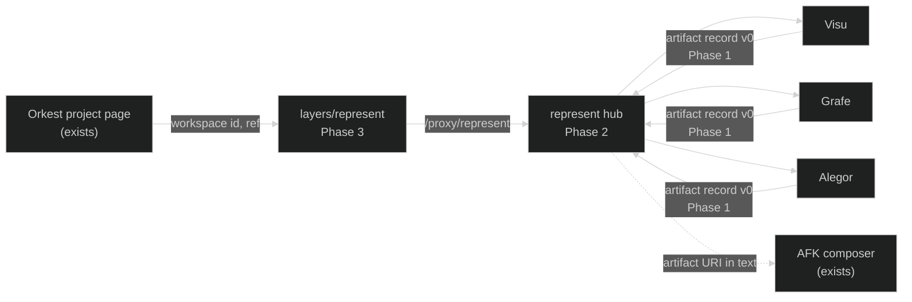

# REPRESENT-ORKEST — Implementation Tracker

> Living design+status doc for hosting Represent's tools inside Orkest through a portable artifact record and a small hub.
> Design: [Represent within Orkest platform design](research/reports/Represent%20within%20Orkest%20platform%20design.md). Research it continues: [Represent within the Orkest platform](research/reports/Represent%20within%20the%20Orkest%20platform.md). Experience to preserve: [Visu guide](guides/visu-experience.md).
> Follows DOCS-PROTOCOL.md Rule 15.
> Updated: 2026-10-24
> Prior-art sweep: 2026-10-24. Checked [CAPABILITIES.md](CAPABILITIES.md) (four promoted capabilities: Visu discovery, Visu overview, Grafe explorer, Alegor re-entry; none covers an artifact record, a hub or an Orkest host), `reference/` and `impl/` filenames, the Ghost ORKEST-FORK tracker (no Represent surface planned there), `layers/orkest` plugins (extension and right-surface APIs exist and are reused, not rebuilt), `layers/rima` (the layer-owned-by-a-sibling-repo precedent this tracker follows), and Ghost's `Ghost.Represent.Host` (methrep; a name collision, not a prior implementation of this feature).

**Bootstrapped 2026-10-24 by the design session. Nothing is implemented.** This tracker exists so that implementation, when authorized, is bounded. Opening it is not authorization to start Phase 1; the operator's Phase 0 review is.

## AI Continuation Prompt

Read `CLAUDE.md`, `docs/CONTEXT.md`, this tracker, the [design](research/reports/Represent%20within%20Orkest%20platform%20design.md) and the [Visu guide](guides/visu-experience.md). Then the reference for whichever tool the phase touches: [visu-discovery](reference/visu-discovery.md), [grafe-mvp](reference/grafe-mvp.md), [alegor-mvp](reference/alegor-mvp.md).

Rules for every phase:
- **Preserve Visu.** No change to the illustration, chapters, pins, outline, disclosures, history or themes. Hosting adds a header line, a freshness badge and an attach action; nothing else. Judge every Visu change against the ImageLab, Luz and ROMPE screenshots in the guide.
- **No paid run without the operator.** Grafe, Alegor and the hub make zero model calls. Visu's explain and illustrate stages are never triggered by a host, a test or a trial. Trials use free capture and existing art.
- **Represent never dispatches, verifies, approves, holds credentials or writes to Multica.** The only handoff to work is opening Orkest's existing AFK composer with text.
- **Do not edit ORKEST-FORK, Orkest docs or `layers/orkest`.** The Ghost paths this tracker owns (Phase 3) are `D:/ware/Ghost/apps/Ghost.Dashboard/layers/represent/`, the shell-core proxy route `server/routes/proxy/represent/[...path].ts`, and two runtimeConfig keys (`representApiBase`, `representServiceToken`) in `nuxt.config.ts`, exactly the shape RIMA uses. Edited by absolute path from a Represent session, as `layers/rima` is from `d:/ware/rima`. The layer imports only shell APIs (`defineExtension`, `defineRightSurface`, route params), never anything under `layers/orkest`. A composer text-prefill is an Orkest change this tracker may request, never make.
- **Tool pages never call the hub.** Attach lives in the hub CLI, the hub page and the Orkest surface. The hub spawns tool servers with a token it generates (`--token`); it does not attach to servers it did not spawn. Loopback only; no LAN bind.
- **Tool stores are immutable and untouched.** The hub reads each tool's real store path from its config or environment (Visu: `<repo>/.represent/visu`; Grafe and Alegor: `%LOCALAPPDATA%/Represent/<tool>` by default). New records go to the hub's own store, `%LOCALAPPDATA%/Represent/hub/` by default (`REPRESENT_HUB_STORE`), outside every project root. No store is moved, merged or migrated.
- **Methrep is not Represent.** New ids are `represent-hub`, `/x/represent`, `/proxy/represent`. Nothing new is named `Ghost.Represent`.
- Tick a box only with evidence (test name, command and exit code, or path). Human boxes are the operator's.

## Open Questions

Resolved with reasoned defaults (the clarify-impl convention); the operator may override in Phase 0.

| ID | Question | Default | Why |
|---|---|---|---|
| OQ-1 | Hub, or an allowed-origin setting in each tool? | Hub (`src/hub/`), after the record and CLI attach are proven in Phase 1 | One registry, one token the hub knows because it spawned the tool, tool pages untouched, RIMA proxy precedent; a per-tool allowlist still cannot let a tool page call the hub. |
| OQ-2 | Where do attached artifact records live? | `%LOCALAPPDATA%/Represent/hub/artifacts/` (`REPRESENT_HUB_STORE`), outside every project root | Same rule as Grafe and Alegor; Alegor refuses a store inside a configured root, so `.represent/hub` under the repo would be refused for the Represent project itself. |
| OQ-3 | Host project identity | methrep workspace id, equal to the `ware.json` name, matched case-insensitively against tool configs | Confirmed in the represent-adapter's `WareJsonReader`; matches the Orkest route; survives moving a checkout. |

## System Intent

Host Visu, Grafe and Alegor for the project and revision Orkest has selected, and return portable, source-linked artifact records to the task. One operator and tens of repositories first; one external developer and one repository second.

## Ingestion Vector

```text
D:/ware/<project>/                    # a registered repository
|-- .git/                             # @LLM-TARGET: revision, ref, dirty flag
|-- README.md, docs/**/*.md            # @LLM-TARGET: Alegor facts; Visu bounded sample
|-- src/**/*.{ts,js,mjs}              # @LLM-TARGET: Grafe bounded scope
|-- node_modules/, dist/, .env        # @LLM-IGNORE: never captured
D:/ware/represent/
|-- examples/{visu,grafe,alegor}/     # @LLM-ENTRY: per-tool allowlists the hub registry reuses
`-- .represent/visu/                  # @LLM-TARGET: Visu's repo-local store (ignored); read-only to the hub
%LOCALAPPDATA%/Represent/
|-- grafe/, alegor/                   # @LLM-TARGET: default tool stores; read-only to the hub
`-- hub/                              # @LLM-TARGET: registry.json and attached records
```

## Visualization Spec

The three existing views, framed by a host: a project and revision chip and a freshness line in each tool; attach actions and a flat artifact list in the hub page and in Orkest's right dock. No new renderer. See the design's Visualization Spec.

## Architecture

- **Artifact record `represent.artifact/v0`**: tool, project (host id, repo root, remote), revision (ref, sha, dirty, capturedAt), scope, evidence with captured hashes, view (url, static), optional task, provenance (inference, model, cost). Content-addressed id excludes `task` and `view.url`.
- **Hub** (`src/hub/`): case-folded project registry over the real tool store paths, read-only artifact index, attach API and CLI writing to the hub store, launch that spawns tool servers with a generated `--token` and returns a URL with project, revision and task. Loopback only, own bearer token, no inference.
- **Layer** (`layers/represent`) plus shell-core wiring (`server/routes/proxy/represent/[...path].ts`, `representApiBase`, `representServiceToken`): `defineExtension` with nav `/x/represent`; `defineRightSurface` scoped to `/x/orkest` and `/x/represent` listing artifacts for the current project with Open, Attach and Compose from this (opens the composer for the artifact's box and copies the artifact text to the clipboard; no text prefill exists in Orkest).
- **Stage C (Alegor companion)**: design note only in this tracker; implementation needs its own tracker after the Phase 4 live UX round.



## Current State (2026-10-24)

Design drafted and audited; tracker bootstrapped. No code written. Visu paused at the automatic-discovery slice; Grafe and Alegor at their promoted MVPs. Orkest cockpit fork is live at `/x/orkest`; its unattended path is gated in ORKEST-FORK Phase 4 and is not a dependency here.

## Known Bugs

None yet.

## What Needs Testing

- **TEST.1 Artifact record round trip.** For each tool, export a record from a Plane Sync snapshot, reload it in a fresh process, and assert tool, repo, sha, scope, evidence hashes and provenance are identical and the id is stable; mutate `task` and assert the id does not change.
- **TEST.2 Evidence hash drift.** Change one cited file in a disposable Plane Sync copy; assert the record's evidence entry reports a mismatch and the record stays readable.
- **TEST.3 Hub registry refusal.** Request a project id not in the registry, and a registered id whose root is outside the allowlist; assert both fail closed with no process launched.
- **TEST.4 Hub launch.** Launch Grafe twice for the same project; assert one spawned server, one port, the hub-generated token accepted by the tool API and refused when wrong, and a URL carrying project, ref and task. A tool server not spawned by the hub is not adopted.
- **TEST.4b Grafe revision and routing.** A Grafe snapshot records the captured HEAD sha and dirty flag; a URL naming a symbol opens that neighborhood directly.
- **TEST.5 Hub token and origin.** Request the index without the token, and with a wrong Origin; assert 401/403 and no body.
- **TEST.6 Layer isolation.** Ratchet: `layers/represent` imports nothing from `layers/orkest` or `layers/ghost-harness`.
- **TEST.7 Orkest journey e2e.** From `/x/orkest/plane-sync` on a lab1 browser, open the Represent surface, open Grafe, attach from the surface, see the artifact listed with the right revision; Compose from this opens the composer for the artifact's box and the clipboard holds the artifact URI and citations.
- **TEST.8 Visu untouched.** The existing 35 Visu regression tests and nine browser checks still pass; no POST is issued during browsing, theme switching or opening from a host URL.
- **TEST.9 No paid call.** Run every trial with gateway keys cleared; assert zero generation requests in the Visu attempt ledger.

## Implementation Status

| Phase | State | Model | Description |
|---|---|---|---|
| 0 Design acceptance and UX design round | Not started | operator + any | Review the design and the five UX changes against the preserved screenshots; record decisions. |
| 1 Artifact record v0 and CLI attach | Not started | any | Schema, export in three tools, Grafe HEAD capture and symbol routing, CLI attach, tests, Plane Sync trial. |
| 2 Hub | Not started | any | Registry, index, attach API, spawn-with-token launch, header chips, tests, URL trial. |
| 3 Orkest layer | Not started | any | `layers/represent` plus shell-core proxy wiring by the RIMA precedent, e2e, Plane Sync journey. |
| 4 Live UX round and Visu round trip | Not started | operator + any | Browser round on the real journey; Visu free capture with reused art; Stage C design note. |
| 5 Promotion | Not started | any | Reference docs, CAPABILITIES line, archive. |

## Checklist

### Phase 0 — Design acceptance and UX design round

- [ ] REPRESENT-ORKEST.0.1 **human:** operator reads the design and confirms or overrides OQ-1 to OQ-3 and the product/brand boundary (Represent product line; methrep keeps its name). Decisions recorded in `CONTEXT.md`.
- [ ] REPRESENT-ORKEST.0.2 Design UX round: static mockups of the five hosting changes (header chip, attach action, freshness badge, theme handoff, artifact surface) placed beside the ImageLab dark/light/mono, Luz mobile and ROMPE references, plus the Grafe and Alegor browser-check captures, under `experiments/orkest-host/design-round/`. Each mockup names what it must not change.
- [ ] REPRESENT-ORKEST.0.3 **human:** operator accepts the mockups or sends them back. Phase 1 does not start before this box.

### Phase 1 — Artifact record v0 and CLI attach

- [ ] REPRESENT-ORKEST.1.1 Write `docs/reference/represent-artifact.md` draft: schema, id rule, evidence hash rule, provenance rule, `visu` extension block. Owned file; reference status only after promotion.
- [ ] REPRESENT-ORKEST.1.2 `src/artifact/record.mjs`: build, canonicalize, hash, validate, load; `tests/artifact-record.test.mjs` covers TEST.1 and TEST.2.
- [ ] REPRESENT-ORKEST.1.3 Grafe revision capture: each snapshot records HEAD sha, ref and dirty flag (new; Grafe runs Git for scope only today). `web/grafe/app.mjs` gains URL routing to a project, snapshot and symbol (TEST.4b). Tests extend `grafe-core.test.mjs`.
- [ ] REPRESENT-ORKEST.1.4 Grafe export: a focused neighborhood at a snapshot becomes a record (`src/grafe/core.mjs` export function; `GET /api/projects/:id/snapshots/:snapshotId/artifact?symbol=`). Tests extend `grafe-server.test.mjs`.
- [ ] REPRESENT-ORKEST.1.5 Alegor export: a brief between two snapshots becomes a record (`src/alegor/core.mjs`; `GET /api/projects/:id/brief/artifact`). Tests extend `alegor-server.test.mjs`.
- [ ] REPRESENT-ORKEST.1.6 Visu export: a view revision becomes a record with the `visu` block (capture, explanation and art identities, measured cost). Export only; no change to capture, analyze or generate. Tests extend the Visu suite; TEST.8 and TEST.9 pass.
- [ ] REPRESENT-ORKEST.1.7 `src/artifact/cli.mjs attach <tool> <snapshot> --task <id>`: reads the tool's real store path, writes the record with task fields to the hub store (`REPRESENT_HUB_STORE`). Tests in `tests/artifact-cli.test.mjs`.
- [ ] REPRESENT-ORKEST.1.8 Plane Sync trial: three records from real snapshots attached by the CLI with a fake task id, under `experiments/orkest-host/artifact-trial/`; README with the TEST.1 and TEST.2 results, a drift example, and a next-day reopen identifying repo, revision, tool, sources and task from the records alone. Zero model calls recorded.

### Phase 2 — Hub

- [ ] REPRESENT-ORKEST.2.1 `src/hub/registry.mjs`: `registry.json` in the hub store mapping case-folded host ids to repo roots, tool configs and each tool's real store path, built from the three `examples/*` allowlists; refusal of unknown ids and out-of-allowlist roots (TEST.3).
- [ ] REPRESENT-ORKEST.2.2 `--token` flag in `src/visu/server.mjs`, `src/grafe/server.mjs` and `src/alegor/server.mjs`: accept a caller-supplied bearer token instead of generating one; behaviour unchanged when absent. Tests in each server suite.
- [ ] REPRESENT-ORKEST.2.3 `src/hub/index.mjs`: read-only listing of records across the tool stores and the hub store; `POST /api/artifacts` attaches a record with host task fields (shares the Phase 1 CLI code).
- [ ] REPRESENT-ORKEST.2.4 `src/hub/launch.mjs` and `src/hub/server.mjs`: spawn each tool server with a generated token, call its API server-side, return a URL carrying project, ref and task; loopback bind only, hub token, Origin check (TEST.4, TEST.5); `src/hub/cli.mjs serve`; a hub page listing projects, tools and artifacts with Open and Attach.
- [ ] REPRESENT-ORKEST.2.5 Tool header chip and freshness line: each tool reads `project`, `ref` and `task` from its launch URL and shows one header line plus its own freshness (Alegor and Visu already compute it; Grafe uses 1.3). Visu reuses the "Local workspace" topbar slot and applies the shell theme only when no stored theme exists; no attach controls in tool pages. Visu changes limited to `web/visu/app.mjs` and `index.html` topbar; TEST.8 passes.
- [ ] REPRESENT-ORKEST.2.6 Plane Sync trial from a URL: open Grafe and Alegor through the hub, attach one record each from the hub page with a fake task id, reopen next day and identify repo, revision, tool, sources and task from the record alone. Record under `experiments/orkest-host/hub-trial/`.

### Phase 3 — Orkest layer

- [ ] REPRESENT-ORKEST.3.1 `layers/represent/nuxt.config.ts` and `app/plugins/00.extension.ts`: extension id `represent`, nav `/x/represent`; shell-core wiring as RIMA's: `server/routes/proxy/represent/[...path].ts` with a GET/POST allowlist, and `representApiBase` (default `http://127.0.0.1:<hub port>`) and `representServiceToken` in `nuxt.config.ts` runtimeConfig. Record the GhostShell commit base in this tracker.
- [ ] REPRESENT-ORKEST.3.2 `app/plugins/10.represent-right-surfaces.ts` and `app/components/RepresentArtifactsPanel.vue`: surface scoped to `/x/orkest` and `/x/represent`; reads the workspace id from the route; lists artifacts (tool, scope, revision, age) with Open, Attach and Compose from this; Compose calls `openComposer(boxId)` for the artifact's box and copies the artifact URI and citations to the clipboard (no text prefill exists; a prefill parameter is a requested Orkest change, recorded here if asked). Imports only shell APIs (TEST.6 ratchet).
- [ ] REPRESENT-ORKEST.3.3 `app/pages/x/represent/index.vue`: the hub's project list with per-tool open links. No new renderer.
- [ ] REPRESENT-ORKEST.3.4 e2e `test/e2e/represent/journey.spec.ts` covering TEST.7 against a local build with the hub running; evidence under `experiments/orkest-host/e2e/`.
- [ ] REPRESENT-ORKEST.3.5 **human:** operator click-through of the Plane Sync journey from `/x/orkest` in a browser on lab1 (loopback view URLs do not open remotely).

### Phase 4 — Live UX round and Visu round trip

- [ ] REPRESENT-ORKEST.4.1 Live UX round in the browser on the real journey across Grafe, Alegor and the surface; screenshots and a punch list under `experiments/orkest-host/live-round/`; fixes land as `polish` commits with their boxes added here.
- [ ] REPRESENT-ORKEST.4.2 Visu round trip: open ImageLab from the hub with project and ref, free capture, export a record reusing existing art, attach it, see it listed. Zero generation requests (TEST.9). Compare against the guide's screenshots.
- [ ] REPRESENT-ORKEST.4.3 Stage C design note `docs/research/alegor-companion-over-orkest.md`: Alegor host sources (current task, methrep session readers), proposal with citations, Compose handoff, what it never does. Rule 6 sections. Not implementation.
- [ ] REPRESENT-ORKEST.4.4 **human:** operator decides whether Stage C gets its own tracker.

### Phase 5 — Promotion

- [ ] REPRESENT-ORKEST.5.1 Promote: `reference/represent-artifact.md`, `reference/represent-hub.md`, `reference/represent-orkest-layer.md`; CAPABILITIES lines; archive this tracker to `impl/`; CONTEXT, TODO, README and LOGBOOK updated.

## Key Files Reference

| File | Purpose | Phase |
|---|---|---|
| `docs/reference/represent-artifact.md` | Artifact record schema and rules | 1 |
| `src/artifact/record.mjs`, `src/artifact/cli.mjs`, `tests/artifact-*.test.mjs` | Record build, hash, validate, load; CLI attach | 1 |
| `src/grafe/core.mjs`, `src/grafe/server.mjs`, `web/grafe/app.mjs` | HEAD capture, symbol URL routing, focused-neighborhood export | 1 |
| `src/alegor/core.mjs`, `src/alegor/server.mjs` | Brief export | 1 |
| `src/visu/core.mjs`, `src/visu/server.mjs`, `web/visu/app.mjs`, `web/visu/index.html` | View-revision export; `--token`; topbar slot only | 1, 2 |
| `src/alegor/server.mjs`, `src/grafe/server.mjs` | `--token` flag | 2 |
| `src/hub/{registry,index,launch,server,cli}.mjs`, `tests/hub-*.test.mjs` | Hub | 2 |
| `web/grafe/app.mjs`, `web/alegor/app.mjs` | Header chip, freshness badge, attach action | 2 |
| `D:/ware/Ghost/apps/Ghost.Dashboard/layers/represent/**` | GhostShell layer (RIMA precedent) | 3 |
| `D:/ware/Ghost/apps/Ghost.Dashboard/server/routes/proxy/represent/[...path].ts`, `nuxt.config.ts` (two runtimeConfig keys) | Shell-core proxy wiring, as RIMA's | 3 |
| `D:/ware/Ghost/apps/Ghost.Dashboard/test/e2e/represent/journey.spec.ts` | Journey e2e | 3 |
| `experiments/orkest-host/**` | Design round, trials, e2e evidence, live round | 0 to 4 |

## Architecture Notes

- **Why a hub and not CORS on each tool.** Each tool injects a per-process token into its own HTML and checks the exact loopback Origin. Opening those APIs to a GhostShell origin would mean three tokens, three CORS rules and no place for a registry, and a tool page still could not call the hub. One hub that spawns the tools with a token it knows keeps the tool pages as they are; attach lives in the hub.
- **Why the record and CLI come before the hub.** The seam is the record. Proving it with a CLI and a URL parameter costs little and tells us whether the hub is worth building before registry and launch code exists (audit finding, 2026-10-24).
- **Why the hub store is outside the repo.** Alegor refuses a snapshot store inside any configured project root, and the Represent repo is itself a configured Alegor project. Grafe and Alegor already default to `%LOCALAPPDATA%/Represent/<tool>`; the hub follows them.
- **Why no composer text prefill.** Orkest's `openComposer(stepId)` prefills only a box id. Represent does not edit `layers/orkest`, so the handoff is open-for-box plus clipboard until Orkest offers more.
- **Why the RIMA precedent.** `layers/rima` is owned by `d:/ware/rima` and edited by absolute path; it proxies to its own container. Represent follows the same shape, so Orkest's later extraction does not drag the Represent layer along, and WARE-ROOTS stays intact (no new app under `Ghost/apps/`).
- **Why no Multica writes.** The adapter can create issues and comments today, but an artifact is not evidence and Represent is not in the trust chain. Text in the composer is the whole handoff.
- **Why Visu export only.** Visu is paused. Export reads the store; the header line reads the URL. Neither touches capture, analyze or generate, so the paid stages and the art-reuse behaviour are unchanged.
- **Why the Phase 4 Visu round trip uses ImageLab.** It is the project that was tested without authored scope and already has art in the local store, so a free capture plus reused art exercises the host without a paid refresh.
- **Session roots.** Phases 0 to 2 and 4 to 5 run from `d:/ware/represent`. Phase 3 edits the Ghost layer by absolute path from the same session root and runs the dashboard e2e from `d:/ware/Ghost`; its commits in Ghost carry this tracker's box ids.
