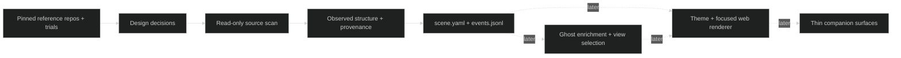

# Represent v0 — Implementation Tracker

> Living design and status for the first directory-to-scene companion.
> Source brief: `docs/handoffs/ASTRA-KICKOFF.md` (local, intentionally ignored).
> Follows DOCS-PROTOCOL.md Rule 15. Updated: 2026-10-21.
> Prior-art sweep: 2026-10-21 — CAPABILITIES.md is empty; no reference/ or impl/ implementation exists. Methodology scripts are tooling, not Represent product code. Methrep exists in GhostDev and remains read-only.

## AI Continuation Prompt

Read CONTEXT.md, this tracker, DOCS-PROTOCOL.md, the reference-repository study, and research/companions.md. Study working upstream projects before implementing; record source evidence and actual trial results separately. Preserve the supplied PDF and earlier design ideas. All AI goes through Ghost; keep the core headless. The first implementation checkpoint is a real `scene.yaml` for `D:/ware/plane-sync`, shown before P2-P4 implementation. Do not extend methrep to parse code or modify sibling repositories. Check current git status: unrelated methodology rollout changes existed before this work. Use exact-path commits and evidence on completed boxes.

## System Intent

Represent is an umbrella for visual understanding tools. The v0 slice maps a local repository into a small, legible overview with deeper structural detail available on demand. Start with code; retain a shared contract that can also render methodology and later design documents. Source facts, inferred responsibilities and hypothetical simulations must remain distinguishable.

## Ingestion Vector

```text
<selected-repository>/
|-- .gitignore       # @LLM-TARGET: filter before parsing or metrics
|-- .git/            # @LLM-TARGET: bounded local history, never raw object ingestion
|-- package.json     # @LLM-TARGET: entry points and module context
|-- src/             # @LLM-ENTRY: JS/TS/C#/Python source relationships
|-- tests/           # @LLM-DECORATIVE: retain evidence, separate from runtime overview
`-- generated/       # @LLM-IGNORE: explicit generated/build filtering
```

Research reads pinned local clones under `references/`. A scan must never execute the scanned project's code or write to its source directory. Output artifacts belong under Represent for the sibling corpus.

## Visualization Spec

Start with an infographic-style overview of named modules, dependency direction and uncertainty. Focus reveals files and source locations. Choose views by the questions they answer; do not draw every node at once. A future game-design adapter may select state machines, economies or interactive simulations, but must not invent undocumented mechanics. Cities, creatures and Unity remain later experiments. The source PDF's pages 3 and 15 are illustrative visual references, not a shipped UI.

## Architecture



Methrep defines the compatibility target: `schema`, `view`, `scope`, `nodes`, `edges`; nodes have `id`, `type`, optional `name`/`label`/`annotations`; edges have `from`, `to`, `relation`. Use `owns` for hierarchy and `depends-on` for resolved imports. Necessary structural `Module` and `File` types must be documented. Unknown semantics must not become asserted Services or Pipelines. Methrep omits empty collections in YAML; future readers must tolerate this. Envelope compatibility does not prove renderer compatibility.

## Open Questions

1. **Q: What comes before implementation?**
   **Resolution:** Clone, inspect and exercise the selected reference projects, synthesize reuse/adapt/avoid decisions, then settle P0 and build P1. Deliver the first plane-sync scene before P2-P4.
   > Rationale: operator's research-first steering on 2026-10-21 supersedes immediately starting a scanner.
   > Override: start a separate implementation spike early only on explicit operator direction.
2. **Q: Which architecture choices are fixed?**
   **Resolution:** Headless core, Ghost-only AI and the scene/events boundary are fixed. TypeScript/web is a working preference until the source study settles it. Reuse methrep's contract, not its date-only event append algorithm.
   > Rationale: the current emitter can miss later same-day events and rewrite on malformed tails; the existing Mermaid renderer skips unknown types.
   > Override: choose another language/renderer when demonstrated tradeoffs justify it; record the decision in CONTEXT.md.
3. **Q: Which corpus and languages?**
   **Resolution:** plane-sync is the small first target (19 tracked files at inspection), including JavaScript `.js/.mjs/.cjs`. Add C#/TS/Python. Choose medium by measured eligible-file count; measure Ghost as the large target.
   > Rationale: kickoff size estimates are not measurements, and omitting JS misses the first target.
   > Override: substitute corpus members when needed, preserving measured size diversity and the first plane-sync checkpoint.

## Current State (2026-10-21)

Plan and reference study in progress. PDF copied and read; companion research drafted. No scanner, enrichment, renderer or companion shell implemented. No promoted capability claimed.

## Known Bugs

No Represent runtime exists yet. Risks: ignore-rule fidelity; falsely resolved references; unstable IDs/layout; unsupported syntax; accidental all-graph rendering; event deduplication. Upstream defects remain research observations, not bugs owned by this implementation.

## What Needs Testing

- TEST.1: ignored tracked/untracked files, nested negations, generated output, symlinks/junctions, Unicode paths and non-Git roots.
- TEST.2: JS/TS/TSX/Python import forms and C# using/namespace extraction, parse errors, ambiguous/external refs; no fabricated edges.
- TEST.3: stable bytes on repeat scans, unique IDs, valid endpoints, source hashes/spans, explicit resource-limit behavior and no source writes/network calls.
- TEST.4: actual small/medium/large file counts, revisions/manifests, timing, peak memory and completeness; no silent 5,000-node ceiling.
- TEST.5: future Ghost budget/cache failures, invalid/truncated view specs, unchanged methrep scene through the same renderer, event playback.

## Implementation Status

| Phase | State | Model | Effort | Description |
|---|---|---|---|---|
| REPRESENT-V0.0 | in progress | gpt-6-astra | xhigh | P0: reference study, trials and recorded decisions |
| REPRESENT-V0.1 | not started | gpt-6.1-sol | xhigh | P1: deterministic CLI/library and first scene |
| REPRESENT-V0.2 | not started | gpt-6-astra | ultra | P2: budgeted Ghost enrichment and view selection |
| REPRESENT-V0.3 | not started | gpt-6.1-sol | ultra | P3: focused renderer and methrep abstraction test |
| REPRESENT-V0.4 | not started | gpt-6.1-sol | xhigh | P4: local companion shell |

Model columns are future execution hints; they are not claims about completed work.

## Checklist

### P0 — Research, then decisions

- [x] REPRESENT-V0.0.1 Preserve/read the PDF, inspect local prior art and bootstrap P0-P4 with the research-first sequence — evidence: research/sources/ChatGPT_Prompt-Codex-Interactive-Atlas_20261020-1748.pdf; CONTEXT.md; this tracker.
- [ ] REPRESENT-V0.0.2 Clone pinned reference repositories and inspect real ingestion/model/layout/theme code; record licenses and reusable paths — evidence: pending inventory and source notes.
- [ ] REPRESENT-V0.0.3 Exercise feasible reference examples; distinguish actual observations from source-only findings; write reuse/adapt/avoid synthesis — evidence: pending trial logs and report.
- [ ] REPRESENT-V0.0.4 Record final v0 choices and scan limits in CONTEXT.md; define contract extensions and validation corpus — evidence: pending decision and implementation plan.

### P1 — First deterministic scene

- [ ] REPRESENT-V0.1.1 Implement CLI/library, filtering, bounded syntax/history extraction and scene serialization as one vertical slice — evidence: pending source and fixture tests.
- [ ] REPRESENT-V0.1.2 Generate, inspect and show the first plane-sync scene with honest completeness and source evidence — evidence: pending saved scene and inspection.
- [ ] REPRESENT-V0.1.3 Benchmark measured small/medium/large inputs, including Ghost; prove deterministic output and bounded behavior — evidence: pending benchmark results.
- [ ] REPRESENT-V0.1.4 Finish companion research with verified sources, compact context model, scan/diff triggers and three testable interaction modes — evidence: pending research review.

### P2 — Cheap enrichment

- [ ] REPRESENT-V0.2.1 Use Ghost's verified transport for compact cluster digests and validated labels/purposes/view specs; no provider SDKs or raw files — evidence: pending adapter/payload tests.
- [ ] REPRESENT-V0.2.2 Cache by content and output-affecting configuration; enforce cost reservations across retries, fail closed when price cannot be bounded — evidence: pending cache/budget tests.
- [ ] REPRESENT-V0.2.3 Report per-cluster completeness and measure cold/warm/changed-scan cost and latency — evidence: pending reports.

### P3 — Renderer

- [ ] REPRESENT-V0.3.1 Ship deterministic layered overview/drilldown, search-to-camera, minimap and readable infographic theme — evidence: pending interaction tests and screenshots.
- [ ] REPRESENT-V0.3.2 Render an unchanged real methrep scene through the same loader/model/renderer with no domain-specific conversion — evidence: pending fixture hash and paired screenshots.
- [ ] REPRESENT-V0.3.3 Implement event playback with stable IDs, explicit invalid-event handling and reproducible replay — evidence: pending replay tests.

### P4 — Companion

- [ ] REPRESENT-V0.4.1 Local web panel + CLI path-to-picture with progress/cancel/retry, reusing the headless core — evidence: pending end-to-end checks.
- [ ] REPRESENT-V0.4.2 Persist compact project context/prior scene and explain structural diffs; recover from stale/corrupt state — evidence: pending restart/diff tests.
- [ ] REPRESENT-V0.4.3 Add scene-grounded follow-ups through Ghost; evaluate ambient/query-first/digest modes before VS Code integration — evidence: pending workflow review.

## Key Files Reference

| File | Purpose |
|---|---|
| [CONTEXT.md](CONTEXT.md) | Decisions and current state |
| [companions.md](research/companions.md) | Companion design research |
| [graphify-tested.md](research/graphify-tested.md) | Measured failure cases to avoid |
| [Source PDF](research/sources/ChatGPT_Prompt-Codex-Interactive-Atlas_20261020-1748.pdf) | Preserved Interactive Atlas conversation |
| `references/` (ignored) | Local upstream study clones; never stage embedded repositories |

## Architecture Notes

The prior Unity recommendation was motivated by shop expertise, theme assets and eventual 3D. Evaluate that argument honestly; web-first must earn its place through v0 interaction and embedding needs. Keep semantic data independent of visual metaphor. Learn from reference code, but choose a small coherent design rather than combining every dependency or reproducing upstream limitations.

## Owned Paths and Commit Policy

This task owns this tracker, the edits to CONTEXT/TODO/README/LOGBOOK, the copied PDF, new research notes/report/inventory, and any new Represent implementation files explicitly added to this tracker. Existing dirty `.claude/skills/qa-pass/SKILL.md`, `.ghostdev/version.json`, `CLAUDE.md` and untracked `bin/` rollout scripts are outside scope. Commit exact files with workflow-git.py. The ignored kickoff remains local. P2-P4 are not promoted by this bootstrap.
