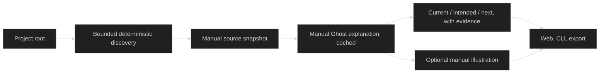

# Visu discovery — Implementation Tracker

> Updated: 2026-10-21. User-authorized implementation on codex/represent-v0.
> Prior-art sweep: existing Visu core/reference/archived MVP checked; curated source/chapter mapping already works.

## AI Continuation Prompt

Read CONTEXT.md, DOCS-PROTOCOL.md and reference/visu-mvp.md. Extend the existing local MVP, preserve its historical snapshots and unrelated working-tree changes. Parent owns integration and tracker; isolated workers own discovery, analysis, and UI files. All paid calls use Ghost. Sources remain read-only; mutation tests use temporary copies. Complete actual root-only ImageLab trial and specific Luz state/design explanations.

## Architecture

Free manual capture discovers bounded, safe text evidence. A separate manual Explain action asks Ghost's json alias to choose six chapters and distinguish current source-reported state, intended design and remaining work with captured citations. Content-addressed analysis is cached; artwork depends on chapter motifs and style rather than every status edit. Image generation remains an explicit third action. Light/dark/monochrome are local UI preferences with no AI calls.

## Open Questions

1. Test project? **Resolution:** ImageLab, root and name only; do not author an overview or tune selection to this repository.
2. Paid analysis on capture? **Resolution:** No. Separate manual Explain action; scans and browsing remain free. One bounded text call per changed captured input; no background watcher.
3. Truth claims? **Resolution:** Source-reported/code-observed, never runtime verified. Unknown fields explicit; citations prove excerpt existence, not entailment.
4. Art refresh? **Resolution:** Stable chapter identity/motifs encouraged; reuse by visual content hash. Analysis pending marks old cover stale and suppresses misleading pins.

## Current State

Implementation planned; prior curated MVP remains usable. Baseline HEAD 661ac3c3685d81d211ce71a6b5ee173a2e59afa7.

## Implementation Status

| Phase | State | Model | Effort | Description |
|---|---|---|---|---|
| 1 | Active | Codex | high | Discovery, grounded analysis, cheap update integration |
| 2 | Active | Codex | high | Themes, manual UX, real pilot and verification |

## Checklist

### Phase 1 — Headless discovery and explanation (verify: unit)
- [ ] VISU-DISCOVERY.1.1 — Discover safe balanced source scope from root-only configuration.
- [ ] VISU-DISCOVERY.1.2 — Ground automatically selected chapters in current/design/next evidence; persist analysis and measured costs with cache/budget/locking safeguards.
- [ ] VISU-DISCOVERY.1.3 — Keep art independent of overlay updates; preserve historical views and legacy explicit manifests.

### Phase 2 — Product proof (verify: e2e)
- [ ] VISU-DISCOVERY.2.1 — Manual capture/explain/illustrate UX and persistent dark/monochrome themes; progressive specific state/design detail.
- [ ] VISU-DISCOVERY.2.2 — Actual root-only ImageLab and refreshed Luz/ROMPE trials, cheap-update measurements, browser checks and small prior-spend report.
- [ ] VISU-DISCOVERY.2.3 — QA, reference/current-state documentation and scoped promotion.

## What Needs Testing

Unsafe paths/ignored files/symlinks/bounded capture; source-ranking reproducibility; invalid model citations and failed-call accounting; unchanged capture/analysis/art zero calls; changed status retains art when motifs unchanged; manual-only mutations; theme persistence/contrast/mobile focus; actual third-project output without editorial manifest. Original source repositories must retain file hashes.

## Known Bugs

None identified yet; finite text scope and heuristic style detection remain explicit limits. No runtime verification or comprehensive repository comprehension claim.

## Key Files Reference

- src/visu/discovery.mjs, analysis.mjs: new headless selection and validated Ghost explanation.
- src/visu/core.mjs, cli.mjs, server.mjs: snapshot/analysis/art cache and manual API integration.
- web/visu/index.html, app.mjs, style.css, README.md: themes, manual actions, state/design detail.
- examples/visu/{rompe,luz,imagelab}.json: root-only configs, no chapters or sources.
- tests/visu*.test.mjs, scripts/visu-discovery-pilot.mjs, scripts/visu-discovery-browser.mjs: regression and actual trials.
- experiments/visu-discovery/: saved evidence and spend report; docs/reference/visu-discovery.md and root living docs.

## Plan — VISU-DISCOVERY.1 / .2

Read-only planner recommends bounded deterministic root inventory plus a separately validated semantic plan, immutable source snapshots and stable chapter identities. Implementation uses discovery.mjs and analysis.mjs rather than duplicate engines. Discovery worker owns safe Git/fallback inventory and generic ranked quotas; analysis worker owns numbered excerpts/schema/current-versus-design prompt. Parent owns core integration, budgets, compatibility and pilot. UI worker owns only web/visu: local persistent theme, explicit Explain endpoint, source evidence and art/label mismatch suppression. Design UX round separates three manual cost boundaries and keeps technical evidence collapsed. Implementation UX round will inspect real browser outputs and correct contrast, wording and interaction defects. Plan base is baseline HEAD above; all feature files are explicitly scoped, unrelated methodology/notion changes excluded.
