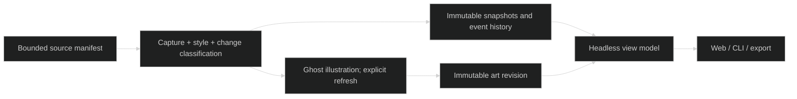

# Visu MVP — Implementation Tracker

> Living design and status. Updated: 2026-10-21.
> Source: [living project views](research/reports/Represent%20living%20project%20views.md).
> Follows DOCS-PROTOCOL.md Rule 15.
> Prior-art sweep: CAPABILITIES.md, reference/, impl/, package manifests and experiments checked. Existing ROMPE HTML is a static concept; no reusable Visu core exists.

## AI Continuation Prompt

Read CONTEXT.md, this tracker, DOCS-PROTOCOL.md and the living views report. Build a local headless Visu MVP, validated against ROMPE and Luz y Luna. Preserve source repositories and unrelated methodology changes. All AI goes through Ghost. Keep source snapshots, art revisions and current overlays separate. Parent owns tracker, exact-path commits and integration; frontend worker has an isolated worktree. Grafe and Alegor research run in parallel and require real trial evidence before implementation. Continue on the existing codex/represent-v0 branch. Use workflow-git.py for scoped commits. Opus planning roles were mapped to available Astra.

## System Intent

Turn selected project evidence into an illustrated, project-styled overview with accessible detail, provenance, history and measurable incremental updates. ROMPE is a retro MMO design/code project; Luz is a jewelry storefront. This MVP supports explicit bounded manifests, not unrestricted repository discovery.

## Ingestion Vector

```text
<configured source root>/
|-- docs/design/*.md                 # @LLM-ENTRY: ROMPE meaning; selected sections only
|-- README.md, docs/reference/*.md   # @LLM-TARGET: Luz purpose and architecture
|-- src/app/layout.tsx               # @LLM-TARGET: observed typography
|-- preset/{plugins,theme}/*.js       # @LLM-TARGET: observed visual tokens
|-- configured progress documents   # @LLM-DECORATIVE: overlay-only evidence
`-- all other paths                 # @LLM-IGNORE: never implicitly upload
```

## Visualization Spec

Use the approved [ROMPE poster](../experiments/rompe/imagegen/rompe-poster-v2.png) as a quality reference. The generated illustration is the main surface, with a few stable interactive regions. Initial composition is a bounded six-region poster recipe. Style is inferred from source signals and can be overridden. Unknown style uses a neutral editorial profile. Detail uses hover, focus and tap; sources are immutable captured excerpts. Timeline thumbnails distinguish source snapshots from art revisions. The full animated semantic scene remains future work.

## Architecture

Node 22 ESM headless library, native HTTP/CLI, thin browser shell. Content-addressed snapshots and images live in ignored .represent/. Source hashes exclude timestamps and machine root. Explicit source roles separate art/style dependencies from detail-only changes; unclassified changes invalidate art. Ghost uses the existing loopback LiteLLM chat-completions route, image-gen alias, no direct provider calls or silent retry. Cost absent from response is unknown, not zero. Generation has explicit call limits; reading cached details/history invokes no AI.



## Open Questions — resolved defaults

1. Non-game proof: Luz, because actual serif typography, cream/ink tokens and commerce context give a meaningful contrast. Plane-sync remains a neutral-style/research fixture.
2. Generation: deterministic evidence selection plus Ghost image generation first; avoid an extra synthesis call unless the bounded source trial proves it necessary. Generated claims remain inferred; captured quotations are the evidence.
3. Scope: one local server, explicit manifests, immutable local history, exported bundles. Hosted sync, broad language analysis, exact automatic hotspot segmentation and arbitrary regional image editing are deferred.

## Current State (2026-10-21)

Plan recorded before implementation. Ghost gateway startup required replacing its stale tailnet port binding with an ephemeral loopback-only Compose override; Ghost tracked files are unchanged. Concurrent Grafe/Alegor research has separate ownership.

## Implementation Status

| Phase | State | Model | Description |
|---|---|---|---|
| 1 | Ready | Codex | Capture, style, immutable history, update classification |
| 2 | Ready | Codex | Ghost adapter, measured budget/cache, CLI and local API |
| 3 | Ready | Codex | Browser shell, two-project pilot, UX improvements and QA |

## Checklist

- [ ] VISU-MVP.1.1 — Bounded manifests, safe capture and source-backed style profiles.
- [ ] VISU-MVP.1.2 — Immutable snapshots/views, no-op dedup, conservative art freshness and regression tests.
- [ ] VISU-MVP.2.1 — Ghost image adapter, attempt ledger, limits, cache and failure semantics.
- [ ] VISU-MVP.2.2 — Shared CLI/library/API, source-preserving exports and local access boundary.
- [ ] VISU-MVP.3.1 — Accessible art-first UI with history, details and explicit design/implementation UX rounds.
- [ ] VISU-MVP.3.2 — ROMPE/Luz live trial, controlled-copy update measurements, QA, reference documentation and scoped promotion.

## What Needs Testing

- TEST.1: Source scope, path traversal/symlinks/secrets, capture limits, unchanged source hashes after pilot.
- TEST.2: Same-content IDs survive restart; repeated scan adds no event; overlay-only update reuses art; depicted/style/removed evidence marks stale; overrides create view revisions without faking a source change.
- TEST.3: Gateway response validation, failed accepted calls, missing cost, explicit call ceiling, duplicate request suppression, no retry or calls on read.
- TEST.4: Real style differences with source signals; neutral/conflicting evidence and explicit overrides; two actual Ghost-generated illustrations.
- TEST.5: Desktop/mobile keyboard and tap detail, readable no-image outline, history and compare, stale labels, export provenance. No unsupported claim of pixel-exact hotspots.

## Known Bugs

None yet. Runtime/generation problems must be recorded with actual evidence rather than hidden with a static image fallback.

## Key Files Reference

Planned ownership: parent src/visu/, examples/visu/, tests/, scripts/, package.json and docs; isolated frontend worker web/visu/ only. Research workers own their named research notes and experiments. Source repositories are read-only; all controlled mutation tests use copies.

## Architecture Notes

Design UX round: simplify to Overview / History / Evidence. Put generation behind an explicit action with a scope/price caveat, keep progress optional, and expose style reasons. Never conflate art creation date with source currency. Implementation UX round must be driven by actual browser inspection after integration.
