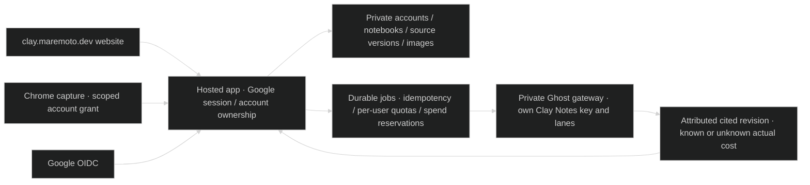

# Clay Notes — hosted service and notebook roadmap

## Notcards and Botanic card chat

The development service at `not.maremoto.dev` owns the editable card, source material, image covers, summary revisions and access permissions. Use one shared Notcards assistant. Create one active Botanic conversation per card on the owner's **first submitted question**. Opening, editing, sorting, refreshing or switching a card costs zero model calls. Reopening a card resumes its thread. A collection may eventually correspond to a Botanic project.

YouTube capture is the exception for background work. Once Ghost authorizes the Notcards lanes, a new transcript queues one automatic fast TL;DR, independently of chat. Record the source revision and processing state. Coalesce equivalent jobs and keep the original source on failure. For ordinary cards, the first question or an explicit summary request starts AI work. Deleting a chat preserves the note.

The maintained Causa native overlay already registers exact parent and API origins, OIDC issuer, private assistant, project and model spec. Its conversation routes check ownership, and its registered Causa site has bank-reconciliation tools. Give Notcards a separate development site registration and notes-scoped assistant. Reuse the registered embedding surface and its permission checks. The initial Botanic registry has no Notcards entry. The development website is a Google relying party, while the Causa adapter expects a configured site issuer. A Google login with the same email alone cannot bind the two applications' user records. See the native overlay's `registry.json`, `server/router.cjs` and `client/Embedding.tsx` in the Causa `botanic-polish-layout` worktree.

1. Establish the supported identity exchange with Botanic. Map a verified Google issuer/subject to a Botanic principal, explicitly handle existing accounts, and retain separate app sessions. Test account switching, revoked grants, signed-out iframes and top-level sign-in.
2. Persist a unique owner/card binding server-side. On the first question reserve the binding, create or recover the Botanic conversation idempotently, then attach the result. Verify Botanic ownership on every resume. Concurrent tabs and retries must resolve to the same conversation. Keep note content, tokens and attachment URLs out of navigation parameters.
3. Give the assistant read-only access to the current card and explicitly selected sources via short-lived, audience- and resource-bound authorization. Resolve citations to immutable note/source revisions. Test cross-account denials and rapid card switches. Enable edits through a preview and explicit apply against the expected revision.
4. Test with two local fixture identities and a counting model stub before live registration. Then verify public development sign-in, reopening the same thread, one user-initiated tool turn and the serving hop. Notcards' gateway request covers its own inference. A shared Botanic relay needs an operator-approved per-app attribution and spending policy before it can carry Notcards turns.

The first live milestone is a text card with one question, one owner-bound conversation and a reload that restores the same thread. Source extraction, optional grouping, AI editing and rich studio outputs follow that milestone.

> 2026-11-16: The product is now **Notcards**. Development uses `not.maremoto.dev` and production targets `not.cards`. The previous hostname and proposed PostgreSQL design below record the earlier plan. The first single-instance dev service uses SQLite for identity and private account directories for sources. See the [development guide](../guides/notcards-dev.md).

> Design approved in direction by the user's2026-11-15 requests. **Implementation plan, not a deployed service.** Current local implementation: [release-prep reference](../reference/clay-notes-release-prep.md). Operational sequence: [release guide](../guides/clay-notes-release.md). Canonical decisions: [CONTEXT](../CONTEXT.md).

## Product contract

Clay Notes is a general source-grounded notebook service with a collectible-card library. YouTube is its first capture adapter. Visit `https://clay.maremoto.dev`, sign in with Google and use the same notebooks in the website and Chrome extension. New Google users can create an account through the normal sign-in flow, subject to server quotas. There is no customer gateway key, local server, pairing code or Cloudflare Access login.

Installation supplies the extension, not an authenticated Google identity. With an existing Clay Notes website session, the extension obtains its account grant quietly. Otherwise the first capture offers one normal Google sign-in, then resumes that capture. Google may require account selection/consent again after revocation or expiry. Do not promise guaranteed silent sign-in on every installation. Chrome documents both interactive and noninteractive authentication flows in [chrome.identity](https://developer.chrome.com/docs/extensions/reference/api/identity).

After capture, save the notebook/card first and open it immediately; the default summary runs as a durable job. The initial prompt requests the main statements and conclusions automatically. The notebook offers a simple better-model redo, cited Q&A, source text and personal notes. Provider/lane names and Ghost setup details belong in operator tooling; a customer sees a useful localized availability/error message. Language and appearance retain their Automatic/manual settings in the gear menu.

## Current proof and gaps

The local card/cache/settings implementation passed118/118 full tests and46/46 focused checks at `d177508`. Three actual YouTube transcripts are saved without inference. Full-art thumbnails, uploaded image covers, saved manual reorder, sorting/search/filtering and responsive light/dark/Arabic views have browser evidence. These files are not yet a production account service. Physical pointer drag was reviewed in code; browser QA exercised keyboard movement.

Current `startServer` creates a shared local session and exposes a local pairing path. **Do not publish that handler by changing its bind address or tunnel route.** The hosted entry point must enforce authenticated ownership and omit the development bootstrap/pairing API. Current globally video-shaped IDs and local-only cache need explicit migration, not reuse as an account boundary. No Google roundtrip, DNS/tunnel change, public backend, installed production extension, gateway Apply or real summary is accepted yet.

## Hosting and account architecture

Proposed first deployment: retain the Node application on lab1, behind an HTTPS tunnel/reverse proxy serving only the Clay Notes app. Keep Ghost `http://localhost:4000` private on its existing host boundary. A remotely hosted browser frontend must never call that loopback URL itself. The edge connector must not gain direct access to Ghost, databases or sibling apps. Use a separate app identity, database/volume and service process; initially run one API/job worker instance with durable queue recovery.

This follows the inspected infrastructure family, not a copied live deployment: `D:/ware/botanic/docker-compose.tunnel.yml` declares an app-only connector and explicitly no Access policy. Botanic's Google configuration in `D:/ware/botanic/docs/upstream.md` requires its own OAuth client and says the real roundtrip was unverified. It is a configuration precedent, not evidence of a reusable working Google module. No sibling repository or infrastructure was edited here. Production host/service/container details are finalized in the hosted implementation slice before publication.

Use PostgreSQL for transactional accounts, sessions, grants, jobs and spend reservations, plus a backed-up private asset volume for the first single-host release. Introduce object storage only when deployment scaling needs it. Each operation resolves an internal account ID from the validated session/grant; every notebook/source/image/job query includes that owner. IDs in a request are never authority. Keep original bytes and immutable source versions separate from generated artifacts.

### Google web login

Register a dedicated Web OAuth client for Clay Notes. Production origin is exactly `https://clay.maremoto.dev`; proposed callback is `https://clay.maremoto.dev/auth/google/callback`. Keep development clients/callbacks separate. Request authentication scopes only: `openid email profile`. Drive/file scopes are optional later permissions, not a condition of signing in.

Use a maintained OIDC library and authorization-code server flow, with one-time state, nonce, code verification and exact redirect allow-lists. Validate Google's signature/issuer/audience/expiry and nonce; map accounts by issuer plus `sub`, not mutable email. The server creates its own revocable session in an HttpOnly, Secure, host-only cookie; rotate it at authentication and use CSRF protection/origin checks on mutations. Avoid credential/token URLs in logs. [Google's OIDC guide](https://developers.google.com/identity/openid-connect/openid-connect) and [server token verification guidance](https://developers.google.com/identity/gsi/web/guides/verify-google-id-token) are the implementation references; their alternate GIS POST flow also requires its documented CSRF handling.

Missing OAuth configuration keeps hosted authentication unavailable with an operator-facing diagnostic; it must not activate the local shared-session fallback. Implement signout/session revocation and an account deletion/export path before public launch. Public users get their own default quota; no invitation list is inherited from Botanic.

### Extension account handoff

The production extension fixes the service origin to `https://clay.maremoto.dev`; settings contain account/status and preferences, not a server URL or pairing token. Add the `identity` permission and only the host permissions actually used by capture/API calls. Do not request cookie access or all browsing history to reuse a session.

1. On a user capture action, persist a bounded pending capture and its idempotency key. Generate extension state and a PKCE verifier/challenge.
2. Start a noninteractive `chrome.identity.launchWebAuthFlow` to `/auth/extension/authorize`. The first-party hosted session can approve a scoped extension grant without depending on third-party-cookie fetch behavior. If there is no session, return an authentication-required state.
3. On the user-visible sign-in action, run the interactive flow through the hosted Google callback. Preserve the original pending capture. Do not launch surprise consent windows at installation time.
4. The app validates the registered extension ID, exact `chrome.identity.getRedirectURL('auth')` callback and PKCE challenge. After authenticated approval, it returns a single-use, short-lived authorization code bound to the account, extension and challenge. Provider OAuth state/nonce and extension state are separate values.
5. The extension verifies its state and exchanges the code plus verifier at `/auth/extension/token`. It stores only a short-lived, limited Clay Notes grant in `chrome.storage.session`; no Google client secret or Ghost key enters Chrome. Renew through the same session-aware flow, with explicit login only when needed. Logout/revocation invalidates grants.
6. Submit the capture once and open `/notebooks/<id>` immediately. The server deduplicates by account/source version/idempotency key, saves source content, queues one summary and reports progress. A duplicate click cannot create another automatic billable job.

Use the stable Chrome Web Store item ID to register the exact callback and API origin. Test development IDs separately. Exact ID registration prevents arbitrary extensions or open redirects from obtaining grants. Token exchange uses a restricted origin policy, but authorization/PKCE/ownership remain mandatory even for nonbrowser clients. API code401 responses trigger one account recovery attempt;429/quota errors preserve the saved card without automatic paid retry.

### Data, caching and AI boundaries

Account, notebook and source are distinct entities. Use opaque internal notebook/source IDs; retain a video's external ID as metadata. Proposed persisted records are `accounts`, `sessions`, `extension_grants`, `notebooks`, `sources`, `source_versions`, `assets`, `jobs`, `revisions`, `conversations` and `spend_reservations`. Every owned row carries `owner_id`; citation pointers include source ID, immutable version and segment/page/timestamp location.

Scope browser caches by opaque account identity and schema version, with a short retention limit and purge on signout/account switch/deletion. Do not display a prior account's cached collection before identity is established. Use a cached public shell while the account check runs, then the account cache. Private media reads remain authorized; do not let an edge cache serve one account's bytes to another. Existing thumbnails remain cover defaults; chosen image covers are a presentation setting until their OCR/vision source processing is implemented.

The service reads only `LITELLM_KEY_CLAY_NOTES` server-side after real Apply evidence. Lanes are `clay-notes-summary` and optional `clay-notes-deep`. Reserve conservative estimated spend transactionally per user and service before queueing, settle actual cost afterward, and retain uncertain charges when attribution is missing. Classify response headers/model/cost; never infer a free hop from the lane name. Disable automatic generation at cap while preserving source capture. Global gateway budget is a backstop, not a user quota or a pricing model. Launch quotas/prices require operator configuration before public enrollment.

## Grounded implementation sequence

| Slice | Work | Acceptance before advancing |
|---|---|---|
| A · hosted foundation | New hosted entry, PostgreSQL ownership schema, Google OIDC, revocable sessions, account export/deletion; preserve local dev entry | Stubbed provider success/failure/CSRF/nonce/replay, unauthenticated denial, two-account isolation including media, signout/cache purge; real Google roundtrip after client registration |
| B · reliable capture and inference | Durable idempotent jobs, quotas/reservations, own-key post-Apply adapter, actual-hop/cost records, source versions | Loopback stub tests for duplicate capture, process restart, exhausted budgets, unknown cost, failure/retry, free/paid fallbacks; no live paid call |
| C · production extension | Fixed hosted origin, identity/PKCE handoff, no pairing/local-host requirement, resumable capture, app-owned pending/error UX | Fresh-profile sign-in once, existing-session quiet reuse, expired/revoked grants, SPA navigation, wrong/missing captions, duplicate clicks and service outage |
| D · private deployment trial | Dedicated service/volume/database, HTTPS hostname, health/metrics, backup and restore; no Access | Google userA/B isolation on real URL, denied private/admin routes, restore rehearsal, installed stable-ID candidate; no production keys in assets/ZIP/logs |
| E · bounded model and launch trial | Operator applies lanes and separately permits a capped three-video trial; validate citations/latency/cost | Actual Apply SHA/lane-tests, three cited summaries compared to transcripts, one approved deep redo, cold/warm timing; then store/privacy/support review and submission |

These are planned slices, not checked implementation boxes. A later hosted tracker should earn them. [The release guide](../guides/clay-notes-release.md) names concrete operator inputs and rollback gates. A public tunnel/hostname must wait for sliceA isolation tests; gateway wiring waits for Apply as the user instructed.

## Future NotebookLM-style capability plan

This follows the user's request to plan broader notebooks after the card work. Google's current [source documentation](https://support.google.com/notebooklm/answer/16215270?hl=en) describes document, web, audio, image and YouTube inputs. Its [notebook overview](https://support.google.com/notebooklm/answer/16206563?hl=en) describes cited chat and a studio with reports, study tools and media outputs. Those are comparison references, not a claim of parity or a requirement to copy a proprietary UI. No exact limits/pricing are imported into Clay Notes.

| Wave | User result | Grounding and release proof |
|---|---|---|
| 1 · general notebook core | Create an empty notebook; attach multiple text/Markdown, pasted text, public web and PDF sources; titles/tags/decks and image covers | Separate internal IDs; adapter capability/size matrix; immutable source versions; page/paragraph citations; extraction preview and explicit unsupported/error states; private-URL/redirect/SSRF protection for server fetch |
| 2 · source-grounded work | Select sources for multi-source Q&A, compare arguments, find disagreements, search library, save/edit answers and notes, export Markdown/JSON/PDF | Citation coverage and correctness evaluation, quoted evidence navigation, refusal on insufficient evidence, prompt-injection fixtures, source removal/version semantics; no silent rewriting of old answers |
| 3 · richer inputs | DOCX/PPTX/CSV/EPUB adapters, image OCR/vision, uploaded audio/video transcription; opt-in Google Drive import/sync | Format fixtures, OCR/page bounds, timestamp/word confidence, transcription provenance, cancellable jobs and budgets; Drive incremental scopes and revoked-access handling; no promise to parse arbitrary files |
| 4 · useful studio | Briefings/reports, FAQs, study guides, timelines, mind maps, flashcards/quizzes, data tables and reusable artifact templates | Editable outputs with source/version citations and export; question/answer validation; inspectable prompts; artifacts persist independently of subsequent source changes |
| 5 · rich studio and collaboration | Audio/video overviews, slide decks and infographics; private viewer/editor sharing, comments and mobile capture/offline shell | Explicit per-generation cost preview/limits, accessibility/transcripts, media quality reviews, sharing/asset authorization matrix, recipient access revocation and account-cache isolation |
| 6 · research and scale | Opt-in source discovery, connectors, source freshness, larger libraries, teams/billing | Licensed/source-attributed discovery, permission and freshness trails, measured retrieval quality, queue concurrency/cost/load tests, tenant-safe storage migration and operational ownership |

Current support is YouTube caption text plus image **attachments/covers**. Wave3 image analysis and audio/video uploads are not implemented. Google login does not grant Drive access. Each source adapter must advertise accepted formats, size/page/duration limits, extraction fidelity, language support, processing status and whether it incurs inference spend. Unknown formats produce an actionable unsupported state, not a fabricated summary.

Prioritize source fidelity, understandable citations and quick reliable capture before expensive studio media. Keep TCG movement restrained and accessible across keyboard/touch/reduced-motion preferences; card art never substitutes for evidence.
