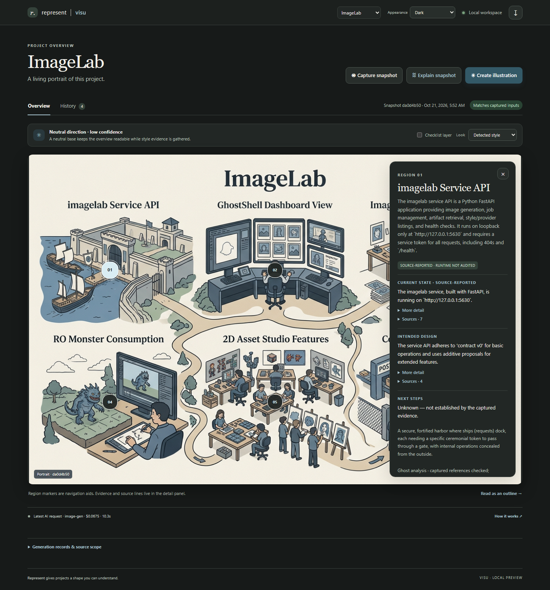
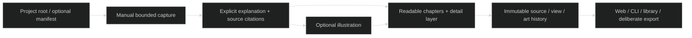

# Keep the Visu experience at hand

> Preservation guide, 2026-10-21. The owner likes Visu and wants it retained inside the broader Represent developer-tooling family. Development remains paused at the completed automatic-discovery slice. This guide preserves the experience and its implementation knowledge before the fresh Orkest-platform design.

## See it before redesigning it

Start with [ImageLab dark](../../experiments/visu-discovery/imagelab-dark.png), [light](../../experiments/visu-discovery/imagelab-light.png), [high contrast](../../experiments/visu-discovery/imagelab-mono.png), [Luz mobile](../../experiments/visu-discovery/luz-mobile.png) and the original [ROMPE memorable overview](../../experiments/rompe/imagegen/rompe-poster-v2.png). The [living overview concept](../../experiments/rompe/living-overview-concept/index.html) records the intended interaction; the later Visu code is the working MVP.



The [current implementation reference](../reference/visu-discovery.md) explains the root-only workflow. The [initial pilot](../../experiments/visu-pilot/README.md) and [automatic-discovery trial](../../experiments/visu-discovery/README.md) show real generated outputs and the rejected attempts. Keep the failures available: the useful lesson includes what had to be corrected.

## What to preserve in the product

| Experience | Why it matters |
|---|---|
| A memorable whole picture | The illustration gives the project an understandable identity before technical detail. The owner selected this direction over the box-diagram trial. |
| The project's own style | ROMPE retro, Luz editorial and an honest neutral fallback are evidence-driven alternatives. Pixel art is not the default for every project. |
| Clean first glance, depth on request | Short chapter summaries lead to more detail and exact captured sources. Hover has focus/tap/outline alternatives. |
| State, intended design and next work | These answer different questions. Their citations and uncertainty stay inspectable rather than implying every depicted feature is implemented. |
| Manual snapshot -> explanation -> illustration | Users choose when to capture and spend. Reading history, switching themes and opening details do not trigger generation. |
| Art survives cheap updates | A new text/state revision can reuse the illustration. Stale art remains visible with its source identity rather than silently becoming current. |
| History and alternatives | Keep source snapshots, explanation/view revisions and multiple illustrations separate. A new image should not erase the earlier view. |
| Light, dark and high-contrast monochrome | Appearance changes locally; they do not require another image-model request. |

The user's positive experience feedback does not establish that all generated facts are correct. Luz's earlier generic explanation and later residual stale-document mistakes remain explicit improvement targets. The full animated, interactive poster is still an ambition; current pins are approximate navigation over a raster, not detected semantic objects or runtime animation.

## Reusable implementation seams



| Source | Reuse before rebuilding |
|---|---|
| [discovery.mjs](../../src/visu/discovery.mjs) | Git-aware safe scope, quotas, style/identity/current-doc selection and coverage diagnostics. |
| [analysis.mjs](../../src/visu/analysis.mjs) | Bounded excerpts, model-selected six chapters, validated source references and stable chapter matching. |
| [core.mjs](../../src/visu/core.mjs) | Immutable capture/view/art identities, freshness, caches, events, attempt/cost accounting and export. |
| [ghost.mjs](../../src/visu/ghost.mjs) | Existing Ghost gateway boundary and image-response validation. |
| [cli.mjs](../../src/visu/cli.mjs) / [server.mjs](../../src/visu/server.mjs) | Headless and local HTTP surfaces; do not rebuild a second provider client just to embed the tool. |
| [web/visu](../../web/visu/) | Overview, pins/outline, disclosures, history, source scope and themes. |
| [examples/visu](../../examples/visu/) | ROMPE, Luz and ImageLab root-only configurations. |

Do not interpret these as a ready Orkest plugin contract. Current local API tokens, origins, project identities and stores need an explicit integration design. Prefer one small capability/artifact handoff before changing independent tools or merging their state.

## Cost and accuracy lessons

The first real Visu trial cost **$0.3682722** through Ghost, including rejected attempts. The later automatic-discovery run cost an additional **$0.28688598**, which already includes its **$0.0144183** controlled text-only status update. That update reused the art with zero image calls. No-op operations reused saved results. These are historical measured gateway charges, not price promises or a provider-invoice reconciliation; the [trial ledger](../../experiments/visu-discovery/README.md) contains the breakdown and exact historical aliases/routes.

Keep precise information outside generated raster lettering. More reliable excerpt selection and stronger conflict handling were worth more than simply choosing the cheapest text model. A status update still sends a bounded whole-snapshot explanation, not a fine-grained delta. Bounded sampling, six chapters, fixed pins, missing sections and model interpretation all constrain the result. The outline and captured evidence are essential, not secondary decoration.

## Preview and preserve existing work

The checked-in screenshots and illustrations can be reviewed without any service. To open the local UI with its existing store and no newly configured gateway, use the offline preview below in a new PowerShell window. It clears gateway credentials only in that child shell; it does not change saved user settings. Startup, browsing and appearance make no generation requests.

```powershell
Set-Location D:/ware/represent; $env:VISU_GHOST_KEY=''; $env:LITELLM_KEY_OPERATOR=''; node D:/ware/represent/src/visu/cli.mjs serve #
```

Open `http://127.0.0.1:8871/` if that port is available. This is a launch instruction, not a claim that the service is currently running. Avoid paid pilot scripts when reviewing saved work; generation should be a separate deliberate task using the [current usage reference](../reference/visu-discovery.md).

The default store is `D:/ware/represent/.represent/visu`, overridden by `VISU_STORE`. At closeout the local default store contained `rompe`, `luz`, `imagelab` and shared `assets`. It is **gitignored**. Tracked trial images/reports preserve the learning; a fresh Git clone does not include all local interactive history. Keep the existing store and use the tool's deliberate export if moving history. Exports contain captured project text and image data, so keep them in the intended private location rather than adding them wholesale to Git. This closeout does not move or delete the store.

Saved verification: automatic Visu discovery recorded 35 regression tests and nine browser checks, including theme persistence, mobile fit, disclosures and browsing without POSTs. Those tests are in the later 57-test combined repository run; they are not extra totals to add. No code or paid run was required to write this preservation guide.

## Use this as a design review input

Before changing the experience, compare the proposal with these screenshots and follow one whole-picture -> detail -> source -> history journey. Require a design UX round and a live implementation UX round for future integration. Judge explanation usefulness separately from art quality and test counts. Keep Visu's standalone usefulness while deciding how Orkest or a future companion opens and uses it.

The [exploration learning record](../research/reports/Represent%20exploration%20learning%20record.md) closes the earlier work; [Represent within the Orkest platform](../research/reports/Represent%20within%20the%20Orkest%20platform.md) is the research input for the next design, not a completed integration.
