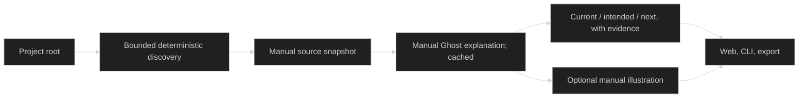

# Visu discovery — Implementation Tracker

> Promoted: 2026-10-21. User-authorized implementation on codex/represent-v0. Implementation commit 3023fd26; 44/44 checks recorded at that HEAD; promotion checker passed every machine gate.
> Prior-art sweep: existing Visu core/reference/archived MVP checked; curated source/chapter mapping already works.

## AI Continuation Prompt

This is the archived implementation record. For current behavior read ../CONTEXT.md, ../DOCS-PROTOCOL.md and ../reference/visu-discovery.md. Preserve historical snapshots and unrelated working-tree changes. All paid calls use Ghost. Source projects remain read-only; mutation tests use temporary copies. Root-only ImageLab trial and specific Luz state/design explanations were completed; semantic limitations are recorded below.

## Architecture

Free manual capture discovers bounded, safe text evidence. A separate manual Explain action asks Ghost's gemini-flash alias to choose six chapters and distinguish current source-reported state, intended design and remaining work with captured citations. Content-addressed analysis is cached; artwork depends on chapter motifs and style rather than every status edit. Image generation remains an explicit third action. Light/dark/monochrome are local UI preferences with no AI calls. The cheaper json alias was tested and replaced as the default after current/historical source conflicts proved too difficult for it.

## Open Questions

1. Test project? **Resolution:** ImageLab, root and name only; do not author an overview or tune selection to this repository.
2. Paid analysis on capture? **Resolution:** No. Separate manual Explain action; scans and browsing remain free. One bounded text call per changed captured input; no background watcher.
3. Truth claims? **Resolution:** Source-reported/code-observed, never runtime verified. Unknown fields explicit; citations prove excerpt existence, not entailment.
4. Art refresh? **Resolution:** Stable chapter identity/motifs encouraged; reuse by visual content hash. Analysis pending marks old cover stale and suppresses misleading pins.

## Current State

Implementation complete; prior curated snapshots remain usable. Plan commit 5be506a, baseline 661ac3c. Thirty-five regression tests and nine live browser checks passed. Root-only ImageLab, Luz and ROMPE all produced automatic scopes, chapters and art. Controlled-copy status refresh cost $0.0144183 with stable chapter IDs, reused artwork and zero image calls; unchanged operations cost zero. Trial evidence: experiments/visu-discovery/. New iteration total $0.28688598; prior $0.3682722 separately reconciled in the report.

## Implementation Status

| Phase | State | Model | Effort | Description |
|---|---|---|---|---|
| 1 | Complete | Codex | high | Discovery, grounded analysis, cheap update integration |
| 2 | Complete | Codex | high | Themes, manual UX, real pilot and verification |

## Checklist

### Phase 1 — Headless discovery and explanation (verify: unit)
- [x] VISU-DISCOVERY.1.1 — Discover safe balanced source scope from root-only configuration. Evidence: discovery.mjs, five discovery regression cases including tracked ignored paths.
- [x] VISU-DISCOVERY.1.2 — Ground automatically selected chapters in current/design/next evidence; persist analysis and measured costs with cache/budget/locking safeguards. Evidence: analysis.mjs, ten analysis regression cases and saved actual project ledgers.
- [x] VISU-DISCOVERY.1.3 — Keep art independent of overlay updates; preserve historical views and legacy explicit manifests. Evidence: six automatic integration cases, fourteen legacy/API cases and update-proof.json.

### Phase 2 — Product proof (verify: e2e)
- [x] VISU-DISCOVERY.2.1 — Manual capture/explain/illustrate UX and persistent dark/monochrome themes; progressive specific state/design detail. Evidence: nine browser checks, measured contrast, desktop/mobile captures; fixed inspector overlap and collapsed longer explanations/citations.
- [x] VISU-DISCOVERY.2.2 — Actual root-only ImageLab and refreshed Luz/ROMPE trials, cheap-update measurements, browser checks and small prior-spend report. Evidence: experiments/visu-discovery/README.md, project JSON/PNG files, update-proof.json; all thirty original Luz source hashes preserved.
- [x] VISU-DISCOVERY.2.3 — QA, reference/current-state documentation and scoped promotion. Evidence: docs/reference/visu-discovery.md, living docs, 35/35 regression tests, 9/9 browser checks; promotion gate and exact-path commit sequence recorded in Git and local loop verification.

## What Needs Testing

Unsafe paths/ignored files/symlinks/bounded capture; source-ranking reproducibility; invalid model citations and failed-call accounting; unchanged capture/analysis/art zero calls; changed status retains art when motifs unchanged; manual-only mutations; theme persistence/contrast/mobile focus; actual third-project output without editorial manifest. Original source repositories must retain file hashes.

## Known Bugs

No unresolved test failures. Finite text scope and heuristic style detection remain explicit limits. Some generated recommendations still misread conflicting historical/current docs or implementation gates. Citation validation proves excerpt existence, not entailment; status is source-reported, not runtime verified. Six fixed chapters and approximate pins are still the visual contract. Generated art may include incidental lettering despite the prompt.

## Key Files Reference

- src/visu/discovery.mjs, analysis.mjs: new headless selection and validated Ghost explanation.
- src/visu/core.mjs, cli.mjs, server.mjs: snapshot/analysis/art cache and manual API integration.
- web/visu/index.html, app.mjs, style.css, README.md: themes, manual actions, state/design detail.
- examples/visu/{rompe,luz,imagelab}.json: root-only configs, no chapters or sources.
- tests/visu*.test.mjs, scripts/visu-discovery-pilot.mjs, scripts/visu-discovery-browser.mjs: regression and actual trials.
- experiments/visu-discovery/: saved evidence and spend report; docs/reference/visu-discovery.md and root living docs.

## Plan — VISU-DISCOVERY.1 / .2

Read-only planner recommended bounded deterministic root inventory plus a separately validated semantic plan, immutable source snapshots and stable chapter identities. Implementation uses discovery.mjs and analysis.mjs rather than duplicate engines. Discovery worker owned safe inventory and generic ranked quotas; analysis worker owned numbered excerpts/schema/current-versus-design prompt. Parent owned core integration, budgets, compatibility and pilot. UI worker owned only web/visu. Final implementation requires Git and fails closed without it; no approximate ignore fallback. Design UX round separated three manual cost boundaries and kept evidence collapsed. Implementation UX round corrected contrast, inspector overlap and verbose details against actual browser output. Plan base is baseline HEAD above; all feature files are explicitly scoped, unrelated methodology/notion changes excluded.

## Verification and promotion

Phases 1 and 2 were integrated as one feature commit because the real pilot exercised the shared discovery → explanation → cache → UI contract; separate intermediate commits would not represent independently verified product states. All checklist IDs remain independently evidenced above. Read-only core review found the tracked-ignore leak, fixed with a regression before final verification. Browser record reports zero mutation POSTs while browsing/themes/history, no JavaScript/request errors and 390px fit. Measured key text pairs pass 4.5:1 light/dark and 7:1 monochrome; this is not a full accessibility audit. Reference content remains subject to human product review.
