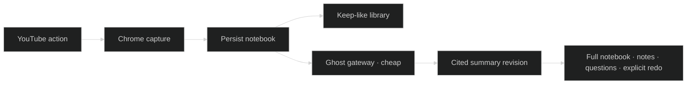

# REP-8: CLAY-NOTES

> Updated: 2026-11-15
> Prior-art sweep: 2026-11-15 — CAPABILITIES, reference index, migrated live/done trackers, package.json, Visu gateway and Trazo server inspected. Existing tools handle repositories; Clay Notes adds video notebooks.

## AI Continuation Prompt

Build Clay Notes in this monorepo. Read CONTEXT, DOCS-PROTOCOL and this tracker. Preserve unrelated .ghostdev/version.json and notion/. Use Python 3.12 for Orkest. Doctor was read-only; feature startup performed the required local release/layout migration. New product focus is explicitly authorized by the user's 2026-11-15 request. Do not resume Trazo's paid trial.

## Open Questions

No unresolved design question blocks local implementation. Default to a loopback Node service, a Manifest V3 Chrome extension and file storage outside the repository. Production hosting, accounts and sync are deferred. A dedicated Clay Notes gateway consumer key must be supplied for a real paid trial; never borrow another app's key.

## System Intent

Click Clay Notes beside YouTube's existing video actions. Create a notebook immediately, automatically extract available captions, then generate a concise list of main statements and conclusions. Browse all saved videos as quiet Keep-like cards; open one for transcript, cited summary, personal notes and follow-up questions. Explicitly regenerate with a selected allowed model and preserve revisions.

## Ingestion Vector

YouTube watch URLs, video identity/title/channel and available timestamped captions. A transcript paste is the recovery path for missing or blocked captions. Transcripts are untrusted data, never instructions. No arbitrary URL fetching on the server.

```text
src/clay-notes/             # @LLM-ENTRY: headless notebook domain and service
  core.mjs                 # @LLM-TARGET: validation, persistent notes, AI revisions
  server.mjs               # @LLM-TARGET: bounded loopback HTTP API
  web/                     # @LLM-DECORATIVE: Satoshi, clay surfaces and notebook UI
extensions/clay-notes/     # @LLM-TARGET: YouTube capture and local-service bridge
tests/clay-notes.test.mjs  # @LLM-TARGET: executable behavior and boundary evidence
```

## Visualization Spec

Apply the supplied Recilab clay composition language to a working notes app: warm off-white, deep green, cream/mint/lime cards, generous rounded surfaces, modest original SVG motifs and restrained motion. Satoshi overrides the reference's Montserrat/Inter choices. Compact YouTube action follows the attached placement reference. Responsive library and full notebook with visible transcript evidence; no copied Clay artwork.

## Architecture

Extension content script inserts one action across YouTube SPA navigation. Background worker captures only the current video and posts to an authenticated loopback service. Main-world player data is used only for caption metadata. The Node service owns storage, a bounded job queue and Ghost's OpenAI-compatible /v1 API. Gateway key stays server-side; cheap is default, optional redo uses the key's available models. Notebook creation precedes summarization. No fabricated summary when transcript or gateway is unavailable. Local pairing protects mutations; same-origin web UI, bounded body sizes, no permissive CORS.



## Current State

Grounded plan only. Implementation, live YouTube compatibility and paid gateway success are not yet claimed.

## Known Bugs

None in new code yet. YouTube caption extraction is a volatile integration and must have a clear missing-caption recovery state.

## What Needs Testing

Canonical video deduplication, atomic persistence, restart recovery, timestamp parsing, prompt injection boundaries, bounded transcripts, invalid model/output, revisions and preservation after failures. HTTP auth/origin/body limits and asynchronous jobs. Extension SPA/idempotence and message validation. Responsive UI, keyboard controls and error states. Tests use an injected gateway; a real consumer-key trial is separate evidence.

## Implementation Status

| Phase | State | Model | Effort | Description |
|---|---|---|---|---|
| REP-8.1 | Shipped | current session | current | Notebook core and gateway contract |
| REP-8.2 | Shipped | current session | current | Service, library, notebook and Chrome capture |
| REP-8.3 | [ ] not started | current session | current | Integration QA and truthful operating reference |

## Checklist

### Phase 1 — Notebook core

> verify: unit
> requires:
>   skip_budget: 0

- [x] REP-8.1.1 — Implement and behavior-test the durable video notebook store, transcript parser and Ghost summary/chat adapter in src/clay-notes/core.mjs and tests/clay-notes.test.mjs; preserve prior revisions on failure and deduplicate video IDs. — evidence: C:/Python312/python.exe D:/ware/represent/tmp/run-clay-tests.py: 9/9 passed, skipped=0, output sha256=dcab67dc18df0bcb6a971f068daa48efd84ec5eeadfa151c279b69278096604a

### Phase 2 — Capture and surfaces

> verify: integration
> requires:
>   skip_budget: 0

- [x] REP-8.2.1 — Add the authenticated loopback service/CLI, responsive Satoshi/clay library and notebook, and unpacked MV3 YouTube extension. Test service auth/jobs/recovery and extension contracts; package a local installable directory. — evidence: C:/Python312/python.exe D:/ware/represent/tmp/run-clay-tests.py tests/clay-notes*.test.mjs: 15/15 passed, skipped=0, output sha256=0539400760850b5a76446ba024847a12eb8789c7b62ddfa793609712e92def27

### Phase 3 — QA and operating guide

> verify: integration
> requires:
>   skip_budget: 0

- [ ] REP-8.3.1 — Run the existing tool regression suite plus Clay Notes integration checks, inspect browser UI when available, repair observed defects and publish an as-built reference with install, pairing, gateway setup, transcript limitations and exact evidence. Distinguish fixtures from real YouTube/paid trials.

## Key Files Reference

| File | Role |
|---|---|
| src/visu/ghost.mjs | Existing bounded gateway request precedent; image-specific class is not copied |
| src/trazo/server.mjs | Existing local server precedent |
| src/clay-notes/core.mjs | New headless store and gateway adapter |
| src/clay-notes/server.mjs | New API and static web server |
| src/clay-notes/cli.mjs | New local entry point |
| src/clay-notes/web/ | New library and notebook UI |
| extensions/clay-notes/ | New MV3 Chrome extension |
| tests/clay-notes.test.mjs | New behavior and service tests |
| docs/reference/clay-notes.md | New as-built operating reference |

## Architecture Notes

The existing package is buildless ESM on Node >=22, so keep that runtime and avoid a new framework or hosted service. Storage defaults to LOCALAPPDATA/Represent/clay-notes, not source folders. Web and Chrome are thin shells over a headless core; CLI/library reuse is immediate, IDE/desktop/mobile-specific shells remain deferred. Ghost's documented cheap alias is the initial default, with server-side allow-list and real response model/cost metadata when provided. Never promise a fixed latency or zero cost from an alias. Each user save authorizes automatic initial summarization; redo/chat are explicit actions.

## Plan — 1

Implement the notebook domain independently of browser/server shells. Exact scope: src/clay-notes/core.mjs and tests/clay-notes.test.mjs. Node built-in test runner, no dependencies. TDD: a failing deduplication assertion against an initially minimal Store, then implement URL validation, bounded timestamped transcript normalization, atomic JSON storage and an injected fetch-based Ghost adapter. Reject invalid source references and truncated/invalid AI output. Persist the notebook before requesting AI; serialize same-note mutations, retain immutable summary revisions and personal notes. Store gateway key only in server memory. Prompt sources are JSON data under an explicit system boundary.

Pins: package.json tests already includes tests/*.test.mjs, so new tests are discovered without a package edit. Existing Visu/Grafe/Alegor/Trazo exports remain unaffected because the new domain imports only Node built-ins. No existing route or tool registry to change in this box. Package CLI entry is phase 2.

Verification: node --test tests/clay-notes.test.mjs from D:/ware/represent; all tests offline with injected fake gateway. Cover duplicate URLs, malicious URL/path, transcript bounds, summary evidence indices, revision failure preservation, unknown models, concurrent mutations and fresh-process persistence. Record red and green using Orkest verify. Run source syntax check as part of test import. No paid model call required for these contracts.

Exact owned files: `src/clay-notes/core.mjs`, `tests/clay-notes.test.mjs`.

### Phase 1 QA — 2026-11-15

No mechanical QA findings.

## Plan — 2

Build local surfaces over the tested headless core. Exact files: package.json; src/clay-notes/server.mjs, cli.mjs, web/index.html, web/app.mjs, web/style.css, web/assets/satoshi-{400,500,700,900}.woff2, web/assets/Satoshi-LICENSE.txt; extensions/clay-notes/manifest.json, background.js, content.js, content.css, options.html, options.js, options.css; tests/clay-notes-server.test.mjs. Group as one atomic box because extension payload, service API and UI must agree.

Service: 127.0.0.1:8876, exact Host/Origin checks, paired extension allowed by a random local token saved outside source, same-origin HttpOnly web cookie, bounded JSON request bodies, no CORS wildcard. Notebook create returns before caption summary; one bounded sequential queue prevents unbounded paid fanout. Gateway URL/key/models from CLAY_NOTES_* environment. POST /api/notes, /:id/transcript, /:id/summarize, /:id/ask and PATCH /:id. GET /api/notes and /api/config. Gateway setup/errors preserve saved content. Config exposes pairing token only to same-origin web cookie; never gateway key.

UI: Satoshi locally hosted with original font licence. Clay language from user's reference (warm background, deep green, large rounded tinted cards, soft original SVG/shape motif), not a landing-page template. Library search/pins/add; notebook summary + conclusions + transcript citations, persisted personal notes, Q&A, transcript fallback and revision/model selector. Explicit save/redo/chat actions. Keyboard and reduced-motion support.

Extension: MV3 action/options, YouTube-only content injection, idempotent SPA action. Worker validates sender/current video, obtains metadata/captions via scripting.executeScript MAIN, restricts captions to www.youtube.com/api/timedtext. Save notebook/open tab before extraction. Caption failure leaves paste fallback. Local pairing token only in extension storage.local, separate from gateway key. User can open the library from action/options.

Pins: package.json gets clay-notes launch script; existing test glob discovers server tests. CONTEXT/TODO/index plan-only entries updated in phase 3. Existing four tools untouched. No global tool registry beyond package scripts. Imported font is source artwork data, not executable code.

TDD: first expose a minimal server rejecting nothing and assert an unpaired API request receives 401; execute the meaningful red, then implement. Verify all clay-notes*.test.mjs via TAP-summary adapter. Tests exercise persistence/async summaries, origin/auth, malformed/oversize input, static assets, host validation and extension permissions/message wiring. Browser inspection and full regression in phase 3.

Exact owned files: `extensions/clay-notes/background.js`, `extensions/clay-notes/content.css`, `extensions/clay-notes/content.js`, `extensions/clay-notes/manifest.json`, `extensions/clay-notes/options.css`, `extensions/clay-notes/options.html`, `extensions/clay-notes/options.js`, `package.json`, `src/clay-notes/cli.mjs`, `src/clay-notes/server.mjs`, `src/clay-notes/web/app.mjs`, `src/clay-notes/web/assets/Satoshi-LICENSE.txt`, `src/clay-notes/web/assets/satoshi-400.woff2`, `src/clay-notes/web/assets/satoshi-500.woff2`, `src/clay-notes/web/assets/satoshi-700.woff2`, `src/clay-notes/web/assets/satoshi-900.woff2`, `src/clay-notes/web/index.html`, `src/clay-notes/web/style.css`, `tests/clay-notes-server.test.mjs`.

### Phase 2 QA — 2026-11-15

No mechanical QA findings.

## Plan — 3

Finish QA with a durable test launcher, interaction/worker coverage, browser inspection and truthful reference. Exact owned files include docs/CONTEXT.md first, docs/TODO.md, docs/README.md, docs/reference/clay-notes.md, docs/orkest/clay-notes.imp.md (current state/bugs/testing only), scripts/clay-notes-test.mjs, tests/clay-notes-extension.test.mjs, tests/clay-notes.test.mjs, tests/clay-notes-server.test.mjs, src/clay-notes/core.mjs, src/clay-notes/server.mjs, src/clay-notes/web/app.mjs, src/clay-notes/web/style.css, extensions/clay-notes/background.js, extensions/clay-notes/content.js, extensions/clay-notes/content.css, extensions/clay-notes/options.css, experiments/clay-notes/README.md, experiments/clay-notes/browser-check.json, experiments/clay-notes/library.jpg, experiments/clay-notes/notebook.jpg, experiments/clay-notes/mobile.jpg, experiments/clay-notes/doctor-summary.json. Screenshot files are evidence only, no fabricated gateway outputs.

Pins: existing package test glob already discovers new extension tests; existing library/CLI paths remain stable. New reference must be indexed and linked by tracker. CONTEXT's old Trazo sprint is preserved but marked superseded by explicit Clay Notes request; no human Trazo gate is accepted. Prior doctor findings remain reported, not automatically repaired or adopted. Update docs first before source changes in this slice. Tracker source scope includes QA repairs discovered in these named surfaces; record exact repair rationale and executed regressions.

Verification: implement a tracked Node test launcher which derives counts from real TAP, imposes a 15-second per-test timeout, preserves exit status and errors. Installed Orkest lacks Node TAP parsing, so the launcher emits the actual derived totals in its supported syntax. Phase 2 repeat was manually canceled after 154s due a test worker hang; direct focused diagnostic and bounded repeat passed all 15 tests. Add extension-worker VM behavior tests (save before extraction, duplicates, page-change safety, missing captions) and any regression for review findings. Perform desktop/mobile browser checks using CUA, fixture store separated from real default storage. No browser installation/paid calls. Full existing tests/*.test.mjs suite once through a strict persistent gate; targeted reruns only after relevant fixes. Review all phase diffs and document inability to establish actual YouTube extension capture or live Ghost success without installation/key. A local verified MVP may be documented independently of these external trial limits; do not claim full end-to-end live success.

Exact owned files: `docs/CONTEXT.md`, `docs/README.md`, `docs/TODO.md`, `docs/reference/clay-notes.md`, `experiments/clay-notes/README.md`, `experiments/clay-notes/browser-check.json`, `experiments/clay-notes/doctor-summary.json`, `experiments/clay-notes/library.jpg`, `experiments/clay-notes/mobile.jpg`, `experiments/clay-notes/notebook.jpg`, `extensions/clay-notes/background.js`, `extensions/clay-notes/content.css`, `extensions/clay-notes/content.js`, `extensions/clay-notes/options.css`, `scripts/clay-notes-test.mjs`, `src/clay-notes/core.mjs`, `src/clay-notes/server.mjs`, `src/clay-notes/web/app.mjs`, `src/clay-notes/web/style.css`, `tests/clay-notes-extension.test.mjs`, `tests/clay-notes-server.test.mjs`, `tests/clay-notes.test.mjs`.
