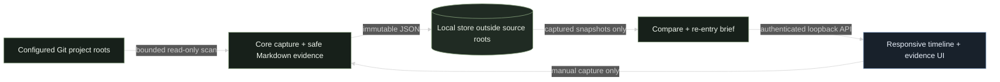

# Alegor MVP

## Overview

Alegor is a local project re-entry companion. It stores manual, immutable checkpoints of selected Git metadata and a bounded set of project-authored Markdown facts. The local UI answers what changed, where to resume, what the project currently says, and which captured lines support each answer. It has no model calls and does not execute project scripts.

## Architecture

`src/alegor/core.mjs` is the zero-runtime-dependency library. It reads Git with bounded commands, selects a small set of safe project documents, creates content-addressed snapshots outside the source roots, and compares only captured evidence. A configured project root must be the repository root; subdirectory scopes currently fail closed. Git history is limited to 40 first-parent commits. `src/alegor/server.mjs` exposes an authenticated loopback API and serves the static interface. The source project is read-only; capture writes only to the configured Alegor store.



Core guarantees and limits are implemented in [core.mjs:66](../../src/alegor/core.mjs#L66), [core.mjs:140](../../src/alegor/core.mjs#L140), [core.mjs:287](../../src/alegor/core.mjs#L287) and [core.mjs:331](../../src/alegor/core.mjs#L331). The web shell and local API are in [server.mjs:12](../../src/alegor/server.mjs#L12), with the timeline, re-entry cards and evidence drawer in [app.mjs:195](../../web/alegor/app.mjs#L195).

## Key Files

- [core.mjs](../../src/alegor/core.mjs) — configuration, document selection, snapshot lifecycle, comparison, evidence extraction.
- [cli.mjs](../../src/alegor/cli.mjs) — capture, list, brief and serve commands.
- [server.mjs](../../src/alegor/server.mjs) — loopback server, token and origin checks, project allowlist.
- [web/alegor](../../web/alegor/) — responsive history and re-entry interface, theme switch, citation drawer.
- [alegor-core.test.mjs](../../tests/alegor-core.test.mjs) and [alegor-server.test.mjs](../../tests/alegor-server.test.mjs) — behavior and security regression tests.
- [projects.example.json](../../examples/alegor/projects.example.json) — explicit local project allowlist.

## API Surface

- `GET /api/projects`
- `GET /api/projects/:id/snapshots`
- `GET /api/projects/:id/brief?current=<snapshot-id>&baseline=<snapshot-id>`
- `POST /api/projects/:id/capture`

The browser receives a random per-process bearer token in its served HTML. API reads require that token. Captures require the expected loopback origin. Host headers are restricted to the local bound address and port.

## Usage Guide

Node.js 22 or newer is recommended. Edit the project list in `examples/alegor/projects.example.json`, then run:

```powershell
node D:/ware/represent/src/alegor/cli.mjs capture D:/ware/represent/examples/alegor/projects.example.json represent #
```

```powershell
node D:/ware/represent/src/alegor/cli.mjs serve D:/ware/represent/examples/alegor/projects.example.json --port 8874 #
```

The default store is `%LOCALAPPDATA%/Represent/alegor` on Windows, `~/Library/Application Support/Represent/alegor` on macOS and `~/.local/share/represent/alegor` elsewhere. `REPRESENT_ALEGOR_STORE` overrides it. The store must remain outside all configured source repositories. Capture is manual; identical project state reuses its prior snapshot.

Open `http://127.0.0.1:8874/`. Choose a checkpoint and optional baseline in the timeline. Open the source drawer to inspect exact captured line citations. If the baseline is outside captured first-parent history, the UI marks the range unavailable instead of presenting zero changes as verified. If a dirty file set exceeds capture limits, the UI calls out incomplete worktree hashing.

## Caveats

The Markdown selector is intentionally conservative and rule-based. It may miss facts written in unusual documents or headings. It ignores hidden, sensitive, generated, dependency, ignored-tracked and historical implementation folders by default. It identifies open checklist lines only under current/active/next/status headings and reports similar checklist wording as a possible disagreement, not a proven conflict. A missing next item remains unknown. Git commit subjects and changed paths describe observed repository activity, not the reason behind a change. The tool stores no conversation transcripts and performs no autonomous actions. Captured citations survive source deletion, but restarting the configured UI still expects repository roots to exist.

## Related Docs

- [Pilot report](../../experiments/alegor-mvp/README.md) — actual project pilots, a disposable real-project clone update, synthetic fixtures and UI evidence.
- [Research and tests](../research/alegor-research-and-tests.md) — repository and Notion research trail, including Skales constraints.
