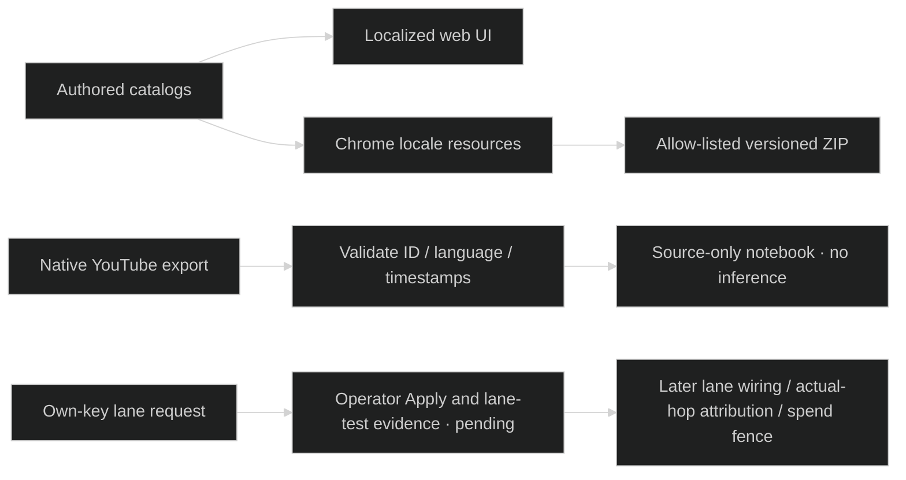

# Clay Notes release preparation

> Updated: 2026-11-15. [Evidence](../../experiments/clay-notes/release-prep/README.md), [complete release plan](../guides/clay-notes-release.md), [own-key gateway request](../design/clay-notes-gateway-request.md).

<!-- CURRENT -->

## Overview

Clay Notes0.2.0 adds ten-language interface copy and a versioned local Chrome package to the existing local MVP. It also has a source-only native browser export adapter, exercised on the three user-provided videos without inference. Gateway onboarding remains at request/review, awaiting operator Apply SHA and lane-test results; it is not finished or live-verified.

## Architecture

The web interface imports a static catalog/runtime from [i18n.mjs](../../src/clay-notes/web/i18n.mjs). English, Spanish, Portuguese, French, German, Italian, Japanese, Simplified Chinese, Arabic and Hindi are selectable with native language labels. Browser regional preferences select a supported language; explicit choice persists locally. `lang`, `dir`, dates, translated labels/placeholders and Arabic logical layout follow the selection. System fonts supply glyphs outside Satoshi's coverage. Captured titles, caption text, personal notes and AI responses never enter the translation lookup. Source text uses appropriate direction handling. Chrome `_locales` follows browser language separately through native `chrome.i18n`; changing the web UI does not change the browser's locale.

The package builder reads an explicit resource allow-list, validates MV3/version/locales/manifest resources and PNGs, rejects symlinks/traversal and excludes unrelated files. Fixed ZIP ordering/timestamps and CRCs make unchanged source reproducible. The source-only importer validates native export ID/language headers, converts bracketed timestamps, strips exporter metadata and persists captions without using a gateway. Existing notebook sources/revisions are preserved on repeated imports.



## Key Files

| File | Role |
|---|---|
| [i18n.mjs](../../src/clay-notes/web/i18n.mjs) | Locale negotiation, authored phrase catalogs, direction and static labels |
| [app.mjs](../../src/clay-notes/web/app.mjs) | Escaped localized authored templates; unmodified user/source content |
| [manifest.json](../../extensions/clay-notes/manifest.json) | MV3 version0.2.0, localized metadata and icon declarations |
| [package builder](../../scripts/clay-notes-package.mjs) | Deterministic ZIP, explicit resources and integrity report |
| [icon generator](../../scripts/clay-notes-icons.mjs) | Original code-native PNGs; no AI image generation |
| [video trial importer](../../scripts/clay-notes-video-trial.mjs) | Native transcript source validation/import, no model request |
| [locale tests](../../tests/clay-notes-i18n.test.mjs) | Regional selection, fallback, catalogs and source boundaries |
| [release tests](../../tests/clay-notes-release.test.mjs) | Caption export and archive behavior |

## API Surface

`resolveLocale(preferences)`, `translate(locale,key,values)`, `direction(locale)` and `localizeStatic(root,locale)` implement authored presentation. Interpolation is literal; HTML-producing callers escape the result. `buildPackage({source,output})` returns archive version/hash/member metadata. `parseBrowserExport(text)` returns validated caption segments with language/ID metadata. `importVideoTrial({url,title,channel,exportPath,store|directory})` returns source counts/hashes/status with zero summary calls. The server change only adds `i18n.mjs` to its static allow-list; no new gateway/key/lane wiring was performed.

## Usage Guide

Start the existing local service, choose a language from the navigation bar, and use the notebook as before. The source-only trial notes used an isolated store at `D:/ware/represent/tmp/clay-localization-store`; default user storage was not overwritten. An existing service at8876 was left untouched; the owned QA service used8880.

Build the release ZIP and integrity report:

```powershell
node D:/ware/represent/scripts/clay-notes-package.mjs #
```

Output: `D:/ware/represent/dist/clay-notes/clay-notes-0.2.0.zip`, with a sibling `package.json` report. The operator can extract the ZIP to a chosen directory and use Chrome's Load unpacked flow, or use the source extension folder directly. No store upload/publication is performed by building. Native locale and manifest messages are packaged; actual Chrome installation/reinjection still needs operator verification.

## Caveats

Translations are authored, not independently native-reviewed. Existing raw service diagnostics and source/model data retain their original language. Generated summaries are not automatically translated by a presentation change; post-Apply output-language preferences require their own tested request contract. The ten offered UI locales do not imply ten tested provider-output languages.

Source-only success through the native browser exporter does not prove installed-extension capture. Last-caption time is not asserted as complete duration. Both Spanish transcripts are automatic and may contain errors; conclusions must eventually be checked against the real source, not inferred from titles. No model summary/quality or actual-hop/cost result exists for these videos yet.

The user now requires an own key and lanes: `LITELLM_KEY_CLAY_NOTES`, `clay-notes-summary` (default confirmed) and optional `clay-notes-deep`. The existing generic-alias configuration is historical local-MVP behavior and has not been represented as compliant new onboarding. No other key is borrowed. No Apply SHA or lane-test is fabricated, and no live paid call is made without separate operator approval. Public Web Store availability also requires privacy/support/listing review and a viable local-companion or authenticated backend distribution decision.

## Related Docs

[Base MVP](clay-notes.md), [full extension release/deployment plan](../guides/clay-notes-release.md), [gateway request and actual operator quote](../design/clay-notes-gateway-request.md), [source/browser/package evidence](../../experiments/clay-notes/release-prep/README.md).
