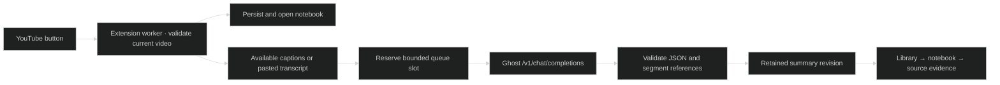

# Clay Notes — local video notebooks

> Updated: 2026-11-15. Local MVP. [Implementation evidence](../../experiments/clay-notes/README.md). Real installed-Chrome caption capture and paid Ghost responses remain unverified.

<!-- CURRENT -->

Clay Notes is a Represent tool for saving a YouTube video and automatically requesting “give me a TLDR list of the main statements and conclusions” from its transcript. It consists of a buildless Node 22+ service, a Keep-like local collection and an unpacked Manifest V3 Chrome extension. A full notebook adds timestamped evidence, a transcript, personal notes, questions and retained summary revisions. There is no NotebookLM dependency.

## Run and connect

Start the local service from any PowerShell 5.1 shell:

```powershell
node D:/ware/represent/src/clay-notes/cli.mjs serve #
```

Open [the local library](http://127.0.0.1:8876). Saving and personal notes work without an AI key. Open **Connect Chrome**, then load `D:/ware/represent/extensions/clay-notes` through Chrome → Extensions → Manage extensions → Developer mode → Load unpacked. Open the extension's settings and paste the library's pairing code. The code is a local service token, not the AI gateway key. The extension action opens the library; its button appears beside video actions on `www.youtube.com/watch` pages and follows YouTube SPA navigation.

Click **✦ Clay Notes** while viewing a video. The notebook is persisted and opened before caption extraction or generation. If already summarized, the existing notebook opens without an automatic new model call. Captions are requested from YouTube's player metadata/timedtext, with a fallback to a visible transcript panel. Missing captions leave a saved notebook with a paste-transcript recovery path. The extension never sends a caption URL to the server for fetching.

## Gateway configuration

Set `CLAY_NOTES_GHOST_KEY` in the launching shell using a consumer key authorized for this tool. Do not paste it into Chrome or source control. This implementation does not read Ghost's `.env`, borrow the operator key, mint keys or broaden allow-lists. Model defaults are `cheap,smart,local`; the initial model is `cheap` when enabled, otherwise the first configured model. Set configuration before starting the same command above.

| Variable | Default | Meaning |
|---|---|---|
| `CLAY_NOTES_GHOST_KEY` | unset | Consumer virtual key, held only by the server |
| `CLAY_NOTES_GHOST_URL` | `http://127.0.0.1:4000/v1` | OpenAI-compatible Ghost gateway; remote endpoints require HTTPS |
| `CLAY_NOTES_MODELS` | `cheap,smart,local` | Comma-separated permitted aliases; the UI intersects these with `/v1/models` |
| `CLAY_NOTES_PORT` | `8876` | Loopback port; set the matching address in extension settings |
| `CLAY_NOTES_STORE` | `%LOCALAPPDATA%/Represent/clay-notes` | Local notebook and pairing storage |

The inspected Ghost consumer registry (2026-11-15) already contains a `represent` consumer with **only `json` and `gemini-flash`**, budget $5/30 days. Its note names Trazo/Visu. Using that existing consumer for Clay Notes requires confirming its scope; if authorized, configure `CLAY_NOTES_MODELS=json,gemini-flash`. This app then uses `json` initially, without requesting `cheap` or silently widening the key. A separate Clay Notes consumer can instead grant the desired aliases. No live consumer/key change was made here. Gateway documentation: [Ghost operator reference](../../../Ghost/docs/reference/ai-gateway.md).

The web model selector offers aliases that the key reports and local configuration permits. **Redo** explicitly creates another summary revision; **Ask** explicitly makes another request. Initial save authorizes the automatic first summary. Aliases can fall back at the gateway, so fast/cheap is an intention, not a latency or price guarantee. Each revision records requested alias, returned model, call ID, duration, usage and cost when reported. Unknown cost stays unknown. There is no automatic retry after a billable failure.

## Store, queue and evidence

Each canonical video ID owns one atomically replaced JSON notebook. Watch, short and live URLs normalize to that ID. Stored data includes title/channel, original URL, transcript source, timestamped segments, immutable summary revisions, Q&A history and personal notes. Each revision retains the segments it cited, so later transcript replacement does not move old citations to new words. The service reopens interrupted jobs as a retryable error on startup.



Transcript input supports YouTube JSON3 events, legacy XML text/p captions, arrays and pasted text with optional timestamps. Limits: 160,000 transcript characters, 8,000 segments, 1 MB HTTP JSON bodies, eight pending notebooks, one queued summary at a time and a 90-second gateway request timeout. Oversize transcripts are rejected explicitly. Entire supported transcripts are sent; long-video map/reduce is not implemented. Queue reservations are atomic across transcript replacement and enqueue, preventing concurrent capture from overwriting a running source.

System prompts distinguish source data from instructions. Summary JSON, finish reason and evidence indices are validated; malformed, truncated or out-of-range outputs cannot replace good content. Valid citation indices establish a link to captured text, not independent fact verification. Model output is rendered as escaped text. A timestamp-less pasted transcript has start 0, so those links cannot give precise source locations.

The server binds only `127.0.0.1`, validates Host/Origin, authenticates the web UI with a SameSite HttpOnly session cookie and the extension with a persistent random local token, and provides no wildcard CORS. The web cookie changes on restart; the extension pairing token remains in `pairing.json`. File storage is local and unencrypted. Pairing is for a single-user machine, with no accounts or cloud synchronization.

## Source map and verification

| File | Role |
|---|---|
| [core.mjs](../../src/clay-notes/core.mjs) | Headless validation, persistence, caption parsing, revisions and gateway adapter |
| [server.mjs](../../src/clay-notes/server.mjs) | Authenticated API, bounded queue and static assets |
| [cli.mjs](../../src/clay-notes/cli.mjs) | Local launcher |
| [app.mjs](../../src/clay-notes/web/app.mjs) | Library, notebook, evidence, notes and questions |
| [style.css](../../src/clay-notes/web/style.css) | Responsive clay surfaces and locally hosted Satoshi |
| [extension worker](../../extensions/clay-notes/background.js) | YouTube capture and local-service bridge |
| [tests](../../tests/clay-notes.test.mjs) | Domain/gateway contract; adjacent server/extension test files cover API and VM worker behavior |

Run only Clay Notes checks:

```powershell
node D:/ware/represent/scripts/clay-notes-test.mjs #
```

Run the existing repository suite too:

```powershell
node D:/ware/represent/scripts/clay-notes-test.mjs --all #
```

Browser evidence uses an isolated offline fixture store, clearly labeled in screenshots and response metadata. It verifies UI flow, source inspection, persistence and selected-model revisions; it does not verify model quality or actual YouTube caption delivery. The [font family](https://www.fontshare.com/fonts/satoshi) is bundled with its [original licence](../../src/clay-notes/web/assets/Satoshi-LICENSE.txt). Art direction adapts the supplied [Recilab clay guide](../../../recilab/docs/reference/clay-style-sites.md), with original SVG shapes and no copied Clay artwork. Satoshi overrides that guide's Montserrat/Inter suggestions.

<!-- IMPROVEMENT -->

Public hosting, Chrome Web Store packaging, cloud sync, bulk imports, non-watch YouTube buttons, audio transcription, very long transcript chunking, a full model catalog and native IDE/mobile shells are outside this local MVP. The headless core and HTTP API are reusable by later shells; this delivery provides CLI/library/web/Chrome surfaces only.
