# Grafe MVP

## Overview

Grafe is a local, zero-AI source explorer for focused code understanding. It indexes a configured JavaScript/TypeScript source scope, gives stable symbol and relationship identities, and presents a selected symbol with source-linked callers, outgoing relationships, candidates, snippets, and scope notes. Refresh is manual; each refresh rebuilds the bounded scope, then reuses an identical content-addressed snapshot on a no-op.

## Architecture

```mermaid
---
config:
  theme: dark
---
flowchart LR
  CLI[CLI and safe project config] --> Core[Bounded source capture]
  Core --> Checker[TypeScript parser and checker]
  Checker --> Scene[Symbols, typed edges, diagnostics]
  Scene --> Store[Immutable local snapshot history]
  Store --> API[Loopback API with token and Origin checks]
  API --> UI[Focused graph, evidence, outline, details]
  classDef dark fill:#18211d,stroke:#68c4a1,color:#e8efeb
  class CLI,Core,Checker,Scene,Store,API,UI dark
  linkStyle default stroke:#91a39a,color:#e8efeb
```



The source capture is the trust boundary. The bounded Git-aware discovery and limits start at [`core.mjs:33`](../../src/grafe/core.mjs#L33); indexing and checker construction start at [`core.mjs:78`](../../src/grafe/core.mjs#L78). The TypeScript host reads captured file text and its own standard library only. It does not execute project code, follow source symlinks, load project configs or references, or read outside the selected scope. TypeChecker identity is used to avoid speculative bare-name links; unresolved/dynamic relationships stay diagnostic or candidate quality. Focused graph neighborhood extraction is exposed at [`core.mjs:196`](../../src/grafe/core.mjs#L196). The authenticated loopback server boundary starts at [`server.mjs:9`](../../src/grafe/server.mjs#L9).

## Key files

- [`core.mjs`](../../src/grafe/core.mjs): Git-aware bounded discovery, compiler host, symbol and edge extraction, stable identities, and focused lookup.
- [`server.mjs`](../../src/grafe/server.mjs): configured-project validation, authenticated loopback API, content-addressed snapshot storage, and static UI delivery.
- [`cli.mjs`](../../src/grafe/cli.mjs): local indexing and server commands.
- [`app.mjs`](../../web/grafe/app.mjs), [`style.css`](../../web/grafe/style.css), [`index.html`](../../web/grafe/index.html): accessible focused navigation UI with graph/evidence views, themes, and history.
- [`grafe-core.test.mjs`](../../tests/grafe-core.test.mjs) and [`grafe-server.test.mjs`](../../tests/grafe-server.test.mjs): source scope, resolution quality, stable identities, path safety, API, and immutable history tests.
- [`real-projects.json`](../../examples/grafe/real-projects.json): local sample project configuration.
- [`experiments/grafe-mvp/README.md`](../../experiments/grafe-mvp/README.md): actual pilot counts, audit approach, UI/UX measurements, caveats, and run instructions.

## API surface

The server exposes authenticated routes for configured projects, current snapshots, manual indexing, snapshot history, and immutable historical snapshots:

- `GET /api/projects`
- `GET /api/projects/:id`
- `POST /api/projects/:id/index`
- `GET /api/projects/:id/history`
- `GET /api/projects/:id/snapshots/:snapshotId`

The API accepts a per-process bearer token injected into the local UI page. Requests must come from the exact bound loopback origin. The listener binds to `127.0.0.1`; project roots can only come from the server config.

## Usage guide

Index a configured project without starting the server:

```powershell
node D:/ware/represent/src/grafe/cli.mjs index D:/ware/plane-sync --output D:/ware/represent/experiments/grafe-mvp/plane-sync-scene.json #
```

Start the sample local explorer:

```powershell
npm ci --prefix D:/ware/represent/src/grafe --ignore-scripts #
node D:/ware/represent/src/grafe/cli.mjs serve --config D:/ware/represent/examples/grafe/real-projects.json --store C:/Users/Administrator/AppData/Local/Represent/grafe-mvp --port 8873 #
```

Open `http://127.0.0.1:8873/`. Choose a configured project, use the search field or Ctrl/Cmd+K to find a symbol, select it, and inspect the focused graph or Evidence view. Use Refresh for a manual rebuild; select a prior timestamp from Snapshot to browse history. The project config must be edited to add or remove allowed roots.

## Caveats

- JavaScript and TypeScript only; no runtime tracing, IDE integration, multi-language parser, or incremental per-file cache.
- Package aliasing, dynamic imports, runtime dispatch, reflection, and code outside the captured source scope may remain unresolved. Candidate matches must not be treated as confirmed calls or test coverage.
- File count/byte bounds may omit parts of large repositories. Inspect scope notes and diagnostics before using a graph as a completeness claim.
- Snapshots are local files under the configured store; moving or deleting that store removes local history.
- The browser UI is intended for a local operator. Do not expose the loopback server through a proxy or public listener.

## Related docs

- [Grafe pilot and UI/UX evidence](../../experiments/grafe-mvp/README.md)
- [Research on Grafe approaches and test projects](../research/grafe-research-and-tests.md)
- [Grafe MVP implementation tracker](../impl/GRAFE-MVP-IMPL.md)
