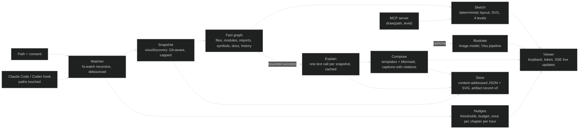
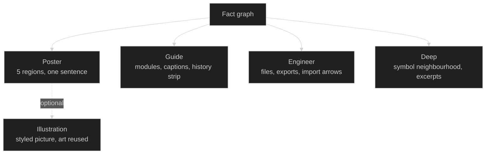

# Trazo: the proactive artist companion, POC design and plan

> Technical design and plan, 2026-10-25, placed in `reference/` at the operator's request as the number-one plan. It describes a system that does not exist yet; when the POC ships, this file is rewritten as-built (DOCS-PROTOCOL Rule 3) and the tracker is [REPRESENT-TRAZO-POC-IMPL](../REPRESENT-TRAZO-POC-IMPL.md). "Trazo" (a pen stroke) is a provisional codename; the operator owns naming. "Dot" below refers to the product whose screenshot was studied in [the OS research](../research/reports/Represent%20OS%20design%20and%20runtime.md); nothing here uses its code or private design.

## The three questions, answered

**Can we have this as a POC?** Yes. A resident process that you point at a folder, that asks before reading it, draws a first sketch in under three seconds with no model call, and then improves the drawing in the background within a budget you set. The parts that carry risk already exist in this repo: bounded Git-aware discovery, six-chapter explanation through Ghost, TypeScript symbol edges, Git history capture, HTML and SVG composition. What is new is the resident loop, the deterministic sketch, the level dial, the templated infographic and the proactive nudges. Four weeks of focused work reaches a POC that really works on four real folders.

**What would I do?** Build the zero-AI sketch first and make it something you would keep open even if the AI never ran. Then add one cheap text explanation per snapshot and compose infographics from it with templates, never with raster lettering. Only then add the optional illustration. Measure three things: time to first drawing, cost per useful redraw, and whether the operator keeps the window open for a week. Those three numbers decide feasibility, not test counts.

**Can it become a product or service?** Yes, as open core. The CLI, the sketch engine, the viewer and the artifact format are open (Apache-2.0). The service sells what a single machine cannot do alone: shareable live links and embeds, team galleries, a managed art budget with the gateway already built in Ghost, an "illustrated README" GitHub App, and later a hosted companion that follows several repositories. The POC de-risks the product question that matters most: whether a proactive artist is wanted daily, by developers first and by anyone with a folder of work second. It does not prove demand; the public repository is how demand gets measured.

## What Trazo is

A small program you run in a folder. It asks for access to that path, then draws it: at first a minimal structural sketch, then, as you work, richer and more specific pictures of what the folder is and what is changing in it. It keeps a quiet window open beside your editor or terminal. It notices changes and offers to redraw the part that moved. A dial sets the technical level from poster (five boxes and a sentence) to engineer (modules, symbols, edges and file paths). It is for developers first because code has the richest structure to draw, and for anyone else second because a thesis, a design project or a campaign folder also has parts, relationships and history.

It sits over a path the way a Claude Code or Codex session does: one process, one working directory, explicit consent, a transcript of what it read and what it spent. It can also be told by those agents what they are touching, through a hook, so the drawing follows the work.

### The experience, as a script

1. `npx trazo` in `D:/ware/plane-sync`. Trazo prints what it will read (Git-tracked text, size caps, ignore rules), what it will never read (`.env`, secrets, binaries, ignored paths) and asks for consent for this path. Consent is stored per path.
2. Under three seconds later the viewer opens at `127.0.0.1:8875` with the **sketch**: a treemap of the folder by file weight, the top-level module boxes, import arrows between them, the last ten commits as a strip, and a one-line label per box taken from a README heading or the folder name. No model has run. The window is small, dark or light following the OS, and stays on top only if you ask.
3. The dial sits at **guide**. Dragging it to **poster** collapses the sketch to five labelled regions; **engineer** expands boxes into files and exported symbols; **deep** shows the Grafe neighborhood of the selected symbol. Every position is instant and local.
4. A banner says "I can explain this folder for about $0.02. Explain once, or let me redraw up to $0.50 today?" You choose. Trazo sends a bounded excerpt set (the same discovery Visu uses), gets back chapters, responsibilities, relationships and uncertainty with citations, and composes the **infographic**: the sketch re-laid-out as chapters with short captions, each caption clickable to the cited lines.
5. You edit `src/sync.ts`. Within ten seconds a small dot pulses on the "Sync" box: "sync changed 42 lines; redraw this chapter? ($0.01)". Ignore it, and it fades. Accept, and only that chapter is re-explained; the rest is cached.
6. Optionally, "illustrate" turns the poster level into a styled picture through the image model, the way Visu does today, with the project's own detected style. The picture is an extra layer; the sketch and infographic stay underneath and remain the source of truth.
7. Close the window; the process keeps watching with zero spend. Reopen tomorrow and the history strip shows yesterday's sketch beside today's.

## What the POC must prove

| Unknown | Measure | Pass |
|---|---|---|
| A zero-AI sketch is worth keeping open | Time to first drawing; the operator's own week of use | Under 3 s on a 2000-file scope; the window stays open on four of five working days |
| Cheap explanation plus templates beats raster art for daily use | Cost per snapshot explanation; cost per chapter redraw; correctness rating | Under $0.05 and $0.02; the operator rates at least 8 of 10 statements per folder as true |
| Proactivity helps without nagging | Nudge acceptance rate; dismissals | At least 1 in 4 nudges accepted; no complaint of noise after the second day |
| The level dial is meaningful | Facts shown per level; redraw latency | Four distinct levels from one fact graph; dial moves under 100 ms with no model call |
| It works beyond code | A documents folder trial | A thesis or docs folder gets a sketch and an explanation that the operator calls recognizable |

## Experience design

**Presence.** One window, three regions: the drawing, a one-line status strip (what I read, what I spent today, what changed since you looked), and the dial. No chat box in the POC. A conversation surface is what the Alegor companion design is for, later.

**Consent and transparency.** Per-path consent, revocable from the window. A "what I will send" preview before the first model call shows the exact excerpts. A ledger of every model call with cost. Offline mode is the default state, not a degraded one.

**Levels.** Four, fixed in the POC: poster, guide, engineer, deep. A level selects facts from one fact graph and a template; it never triggers a model call. Captions at poster and guide come from the explanation; captions at engineer and deep come from the code itself.

**Proactivity rules.** A nudge appears only for a change above a threshold (lines changed, files touched, a new top-level folder, a new dependency), at most once per chapter per hour, and never spends without a click unless a daily budget is set. Nudges are suggestions with a price on them.

**Non-code folders.** The sketch engine treats Markdown headings, document titles and folder names as structure, and file dates as history. The explanation prompt is the same, with a different vocabulary ("sections" instead of "modules"). This is one adapter, not a second product.

## Architecture



**Watcher.** Node 22 `fs.watch` with `recursive: true` (Windows, macOS, and Linux from Node 20) debounced at 500 ms, filtered by the same ignore rules as discovery. No native dependency. Fallback polling at 5 s where recursive watch is unavailable.

**Snapshot.** Visu's `discovery.mjs` as is: Git `ls-files` for scope, ignore-aware, size and count caps, style and identity hints. For a non-Git folder, a plain walk with the same caps.

**Fact graph.** One JSON document per snapshot: nodes (folder, file, module, symbol, document, section, commit) and edges (contains, imports, calls, cites, touched-by). Builders: folder and file nodes from the snapshot; import edges from a cheap regex scanner for JS, TS, Python, C#, Go and Rust (imports only, no types); symbol nodes and typed edges from Grafe's core when the scope is JS or TS; document and section nodes from Markdown headings; commit nodes from Alegor's bounded Git read. Each node carries a `level` floor so the dial can filter without recomputation.

**Sketch.** A deterministic layout engine with three layouts: treemap (folders by weight), layered boxes with import arrows (modules), and a history strip (commits). Output is SVG built from a small set of primitives, so it renders identically in the viewer, in an exported file and inside an Orkest page. Layout is stable across snapshots: nodes keep positions by identity so the picture does not jump when one file changes.

**Explain.** One text call per snapshot, reusing Visu's `analysis.mjs` prompt shape: chapters, current state, intended design, next steps, uncertainty, each with citations validated against the excerpts sent. Cached by the hash of the excerpt set, the prompt version and the model. A chapter redraw sends only that chapter's excerpts.

**Compose.** Infographic templates as SVG fragments with slots: title, chapter boxes with captions, relationship arrows, a legend, a freshness line. Diagrams that are better expressed as graphs are emitted as Mermaid text and rendered client-side; Mermaid text is also what an agent can read and edit. Nothing precise goes into raster; the [Visu guide](../guides/visu-experience.md) lesson stands.

**Illustrate.** Visu's `ghost.mjs` and image path, unchanged: style detection, prompt from the poster level, measured cost, art reused across cheap updates.

**Viewer.** A static page served by the same process on loopback with a per-process token and exact-Origin check, like the three existing tools. Live updates by Server-Sent Events. The dial, theme and history are local. A "stay on top" option is deferred to a Tauri shell after the POC; the POC uses a normal browser window.

**Agent hooks.** A Claude Code `PostToolUse` hook and a Codex hook post the paths an agent edited to the local process, so nudges can say "your agent changed the sync module". An MCP server exposes `draw(path, level)` and `explain(path)` so an agent can ask for a picture and receive SVG or Mermaid text. Both are thin and optional.

**Store.** Content-addressed JSON and SVG under `%LOCALAPPDATA%/Represent/trazo/` by default, outside project roots, following Grafe and Alegor. Every explained snapshot also writes a `represent.artifact/v0` record, so the Orkest design's seam is honoured from day one.

## Stack decision

| Concern | Choice | Alternatives considered | Why |
|---|---|---|---|
| Language and runtime | TypeScript on Node 22, ESM, no bundler for the CLI | Rust (Tauri core), Python, Go | Same stack as the three tools; zero-dependency discipline keeps supply-chain surface tiny; one language for CLI, server and viewer. |
| Dependencies | None at runtime for the core; `typescript` only when Grafe's symbol builder is used; `@modelcontextprotocol/sdk` only for the optional MCP server | chokidar, express, ws | `fs.watch` recursive, `http` and SSE cover the needs. |
| Diagrams | Hand-built SVG primitives for sketch and infographic; Mermaid text for graph-shaped views, rendered client-side from cdnjs | elkjs, dagre, D3 | Deterministic, inspectable, agent-readable text; elkjs is heavy and dagre unmaintained; D3 earns its weight only for interactive canvases, which are post-POC. |
| Illustration | Ghost AI gateway (LiteLLM) with the measured image route; provider adapter with an OpenAI-compatible endpoint, Anthropic and Ollama for the open release | Direct provider SDKs in the tool | Budget, attribution and caching exist in Ghost; the open release needs bring-your-own-key without copying that into every tool. |
| Viewer | Vanilla HTML, CSS and ES modules; SSE | Nuxt, React, Electron | The existing tools proved it; a framework buys nothing at this size and costs the zero-dependency rule. |
| Desktop presence | Browser window in the POC; Tauri shell after | Electron | Tauri is small and uses the same web viewer; not needed to test feasibility. |
| Editor presence | VS Code webview after the POC, over the same local API | JetBrains first | VS Code is where the operator and most targets work. |
| Store | Content-addressed JSON and SVG files | SQLite, Postgres | Immutable snapshots are already the house pattern; no queries beyond listing. |
| Licence | Apache-2.0 for the open core | MIT, AGPL | Patent grant matters for a product; AGPL would deter the embedding the product needs. |
| Tests | `node --test`, browser checks with Playwright in CI | vitest | Same as today; CI must run without any key. |

## Data model

```json
{
  "schema": "trazo.facts/v0",
  "snapshot": { "id": "sha256:...", "root": "D:/ware/plane-sync", "sha": "7f3a...", "capturedAt": "..." },
  "nodes": [
    { "id": "mod:src/sync", "kind": "module", "label": "Sync", "weight": 1840, "level": 0, "path": "src/sync" },
    { "id": "sym:src/sync.ts#syncIssues", "kind": "symbol", "label": "syncIssues", "level": 2, "span": [120, 164] },
    { "id": "doc:README.md#Setup", "kind": "section", "label": "Setup", "level": 1 },
    { "id": "commit:9c01", "kind": "commit", "label": "fix stale issue", "level": 1, "at": "..." }
  ],
  "edges": [
    { "from": "mod:src/sync", "to": "mod:src/plane", "kind": "imports", "level": 1 },
    { "from": "sym:...#syncIssues", "to": "sym:...#renameBox", "kind": "calls", "level": 3 },
    { "from": "commit:9c01", "to": "mod:src/sync", "kind": "touches", "level": 1 }
  ],
  "explanation": { "id": "sha256:...", "chapters": [ { "node": "mod:src/sync", "caption": "...", "cites": [ { "path": "src/sync.ts", "lines": [120, 164], "hash": "..." } ], "confidence": "medium" } ], "model": "...", "cost": 0.021 }
}
```

Levels: 0 poster, 1 guide, 2 engineer, 3 deep. A node or edge at level n appears at every level at or above n. The explanation attaches to nodes, so a chapter redraw replaces one caption set. The artifact record v0 wraps a snapshot plus explanation and points at the SVG.

## Reuse before building

| Existing | Used for | Change needed |
|---|---|---|
| `src/visu/discovery.mjs` | Scope, caps, ignore rules, style hints | None; called as a library |
| `src/visu/analysis.mjs` | Explanation prompt, citation validation, chapter matching | Parameterize vocabulary for non-code folders |
| `src/visu/ghost.mjs` | Gateway client, image validation | Add the provider adapter behind the same interface |
| `src/grafe/core.mjs` | Symbol nodes and typed edges for JS and TS | Expose a function that returns nodes and edges for a file list |
| `src/alegor/core.mjs` | Bounded Git history | Expose the commit reader |
| `experiments/represent-os-concept/` | Proof that SVG and HTML composition with exact labels works | Templates are redrawn, not copied |
| `experiments/rompe/`, `experiments/visu-discovery/` | Art and screenshots as the quality bar | None |
| `web/visu` server pattern | Loopback, token, Origin, static UI | Reused as a module, not copied |

## Security and privacy

- Consent per path, stored in the Trazo store, shown in the window, revocable.
- Reads are bounded by discovery; secrets, binaries, dependencies and ignored paths are never read. The hook receives paths only, never content.
- Nothing leaves the machine except the excerpt set for an explanation and the poster prompt for an illustration, both previewable before the first call and logged with cost.
- Loopback only, token and Origin checks, project roots from the consent list. The MCP server is stdio, not a network listener.
- No telemetry in the open core. A service would make every upload explicit.

## POC scope

**In:** CLI, consent, watcher, snapshot, fact graph for code (JS, TS, Python, C#, Go, Rust imports; JS and TS symbols) and for Markdown folders, sketch with three layouts and four levels, explanation through Ghost, templated infographic with citations, chapter redraw, nudges with budget, viewer with SSE, history strip, artifact record export, Claude Code hook, MCP `draw`, tests, four real-folder trials, one ROMPE illustration pass using existing art.

**Out:** chat, agent dispatch, cloud sharing, accounts, Tauri or VS Code shells, runtime tracing, incremental symbol indexing, languages beyond import scanning, any Orkest or Ghost code.

## Plan: four weeks

| Week | Milestone | Acceptance |
|---|---|---|
| 1 | **Sketch** | `trazo` on Represent, Plane Sync, luz and a docs folder draws the treemap, modules and history under 3 s with zero model calls; dial moves between four levels under 100 ms; consent and ledger shown; 20 tests. |
| 2 | **Explain and compose** | One explanation per folder under $0.05 through Ghost; infographic with chapter captions and clickable citations; cache hit on an unchanged folder costs $0; operator rates 8 of 10 statements true per folder; artifact record written. |
| 3 | **Live and proactive** | Watcher and hook feed nudges; a chapter redraw costs under $0.02; nudges obey thresholds, hourly cap and daily budget; SSE updates the window without reload; MCP `draw` returns SVG to a Claude Code session. |
| 4 | **Polish, trials, decision** | One design UX round against the Visu screenshots and one live round; five working days of the operator keeping it open with the ledger as evidence; one ROMPE illustration pass with existing art; README, demo recording, Apache-2.0, public repository; feasibility verdict written against the table above. |

Each week ends with a `qa-pass`, a LOGBOOK entry and a decision to continue, and the tracker's phases mirror the weeks.

## Product and service path

**Open core (free, public GitHub).** CLI, sketch engine, fact graph, viewer, templates, artifact format, hooks, MCP server. Bring your own key for explanation and illustration. The repository is the demand instrument: stars mean nothing, but issues that say "it drew my folder wrong" mean a user.

**Service (paid, later).**
- Live share links and embeds: a drawing that stays current as the repository changes, hosted, with an access list.
- Team gallery: every project's current picture on one wall; the Orkest project grid is the internal version.
- Managed art budget: no key handling, per-seat allowance, Ghost's gateway as the metering layer already built.
- Illustrated README GitHub App: on push, refresh the repository's poster and social preview.
- Companion plan: the Alegor conversation surface following several repositories, built on the same facts and artifacts.

**Who pays first.** Solo developers and small teams who present their work (open-source maintainers, agencies, consultancies), then teams onboarding people, then anyone with a folder of structured work. The non-developer audience is a hypothesis to test after the developer POC, not a launch target.

**What stays honest.** No market validation exists today. Pricing, conversion and retention are unknown. The POC's week-of-use measure is the first signal, and the public repository is the second. Trademark and name clearance are open, as for the whole Represent line.

## Relationship to the rest of Represent and to Orkest

Trazo is the resident, proactive form of the same facts Visu, Grafe and Alegor already produce. It consumes their cores as libraries and writes the artifact record the [Orkest design](../research/reports/Represent%20within%20Orkest%20platform%20design.md) defines, so REPRESENT-ORKEST Phase 1 is partly delivered by this POC and the hub can index Trazo's store later. The Orkest tracker waits behind this POC by the operator's decision of 2026-10-25; nothing in it is discarded. Visu's experience stays the quality bar for anything illustrated, and Visu's own code stays paused except for the library seams named above.

## Risks

- **The sketch is dull.** Mitigation: week 1 ends with the operator's verdict, before any model call is written; if the sketch is not wanted, the POC stops cheaply.
- **Explanations are wrong in ways the picture hides.** Mitigation: captions always carry citations; confidence is drawn (dashed boxes); the Luz stale-document lesson becomes a conflict marker.
- **Proactivity annoys.** Mitigation: thresholds, hourly cap per chapter, daily budget, and a one-click "quiet for today".
- **Recursive watch on large trees.** Mitigation: the same caps as discovery; polling fallback; the watcher ignores what discovery ignores.
- **Scope creep toward Dot.** Mitigation: no chat, no execution, no accounts in the POC; those belong to Orkest and to the Alegor companion design.

## System Intent

A resident companion that draws the folder you are working in, immediately and for free, then explains and illustrates it on request within a budget, at a technical level you choose. Developers first; any structured folder second. Scale: one machine, one folder at a time, up to 2000 captured files.

## Ingestion Vector

```text
<consented path>/
|-- .git/                        # @LLM-TARGET: scope via ls-files, HEAD, bounded history
|-- README.md, docs/**/*.md       # @LLM-TARGET: sections, labels, explanation excerpts
|-- src/**, lib/**, app/**        # @LLM-TARGET: modules, imports, JS/TS symbols
|-- package.json, *.csproj, go.mod, pyproject.toml, Cargo.toml  # @LLM-TARGET: language and dependency hints
|-- node_modules/, dist/, build/, vendor/, *.lock  # @LLM-IGNORE: dependencies and output
`-- .env*, secrets/, *.pem, *.key  # @LLM-IGNORE: never read, never watched
%LOCALAPPDATA%/Represent/trazo/
|-- consent.json                 # @LLM-TARGET: consented paths and budgets
`-- <project>/<snapshot>/        # @LLM-TARGET: facts.json, explanation.json, sketch-<level>.svg, artifact.json, ledger.json
```

## Visualization Spec

Three drawings from one fact graph: a treemap of weight, layered module boxes with import arrows, and a history strip; the infographic re-lays the module view as captioned chapters with citations; the optional illustration is Visu's styled picture over the poster level. Four levels, stable positions, light and dark and high-contrast, keyboard reachable. Precise text never in raster.



## Bootstrapping Steps

1. Operator confirms the codename or renames, the licence, and the four trial folders.
2. Week 1 sketch; stop-or-go verdict on the zero-AI drawing.
3. Week 2 explain and compose; cost and correctness measured.
4. Week 3 live and proactive; nudge acceptance measured.
5. Week 4 polish, trials, public repository, feasibility verdict; then decide whether the service path starts and whether REPRESENT-ORKEST resumes.
