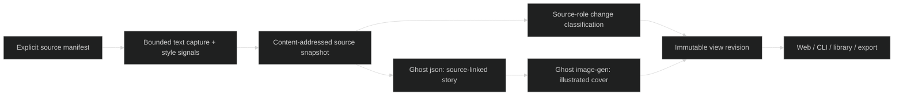

# Visu MVP

> **Historical curated workflow, superseded for default configurations on 2026-10-21.** See [automatic discovery and manual snapshots](visu-discovery.md) for the current root-only workflow, text-model choice and UI themes. Explicit manifests and saved history described below remain compatible.

## Overview

Visu is Represent's local illustrated project overview. It captures a bounded set of files, infers one of three visual directions, prepares a source-linked story through Ghost, and generates an illustrated cover. The web view adds keyboard/touch/hover detail, captured source excerpts, optional checklist counts, snapshot history, separate portrait revisions and JSON export. It is a working narrow MVP; it does not discover arbitrary project architecture or animate semantic art layers.

The initial projects are ROMPE and Luz y Luna. [Pilot measurements](../../experiments/visu-pilot/measurements.json) contain actual costs, failures and update timings. [Visual trial notes](../../experiments/visu-pilot/README.md) explain the discarded images and refinements.

## Architecture



The Node 22 ESM core uses standard-library APIs; no runtime package installation is required. Capture never executes source-project code. Paths must be explicitly listed, remain under the configured root, avoid symlinks/junctions and known secret filenames, and contain bounded text. Limits are 40 files, 300 KB per input file and 600 KB selected text. A selected line range is hashed as captured evidence; changes outside that range are intentionally outside this view's scope. A manifest is an operator-authored configuration, not generated repository data.

Source identity includes selected paths, roles, ranges and content hashes; it excludes timestamps, absolute root and Git revision. Git HEAD is capture metadata, not proof that the working tree was clean. Source text is preserved in the immutable snapshot. Source capture and image creation dates are distinct. Returning to old content reuses its content identity; events record the later transition. This is content history, not a claim to record every filesystem save.

Three source roles govern updates:

| Role | Included in story evidence | Invalidates art | Meaning |
|---|---|---|---|
| `art` | Yes, bounded numbered excerpts | Yes | Depicted concepts |
| `style` | Used by deterministic detector | Yes | Style context/tokens |
| `detail` | Kept in saved view/source panel only | No | Metadata or checklist details deliberately excluded from raster claims |

The manifest selects at most six chapters, source mappings and approximate normalized positions. It can provide editorial summaries and visual motifs. Ghost's `json` alias rewrites summaries from current selected evidence. Its structured output chooses numbered excerpts from that chapter's source paths. Validation confirms IDs, bounds and captured text provenance; it **does not prove that the summary is logically entailed by the citation**. The UI labels this as interpretation. Generation uses the validated story or explicit illustrative motifs, not raw long documents. Broad automatic chapter selection and general asset/style analysis remain outside this MVP.

Snapshots, views, story cache and the attempt ledger are stored in `.represent/visu/<project>/state.json`, with images addressed by SHA-256 in `.represent/visu/assets/`. Writes are atomic per file and serialized by a per-project lock. `state.json` is authoritative; `scene.yaml` and `events.jsonl` are derived exports. The event list only grows logically; its JSONL projection is rewritten atomically. This is not a multi-file transactional database. On interruption, a pending attempt remains charged against the attempt limit; remove a stale lock only after verifying its recorded process is no longer running.

`scene.yaml` is JSON syntax, which is valid YAML 1.2. It carries `represent.scene/v0`, `view`, `scope`, one `Workspace` node and the Visu view under node annotations. This matches the inspected envelope in GhostDev's `Model.cs:7`; compatibility with every methrep consumer has not been tested. Visu does not yet import and render arbitrary methrep scenes.

## Key Files

| File | Responsibility |
|---|---|
| [core.mjs](../../src/visu/core.mjs) | Capture, style, snapshots, views, cache, limits, export; `src/visu/core.mjs:1` |
| [ghost.mjs](../../src/visu/ghost.mjs) | Ghost JSON/image requests, reference validation, PNG validation, usage |
| [server.mjs](../../src/visu/server.mjs) | Loopback API, session authentication and web assets |
| [cli.mjs](../../src/visu/cli.mjs) | CLI/configuration over the same core |
| [web/visu](../../web/visu/index.html) | Browser surface with progressive disclosure |
| [ROMPE manifest](../../examples/visu/rompe.json), [Luz manifest](../../examples/visu/luz.json) | Explicit scope, chapters and illustrative motifs |
| [Regression tests](../../tests/visu.test.mjs) | History, scope, cache, failure, budget, API and provenance behavior |
| [Copy-based pilot](../../scripts/visu-pilot.mjs), [browser checks](../../scripts/visu-browser-check.mjs) | Reproducible measurements and UI evidence |

## API Surface / Code Examples

`Visu` exposes `scan(id)`, `style(id, profile)`, `generate(id)`, `bundle(id)`, `export(id)` and `list()`. `capture()` and `detectStyle()` can be used independently. The server uses exactly this library.

| HTTP route | Behavior |
|---|---|
| `GET /api/projects` | Configured projects |
| `GET /api/projects/:id` | Saved snapshots/views, style evidence and usage ledger |
| `POST /api/projects/:id/scan` | Capture and classify; no AI |
| `POST /api/projects/:id/style` | `{ "profile": "auto" | "retro" | "editorial" | "neutral" }` |
| `POST /api/projects/:id/generate` | Cached reuse, or explicit Ghost story/image calls |
| `GET /api/projects/:id/export` | Historical source, events, views and embedded image data |
| `GET /api/assets/:hash` | Authenticated local image |

API reads and writes require the server's per-launch bearer token injected into its same-origin page. Host/Origin checks and loopback binding reject ordinary cross-origin and network access. This is a local process boundary, not multi-user authentication or a production hosted service. Exports contain potentially private source; export is an explicit user action.

## Usage Guide

Start locally, with Node 22+, without AI configuration:

```powershell
node D:/ware/represent/src/visu/cli.mjs serve #
```

Or use the existing authorized Ghost operator virtual key from a selected environment file. The script reads that assignment only and never prints it:

```powershell
powershell -NoProfile -File D:/ware/represent/scripts/start-visu.ps1 -GhostEnvPath D:/ware/Ghost/infrastructure/docker/.env #
```

Open `http://127.0.0.1:8871`. Choose a project, scan, inspect its detected style, then create the overview. Re-scan after source changes. A stale illustration remains visible with its source identity until explicitly regenerated. The checklist layer counts only checkboxes in captured detail excerpts; it is not a whole-project completion estimate. History keeps source snapshots and multiple art/view revisions separate.

```powershell
node D:/ware/represent/src/visu/cli.mjs scan rompe #
```

```powershell
npm --prefix D:/ware/represent test #
```

```powershell
npm --prefix D:/ware/represent run pilot #
```

The pilot requires saved real art and creates disposable copies under ignored `.represent/`; it never edits the configured source roots. Browser checks require Playwright supplied through `VISU_PLAYWRIGHT_PATH` or installed in the environment. Tests themselves use standard Node.

Configuration: `VISU_MANIFEST_DIR`, `VISU_STORE`, `VISU_PORT`, `VISU_GHOST_KEY` (or `LITELLM_KEY_OPERATOR`), `VISU_GHOST_URL`, `VISU_IMAGE_MODEL`, `VISU_MAX_IMAGE_CALLS`, `VISU_MAX_COST_USD`. Defaults are loopback port 8871, Ghost port 4000, `image-gen`, three image attempts and three story attempts per project's stored lifetime, and a $1 measured-spend stop threshold. The pilot has consumed some/all of these attempts; raising an attempt limit is an explicit environment setting. Cached reuse remains available after a limit. Missing/failed response cost is unknown, and a new call can exceed the remaining dollar threshold; it is **not a guaranteed spending ceiling**. No automatic retry or provider fallback is added by Visu.

To add a project, copy a manifest into a configured manifest directory, set its absolute root and explicit source paths, and select chapters. Choose `detail` only for evidence that is deliberately absent from the illustration. Restart the server to reload manifests. No watcher is implied.

## Caveats

- Two tested style families are evidence of this pilot, not a general style classifier. ROMPE detection is textual/contextual; Luz detection reads actual tokens and typography. No owned-image analysis is implemented.
- Raster text and imagery can be wrong despite valid citations. Inspect generated artwork. The final pilot deliberately limits text, and earlier bad versions remain visible as history.
- Chapter mappings and optional visual motifs are curated. Numbered markers are approximate navigation, not detected object boundaries. Six-chapter layout is the only supported composition recipe.
- Detail-only changes reuse art because the manifest explicitly separates them. Other changes invalidate conservatively; there is no semantic proof that a wording-only change needs a new picture, and no pixel-level editing.
- Any changed art dependency currently reruns the bounded story stage; unchanged and detail-only changes do not. Finer per-chapter synthesis and independent style/story cache keys are future optimization.
- Token/response/call/cost metrics are observations for this gateway, not universal pricing. Costs include failed accepted requests.
- The core uses local files, no sync, retention policy or encrypted archive. Preserve `.represent/` if history matters; it is intentionally ignored by Git. Exported bundles include the evidence and images without requiring the original checkout.
- Grafe and Alegor remain research/design tracks. Full source navigation, session correlation and animated semantic scenes are not implied by this implementation.

## Related Docs

[Living product design](../research/reports/Represent%20living%20project%20views.md), [Grafe research](../research/grafe-mvp-research.md), [Alegor research](../research/alegor-mvp-research.md), [pilot evidence](../../experiments/visu-pilot/README.md).
