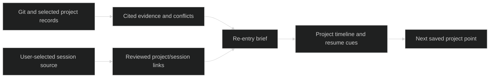

# Alegor — Research and Test History

> Research record updated 2026-10-21. This document separates user-originated needs, repository/document study, experiments, and the current parallel MVP work. It is not market validation. The product itself is not a mascot: Alegor is the optional project companion that helps people recognize, understand, and resume their work.

**Skales result:** I cloned the user-linked repository at `7560a4133a816305797546eac0efe67b707b85dd` and inspected its README, license and bundled user-guide documentation. The current repository explicitly says the product is proprietary and its source is not available; I did not install or run the app, inspect binaries, or attempt to recover internal code. The prior session-correlator test result remains **25/25** after an isolated Windows path fix, but that validates one context suite only, not the current Alegor MVP. See the test genealogy below.

## System Intent

Alegor has two connected jobs. First, reduce confusion between many simultaneous coding-assistant conversations by making each session easier to recognize and return to. Second, preserve a project-centered account of what changed, what is currently declared, what was decided, and what remains uncertain. It should help answer “where did I leave off?” with evidence a person can inspect.

The current MVP begins with deterministic, local Git and selected project-document evidence. It must be useful while Visu is paused and without any session connector. Session identity, user-selected transcript sources, and saved Grafe/Visu views can enrich the project history later. The product should show observed repository facts separately from declared documentation and inferred session links. A timeline alone does not prove cause or intent.

The longer-range role is a privacy-aware, user-customizable companion that can sit beside the developer's existing tools, group work around projects, and offer quick re-entry cues. It is not an autonomous agent runner. Broad computer-use, email, browser, scheduling, and “do anything” permissions would expand scope beyond the user pain and create trust costs before the narrower history workflow is proven.

## Ingestion Vector

The selected MVP inputs are a local project root, Git history and working-tree identity, and a small explicit set of status/decision files. A session connector is opt-in, selected by the user, previewed before reading, and bounded to a chosen source. The exploratory Notion notes are original product evidence, not operational session transcripts; they remain outside the runtime ingestion scope.

```text
project-root/
├── .git/                              # @LLM-TARGET: commits, branch, changed paths; observed evidence
├── README.md                          # @LLM-ENTRY: project purpose and vocabulary
├── docs/CONTEXT.md                    # @LLM-TARGET: declared status/decisions with line citations
├── docs/TODO.md                       # @LLM-TARGET: declared active/completed tasks; compare, do not silently reconcile
├── .represent/                        # @LLM-TARGET: optional shared project snapshots and view references
│   ├── snapshots/                     # @LLM-TARGET: source revision and evidence manifest, if present
│   └── views/                         # @LLM-TARGET: Visu/Grafe revisions, if present
├── [user-selected session roots]/     # @LLM-OPT-IN: preview connector, files, parser coverage and exclusions
├── node_modules/                      # @LLM-IGNORE: dependency content
└── build output/                      # @LLM-IGNORE: generated files unless explicitly chosen as evidence
```

Preserve provenance and claim type: `observed`, `declared`, `inferred`, `user-corrected`, or `unknown`. Keep the source URI/hash, parser version, timestamp, repo/worktree/branch identity and evidence reference when the connector supports them. File overlap and time proximity may produce a candidate session link, but must not be presented as proof that a session caused a commit. Weak correlations stay unlinked.

### What was considered and why

| Candidate | What it contributes to Alegor | Evidence actually gathered | Decision and limits |
|---|---|---|---|
| `nicknisi/sessions` | Cross-agent transcript search, project-scoped context, candidate commit/file-to-session links and read-oriented agent access | A pinned checkout and Windows context-suite trial are described in the [earlier Alegor research brief](alegor-mvp-research.md) and retained under `experiments/alegor-restart/`. At revision `9293eb6a8ed7a92c27c9c531061bd20e5b8bd1cb`, initial context tests reported 8 pass and 14 fail because Windows separators were not normalized in fixture paths. An isolated fixture correction exposed the same assumption in the scanner. A local two-line experimental normalization then yielded 25/25 in that context suite. | Strong adjacent implementation pattern for search and correlation; not proof of causality or user demand. The patch was not upstreamed. This was one context suite, not the complete project test suite. Actual Claude Code on-disk folder naming was not verified against a user-selected real session source. No personal sessions were read. |
| `DnaMes/lore` | Local archive, exports, multi-agent transcript adapters and a shared-memory direction | Pinned source inspection at `db5cabdf80ce7d48e91630b043b1c218aa333a84`, recorded in [Alegor MVP research](alegor-mvp-research.md). | Useful connector/ecosystem checklist. Several adapters are described as fixture-only or unverified, so the adapter list was treated as a test backlog, not working compatibility. No application or test suite was run. |
| `dannymaaz/memory-mcp` | Durable project context, provenance and bounded retrieval for agents | README-level study recorded in [Alegor MVP research](alegor-mvp-research.md). | Informs later read-only retrieval and provenance patterns. The then-current README said public package release was pending. This does not by itself solve session recognition or establish demand. No checkout/test was recorded in the prior brief. |
| `skalesapp/skales` | A broad personal assistant/code tool whose documented UI includes session history, project grouping, visual customization, resumable work and multi-step task traces | **This was missed by the earlier research**, despite the user's Notion `PET` note linking it directly. I cloned and inspected the current public repository documentation; see [the bounded check record](../../experiments/alegor-reference-checks/skales-inspection.json). | Good interaction reference, not a source-code reuse candidate. At current HEAD the repository says Skales is proprietary, its source is not supplied, and its prior source snapshot was removed. I read public README/user-guide content only; did not install, execute, inspect binaries or attempt to infer internals. No Alegor code is copied. |
| User's Notion export | First-person needs and early product concepts | Read the original Markdown pages listed in [Notion traceability](#notion-traceability); visually inspected the attached images needed to identify their subject. | Direct evidence of this user's goals and language, not broad-market evidence. The notes contain mixed concepts from more than one Represent track and should not all become Alegor scope. |

These choices distinguish neighboring categories. `sessions` and `lore` focus on transcripts and agent memory; Skales documents a much wider assistant and coding environment. Alegor's hypothesis is a **project-centered history and re-entry layer** that can connect repository evidence, decisions, optional sessions, and eventually the other Represent views without replacing those tools. That distinction still needs task-based validation.

## Visualization Spec

The restart prototype is a static, source-cited vertical commit timeline with a project-state card, a conflict card, and a clearly labelled synthetic candidate session. It includes JSON and Markdown records plus a bundled line-numbered evidence view. It showed a concrete discrepancy: CONTEXT's Current Sprint still called Visu discovery a next proof while TODO recorded that work as complete. The prototype displayed both declarations rather than silently selecting a winner.

For the MVP, favor a quiet project archive with a clear re-entry card and a compact timeline. Useful controls should be visible without reading a transcript: project/session title, recognizable icon or accent, branch/worktree, last activity, current task, and a short changed-files cue. Clicking a session should reveal why Alegor associated it with a project and let the user correct or remove that association. Details can expand to citations, commit lists, parser coverage, and the original session link.

The screen should distinguish:

1. **Observed changes** — commits, branch, file paths and timestamps from Git.
2. **Declared project state** — excerpts from selected records with file/line citations.
3. **Session candidates** — source, correlation signals and a human review action.
4. **Conflicts and unknowns** — contradictions or missing support remain visible.
5. **Resume action** — link to the original assistant/tool when a stable resume target exists; otherwise say that no resume link is available.

Skales' public documentation supplies interaction ideas worth considering independently: sessions are saved and restorable from an in-context history panel; its README describes pinning/personalizing navigation; its Code guide documents visible repo/branch/change-size context and a trace of work steps; its project guide describes linked chats that can be unlinked without deleting a conversation. These are documented product behaviors, **not independently tested in a running Skales app**. Alegor should adapt the useful recognition and recoverability principles to its own minimal surface and local-first record model. Broad task execution and Skales branding/assets/text are outside the design scope.



## Bootstrapping Steps

The present parallel implementation should remain a local deterministic first slice. This research did not authorize a broad agent platform, automatic home-directory scanning, transcript upload, or unattended external actions.

1. Keep the current Git/docs re-entry core useful without Visu, Grafe, AI calls, or transcript access.
2. Establish one versioned record for project identity, source point, evidence, conflict, candidate session link, user correction and rendered brief. Keep view revisions separate from source snapshots.
3. Give session cards a stable identity and a small user-customizable cue (title/accent/icon) with project, branch/worktree and last-activity context. Preserve the source tool's title and identity alongside any user label.
4. Let users explicitly connect or unlink a session and show the basis for any suggested association. Store a correction as a user decision, not an AI fact.
5. Validate re-entry on real project history and selected documents. Then request one narrowly chosen, privacy-previewed session source and test whether the operator can identify the right conversation among several plausible sessions.
6. Record false links, missed links, stale citations, unsupported resume URLs and user correction effort. Keep low-confidence links unassigned.
7. Add read-only CLI/MCP access only after the local evidence and permission boundaries are clear. Optional synthesis must go through Ghost, cite supplied evidence IDs, cache by evidence/prompt/model identity, and preserve uncertainty.

## Ghost AI Plan

The historical restart extractor and current narrow MVP can answer the first re-entry questions deterministically. Keep AI out of initial indexing, link suggestion and history rendering unless a measured user task needs it. If synthesis is added, call it through Ghost's gateway with a small evidence packet, stable evidence IDs and required citations; cache by evidence digest and prompt/model version. Never treat transcript content as instructions. No paid model call was made during the research and reference checks recorded here.

## Embeddability Plan

The record and deterministic re-entry function belong in a local headless core. The first surface can be a small local web UI with a CLI export. IDE panels and read-only MCP tools can later display the same evidence and links. The user must choose session roots; connector preview should state which files and formats are recognized and skipped. A project/session association must be reversible. Hosted sync, cross-device relay, auto-injection, autonomous tool execution and writes are separate product decisions, not implied by an embeddable core.

## Research and Test Genealogy

### Initial research and earlier blind spot

1. The prior Alegor research explored `sessions`, `lore` and `memory-mcp` as adjacent systems. It proposed a project-history layer that connects snapshots, evidence, decisions, optional sessions and views. The original brief documented local session search and a Windows test for `sessions`; it did **not** record Skales or the direct Notion `PET` pointer. That was a miss: the link was explicit in the user's notes, and the earlier pass should have followed it.
2. The restart experiment then kept Alegor independent of Visu. It generated a deterministic brief from actual Represent Git history and two status documents. The tested base was `d7b24ac`; captured HEAD was `df3233a`; the extract covered seven commits and 78 unique changed paths. It found the stale CONTEXT/TODO mismatch described above.
3. A synthetic session fixture overlapped `docs/CONTEXT.md` and the Alegor brief. This demonstrated candidate-link mechanics only; it did not prove that a real conversation caused or explained the changes.
4. The static restart prototype passed 12 headless browser checks in the recorded run, including evidence-link navigation and 390px layout fit. No AI was called and no personal session folders were enumerated. The current MVP builders are doing separate live implementation and real-project testing; their final pass counts and measured outcomes are intentionally left for the parent report to add after their runs finish.
5. In response to the user's direct question, I cloned the exact Skales repository on 2026-10-21. The current clone at `7560a4133a816305797546eac0efe67b707b85dd` is a distribution/documentation repository. Its README says the product is proprietary, not open source/source available, and that the former source snapshot was removed. I therefore checked published feature descriptions and the shipped user guide only. I did not run the Skales app, use a binary, scrape its behavior, or attempt to reconstruct internals.

The full Skales metadata, examined areas, boundaries, and evidence labels are recorded in [`skales-inspection.json`](../../experiments/alegor-reference-checks/skales-inspection.json). At the time fetched, GitHub's repository page displayed 2.2k stars and 300 forks. Those are mutable platform counters and weak attention signals; they cannot establish active-user counts, satisfaction, adoption, or unmet demand. The repository's own README also says source code is not provided, which is why this study stays at the public product/document level.

### Notion traceability

The source files are the user's original export under `D:/ware/represent/notion/`. Existing reports had synthesized some ideas from it, but the earlier Alegor study did not inspect every Alegor-relevant pointer. I read the original pages below and checked the relevant attached images. These links refer to the local export and preserve exact note names/IDs; source export remains unmodified.

| Original note | Exact evidence | What it means for Alegor | Adopted / deferred |
|---|---|---|---|
| [`What if`](../../notion/Pixel%20Clay%20-%20Represent%20Code%20Graphics%20Representatio/What%20if%2031816a8a3d6580129e42f59e492fb5b3.md#L5) | Lines 3 and 5: user wants a more powerful session environment, customizable colors/images/titles, and says their main pain is confusing conversations while handling 5–10 sessions at once. | This is the clearest first-person problem statement for session recognition and re-entry. | Adopt recognizable labels and fast project/session context as a core future design test. Defer building a replacement IDE; integrate with existing assistants where feasible. |
| [`PET`](../../notion/Pixel%20Clay%20-%20Represent%20Code%20Graphics%20Representatio/PET%2032816a8a3d6580209f8ec360a6088f18.md#L5) | Line 5 links directly to `https://github.com/skalesapp/skales`. | The prior research's omission was not caused by ambiguity in the export; the explicit link was present. | Addressed in this study through a clone plus bounded documentation inspection. |
| [`Code runtime doctor`](../../notion/Pixel%20Clay%20-%20Represent%20Code%20Graphics%20Representatio/Code%20runtime%20doctor%2031b16a8a3d65809aae3fc0469c228281.md#L3) | Lines 3–5 ask for precise strengths/weaknesses analysis of program workflows, first using Unity profiling data and later broader supports. | Related long-term project intelligence; potentially valuable but distinct from “which session was I in?” | Defer runtime/performance diagnostics to a separate Alegor/Grafe research experiment. Do not mix profiler ingestion into this MVP. |
| [`11 abril Attempt`](../../notion/Pixel%20Clay%20-%20Represent%20Code%20Graphics%20Representatio/11%20abril%20Attempt%201d316a8a3d6580aa9dbbf1e1a3df496f.md#L7) | Lines 7–24 propose a configurable pipeline combining regular work and LLM steps, flexible outputs, and an image/viewer embedded in IDEs or web; the generated answer proposes a .NET/C# architecture. | Early broad Represent toolchain idea, not a focused companion need. | Keep headless/exportable records and optional surfaces as a suite principle; defer generalized ETL/prompt-editor architecture from Alegor MVP. |
| [`Pixel Clay main note`](../../notion/Pixel%20Clay%20-%20Represent%20Code%20Graphics%20Representatio%20d2122e06d68d451c9f980fa24256b9f4.md#L1) | Lines 3–13 collect related child pages. Lines 11–23 describe a possible NotebookLM-like study source, custom visual themes and associating changes; lines 27–38 discuss workflow analysis, project imagery and local data. | Establishes that session tooling sits inside a larger product cluster and that project change history/customization have broader relevance. | Adopt association of history with changes and local records as a direction; defer a general NotebookLM replacement and all-purpose theme/mod system. |
| [`MiniMap`](../../notion/Pixel%20Clay%20-%20Represent%20Code%20Graphics%20Representatio/MiniMap%2031116a8a3d65801ba934c246225923bf.md#L3) | Lines 3–9 propose a project/code map that follows navigation, zooms between local/full context, and can detach. | This is primarily Grafe/Visu territory, though the user's desire for recognizable, contextual companions informs suite interactions. | Deferred from Alegor; use only as evidence the suite should make project context easy to re-open. |
| [`Go Visual`](../../notion/Go%20Visual%20-%20Auto%20Mermaid%20Diagram%20of%20your%20architect%2017316a8a3d6580cd9702cfbc5c89b20d.md#L1) | Lines 1–29 discuss cost per LLM query, client RAM/disk limits, a pseudo-visual-scripting step, themes, modding and IDE/web embedding. | This is a Represent/Grafe/Visu architecture note and performance concern, not session re-entry evidence. | Preserve cost and resource limits as shared suite concerns; exclude code-graph/renderer scope from Alegor. |
| [`Research` link](../../notion/Pixel%20Clay%20-%20Represent%20Code%20Graphics%20Representatio/Research%2026316a8a3d65809d84afd8cce42368e6.md#L1) | Line 3 links to Product Hunt's Codalogy. | A pointer to a code-visualization product. | Route to Grafe research; no Alegor behavior is specified. |
| [`Research page`](../../notion/Pixel%20Clay%20-%20Represent%20Code%20Graphics%20Representatio/Research%2026316a8a3d65809d84afd8cce42368e6.md#L3) | Line 3 is a Product Hunt link to Codalogy. | Adjacent code-understanding discovery, not a session history specification. | Not treated as Alegor evidence; parent Grafe research can assess it. |
| [`Untitled.png`](../../notion/Pixel%20Clay%20-%20Represent%20Code%20Graphics%20Representatio/Untitled.png) | Image visibly labels `github.com/divan/codevis/cmd/codevis` and shows code snippets attached to graph nodes. | A historical technical-visualization reference for Grafe. | Routed to Grafe; not an Alegor feature. |
| [`image.png`](../../notion/Pixel%20Clay%20-%20Represent%20Code%20Graphics%20Representatio/image.png) | Screenshot of a retro game map/action scene, no visible session-history UI. | The parent note does not establish it as an Alegor reference. | Not adopted in Alegor. |
| [`MiniMap/image.png`](../../notion/Pixel%20Clay%20-%20Represent%20Code%20Graphics%20Representatio/MiniMap/image.png) | RTS-style terrain minimap screenshot attached to MiniMap note. | Illustrates the metaphor for an overview map that follows the developer's location. | Grafe/Visu visual reference only. |
| [`MiniMap/image 1.png`](../../notion/Pixel%20Clay%20-%20Represent%20Code%20Graphics%20Representatio/MiniMap/image%201.png) | Isometric architecture infographic screenshot attached to MiniMap note. | Supports the code-map/architecture exploration direction. | Grafe/Visu visual reference only. |

This pass read the Markdown pages in the local export: the 242-line Pixel Clay index, 58-line Go Visual note, 3-line Research link page, 263-line 11 April Attempt, and the Code Runtime Doctor, PET, What if and MiniMap pages; it also visually inspected all four exported images. The table records which pages are outside Alegor rather than folding them into its scope. The prior local `original-vision.md` synthesis remains useful for Grafe and overall vision; this table restores exact Alegor source links.

### Skales source study: exactly what was and was not tested

The current clone is at `references/alegor-skales` (git-ignored) from `https://github.com/skalesapp/skales`, HEAD `7560a4133a816305797546eac0efe67b707b85dd`, commit date 2026-10-19, repository page version 12.9.55. The root includes README, CHANGELOG, install guides, license files and a bundled HTML user guide. The README explicitly states that the product is proprietary, not source-available; it says a v7 source snapshot was removed because it no longer described the shipped app. The current agreement forbids extracting source/internal structure and copying protected code, text, prompts, tool definitions, or assets. This study respected those limits.

The bounded check was a documentation/design review:

| Surface reviewed | Documented pattern relevant to Alegor | How Alegor may use the lesson |
|---|---|---|
| README, sidebar/history description | History opens as a panel over the active conversation; navigation groups can be pinned. | Keep recent sessions accessible in-context and let the user decide what deserves a persistent shortcut. |
| User guide, Chat sessions (`docs/skales-guide.html`, around line 1447) | Every conversation is saved as a session, can be browsed/restored from a sidebar panel, and receives an automatic title from the first message. | Preserve automatic title as a starting label, allow a distinctive user alias, expose last activity and source identity. No transcript content is needed merely to display the alias. |
| README and Code guide (`docs/skales-guide.html`, around lines 2190–2248) | Project entry lists existing sessions with branch and change size; status line names folder, branch and added/deleted lines. | Use project, branch/worktree and compact changed-path cues to distinguish concurrent tasks. Avoid importing a full coding terminal into Alegor. |
| Code guide (around lines 2295–2298) | Long runs leave a report, and named parallel tasks use separate checkouts/branches/sessions with visible state. | Link a session to its own worktree when available; surface running/waiting/idle as source-provided state. Do not infer activity state from stale chat timestamps alone. |
| Project guide (`docs/skales-guide.html`, around line 3136) | Projects hold status, priority, milestones, tags, attachments and notes; linked chats can be removed from a project without deleting the conversation. | Make project association reversible; a user correction should not rewrite or delete source conversation history. Keep the first version simpler than a task-management suite. |
| README personalization section (around lines 235–243) | Themes, user-picked accents/backgrounds and layout density are documented as customization. | Supports exploring session-level identity cues and user control. It does not prove that every session should have a custom image, nor that Alegor needs animated backgrounds. |
| Guide on restore/export (around lines 4550–4569) | Data backup/export and import of histories from other AI tools are described. | Import/export and transparent portability are important candidate ecosystem features. They remain outside first MVP until one selected connector is validated. |

**No Skales runtime test was run.** I did not install or launch the proprietary app, inspect a binary, use a user's account, or test its claimed interactions. The candidate UX above comes from its public README and bundled guide, so it should be treated as documented behavior rather than independent verification. The `skales-inspection.json` manifest records paths reviewed and this boundary. A responsible next validation could compare these interaction needs against an independently built synthetic ten-session list with dummy data; it should evaluate recognition and navigation, not imitate Skales internals or reproduce its visual assets.

## Decisions, Open Questions, and Limits

| Question | Current position | Evidence still needed |
|---|---|---|
| What is the product? | A project-history and re-entry companion that makes work and sessions recognizable, with source-backed state and optional links to other Represent views. | Repeated real-project sessions and task success; whether the UI should live in a standalone local web view, IDE pane, or both. |
| Why not just session search/memory? | Session search, summaries and persistent memory already exist as adjacent project categories. Alegor's hypothesis is to tie session identity to project state, Git changes, decisions and view history. | A direct task comparison: can a developer resolve “which session / what changed / where resume?” faster or more accurately with Alegor? |
| How much AI? | Deterministic local indexing and citations first. Ghost only for optional synthesis if it improves a measured task. | Accuracy, latency and cost after a verified source set; no paid calls in the trials recorded here. |
| Is the connector ecosystem viable? | Start with explicit file selection, preview, tested fixtures and a compatibility table. | One actual user-selected session folder, parser coverage, false/missed link rate and resume-link reliability. |
| Does Notion justify scope? | It justifies addressing the user's own session-confusion pain and separately exploring workflow diagnostics. | It does not establish broader demand or validate an all-purpose IDE/agent platform. |
| Is Skales open source? | No. The current public repo describes a proprietary app and no source distribution. | No code reuse or internal study is proposed; UI ideas are derived from public product descriptions only. |

Stars, forks, feature counts, README claims, and a successful synthetic fixture are not active-use or market-size evidence. `sessions` tests measure only the tested context suite on this Windows host. The static Alegor restart prototype validates that deterministic Git/docs evidence can expose a real documentation mismatch; it does not validate transcript correlation or re-entry success with the user's own session histories. The current parallel MVP implementation must publish its separate tests and real-project results after completion.


## Sources and Local Artifacts

- [Skales repository and current README](https://github.com/skalesapp/skales) — inspected at pinned clone SHA above; public product claims and source availability statement.
- [Skales public license](https://github.com/skalesapp/skales/blob/main/LICENSE) — current repository license; version 1.2 shown in the pinned checkout.
- [Earlier Alegor research brief](alegor-mvp-research.md) — prior `sessions`, `lore` and `memory-mcp` study and `sessions` context-suite trial.
- [Restart evidence and implementation](../../experiments/alegor-restart/README.md) — actual Represent Git/docs run, synthetic candidate session, Windows test logs and prototype browser record.
- [Parallel-track report](reports/Represent%20parallel%20track%20restart.md) — joint Grafe/Alegor restart outcomes, explicitly separated scopes and test limits.
- [Original Notion export](../../notion/) — user-authored primary source for personal needs and early concepts; not modified.
- [Skales inspection manifest](../../experiments/alegor-reference-checks/skales-inspection.json) — exact clone identity, inspected files, observations, limits and test status.

## Completed MVP: real projects, review findings and decisions

The completed zero-dependency Node library, CLI and local web app are documented in [the implementation reference](../reference/alegor-mvp.md). Its [MVP experiment record](../../experiments/alegor-mvp/README.md) contains the real-project report, controlled-copy proof, browser checks and screenshots. **12/12 core/API tests passed**, also included in the parent **57/57** repository regression run. Browser checks passed for citation jumps, persistent themes, compact details, keyboard/mobile access, explicit unavailable ranges and empty next-step state. The earlier `sessions` 25/25 result remains a separate upstream experiment, not this product's test count.

Represent was captured at `34a79ca3cba61ed9fc19972cb6ec335304e1e709`, branch `codex/represent-v0`, with 22 first-parent commits and 12 selected documents. The already-dirty worktree contained 41 changed paths with hashes covering 6,807,206 bytes. Its next-task evidence cited the then-open MVP work in `docs/TODO.md:32–33,40–41` and `docs/ALEGOR-MVP-IMPL.md:55–60`. The exact document hashes are retained in `real-pilot.json`; these are historical declared tasks, not proof that the implementation was unfinished after promotion. Plane Sync at `a1a91c4fa80888c2be0a7898dfb91bf7e42c5cd3` provided 25 commits and two documents. Its checklist was closed, so Alegor correctly left the next step unknown. Both repeated captures reused their immutable revision and left source HEAD/status unchanged.

The parent then cloned Plane Sync into a disposable directory and ran [alegor-copy-pilot.mjs](../../scripts/alegor-copy-pilot.mjs). The [controlled-copy record](../../experiments/alegor-mvp/controlled-copy.json) proves first capture (1,161.29ms), unchanged reuse (1,412.97ms), and a docs-only update (1,534.66ms) with unchanged Git HEAD and zero new commits. A synthetic TODO task at line 5 became the next-step evidence. Its citation remained readable after deleting the file. Original HEAD, status and selected document hashes stayed unchanged. The task was deliberately authored only in the test clone; it is not a discovered Plane Sync requirement. No-op reuse avoids another stored revision but still performs bounded Git/docs collection.

The design round established project identity, branch, timeline/baseline selection, observed changes, declared state and exact evidence drawers. Independent review fixed completed-task classification, hidden/sensitive paths, implicit subdirectory-to-root expansion, rename direction and destination hashing, and unknown comparison ranges falsely appearing as zero changes. The implementation UX round capped first-layer claims/tasks/changes, moved full hashes behind disclosure, rendered Markdown table rows readably, and fixed mobile overflow. Light/dark persistence and precise highlighted citations were exercised. The unavailable-history browser case uses an explicitly synthetic intercepted API response; real fixture tests separately cover divergence and an out-of-window baseline. No unaided user study was performed.

The entire MVP path makes **zero AI/API calls**, keeps its store outside source roots and requires manual capture. It selects at most 12 documents (80KB each, 240KB total), retains at most 40 first-parent commits and exposes partial dirty-file hashing. Selection is rule-based and can miss unusual document conventions; declared plans are not verified implementation facts. Captured evidence survives source deletion, but restarting the configured UI still expects its repository roots to exist. Session/transcript connectors, autonomous actions and multi-user hosting are not implemented.

The next Alegor track should measure an unaided “what changed / where do I resume?” task, then build one explicitly selected session-source preview with false/missed-link measurements. Skales suggests useful restoration and project-context interactions, but its current public distribution provides no source implementation to reuse. Open-source evidence formats, capture adapters and portable session exports are plausible community work. The [developer-needs study](research_notes/Represent%20parallel%20track%20restart/developer-needs.md) grounds those hypotheses in public developer complaints; it does not establish market size, active adoption or willingness to pay. Grafe and Alegor can continue independently while Visu remains paused.
