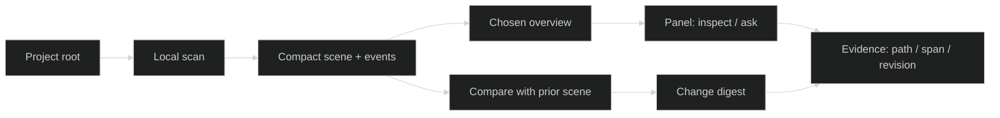

# Companion Research: Mascot-Free Project Presence

**Status:** Research proposal; no implementation implied. **Verified:** 2026-10-21.

## System Intent

A small, persistent web-panel companion for a directory or other structured input. It builds a compact, local project model and presents a chosen, legible view of structure and change. It supports inspection and questions without becoming a general autonomous worker. The panel has no mascot, avatar, or gamification. Represent's intended scene + append-only events contract is a useful target; selection and hierarchy matter more than rendering every node.

**Evidence boundary.** OpenAI currently documents “dot” as an always-on agent with persistent tasks, memory, optional local-computer access, user review, and pause controls. A separate Windows-app page describes the older/specific Companion Window as an on-demand hotkey window for asking questions and attaching files. These are two related but distinct interfaces; neither establishes a minimalist code-map panel. xAI's current Grok Bot announcement describes persistent work agents. We found no official evidence in the sources below that the consumer Grok “companions”/Ani visual-character feature is a directory-aware project companion; treat that particular comparison as **unverified**. New Computer Dot was also not verified as a distinct product name or capability; do not conflate it with ChatGPT's dot agent or Windows Companion Window.

## Ingestion Vector

Start from a user-selected root. Use scan output and repository metadata as a compact snapshot; never repeatedly feed whole files to the interaction layer. This tree is a proposal for Represent inputs, not a claim about current code.

```text
<project-root>/
├── .gitignore                 # @LLM-TARGET: ignore rules; filter before indexing
├── README.md                  # @LLM-TARGET: project purpose and entry points
├── package.json               # @LLM-TARGET: scripts, dependencies, workspace hints
├── src/                       # @LLM-ENTRY: primary source walk
│   ├── services/              # @LLM-TARGET: cluster and summarize imports/exports
│   ├── stores/                # @LLM-TARGET: state/data ownership signals
│   ├── components/            # @LLM-TARGET: UI relationships, summarize by cluster
│   └── generated/             # @LLM-IGNORE: generated artifacts
├── tests/                     # @LLM-IGNORE: exclude from initial runtime map; opt-in later
└── dist/                      # @LLM-IGNORE: build output
```

Persist a project fingerprint, scan timestamp, file/cluster identifiers, import edges, content hashes, git revision, selected view, completeness and skipped-path reasons. Keep source spans and path references so every summarized claim can point back to evidence. Recompute only changed files and affected clusters; ask before broadening scope or accessing external services.

## Visualization Spec

A persistent, collapsible side panel: project identity + scan freshness; a top-level overview with a small number of named clusters; click/zoom for module and file detail; search focuses the camera; a change view compares the last accepted scene with the new scene. Render only a curated view at each zoom and expose “show more” when coverage is incomplete. Use stable placement where possible and animate updates in place. The view must distinguish observed facts (paths, imports, hashes, git changes) from inferred labels/purpose, with source links and confidence/assumption notes.



This is an interaction concept, not a claim about implemented mechanics.

## Bootstrapping Steps

1. Use the planned deterministic local scan to produce a scene and record completeness, hashes, and revision.
2. Add a thin panel that opens on explicit invocation, remembers its last location/state, and can be dismissed or paused.
3. Implement scene overview, search-to-focus, drill-down, and source-linked details before adding chat.
4. Compare scenes after a user scan or an opt-in local change trigger; show additions, removals, and changed relationships with evidence.
5. Add query-over-scene using the compact model and retrieved source spans; separate answer claims from scan facts and label inferred content.
6. Measure scan latency and panel response on small/medium/large repositories. Keep local scan bounded; show progress/cancel. Run expensive enrichment only on explicit demand or selected changes, with cache and a hard budget.

## Findings and Design Lessons

| Observed capability (source) | Design lesson for Represent (inference) |
|---|---|
| ChatGPT dot can retain context, continue ongoing tasks, accept feedback/direction changes, and be paused; user reviews activity and can control local access. | Persistent identity can help continuity, but make pause, scope, activity, and local access visible. Represent's v0 can persist project context without autonomous work. |
| ChatGPT Windows Companion Window opens on a hotkey, accepts questions/files, remembers its position, and supports starting a fresh chat. | Fast invocation, stable placement, and a clear reset/close affordance suit a lightweight panel. It is a chat window, not evidence of a project visualization. |
| Grok Bot is presented as a persistent, cross-device text-thread teammate that remembers preferences, works asynchronously, and returns for judgment/approval. xAI's design post discusses presence, progress visibility, and work that starts without a prompt. | Thread continuity and concise status can make asynchronous work legible. For Represent, keep proactive notices opt-in and reserve interruption for meaningful, actionable changes. |
| The official sources describe agent access, permissions, memory, and work flows; they do not establish scan latency targets or a source-faithful code-map UI. | Treat latency budgets, diff design, and fidelity rules below as project requirements to validate, not observed competitor behavior. |

### A/B interaction modes

| Mode | Interaction | Best fit / tradeoff |
|---|---|---|
| Ambient panel | Quiet overview stays available; refresh on explicit scan or opt-in change detection; badge only meaningful changes. | Frequent navigation and orientation; risks visual clutter if the overview lacks hierarchy. |
| Query-first | Panel opens to a prompt; answers are grounded in the cached scene and linked source spans; map appears on request. | Occasional questions and lower screen footprint; weaker passive awareness. |
| Change digest | On user-triggered scan (later, optional watch), show a compact list/map of what changed since the prior scene. | Code review and returning to a project; can miss why changes matter, so link each diff to paths/edges and avoid speculative interpretation. |

### Interaction constraints to test

- **Interruption:** default to silent refresh while the panel is open and a quiet badge while closed. Let users choose notification thresholds. Do not interrupt for routine file churn.
- **Latency:** return the cached overview immediately; scan in background with progress and cancel. Set numeric targets only after measuring P1 on the three representative repository sizes.
- **Context:** store a compact, versioned project model (scene, hashes, revision, user view preference, accepted labels). Retrieve only relevant clusters and source spans per question; do not rebuild context from full source on every turn.
- **Scan triggers:** explicit “Scan” is the first version. Add debounced file-watch refresh only as opt-in, ignore-aware, and pausable; avoid network polling.
- **Diffs:** compare stable IDs and edges, separate structural changes from wording changes, and show additions/removals/changed links with before/after evidence. Mark uncertainty where rename detection or incomplete scans affect comparison.
- **Source fidelity:** path, revision, and span underpin every factual assertion; labels and purpose summaries are clearly marked as inferred. Report skipped/ignored paths and incomplete parsing. Never imply the overview is exhaustive when it is curated.

### Sources (official; checked 2026-10-21)

- OpenAI Help Center, [Getting started with your dot](https://help.openai.com/en/articles/20001530-getting-started-with-your-dot) — current dot setup, ongoing work, memory, pause, access, and review controls.
- OpenAI Help Center, [Using the ChatGPT Windows app](https://help.openai.com/en/articles/9982051-using-the-chatgpt-windows-app) — Companion Window shortcut, files/questions, position, and fresh-chat behavior.
- OpenAI Help Center, [Dots privacy, security, and safety FAQs](https://help.openai.com/en/articles/20001529-dots-privacy-security-and-safety-faqs) — memory, access, permissions and control.
- xAI, [Introducing Grok Bot](https://x.ai/news/introducing-grok-bot) — persistent agents, messaging, memory and approvals.
- xAI, [Designing Grok Bot for a world of persistent agents](https://x.ai/news/designing-grok-bot) — product design discussion of persistent agent presence and progress.
- xAI, [Announcing Grok](https://x.ai/news/grok) — original Grok persona framing; does not verify the consumer companion-character experience or a project visualization.
