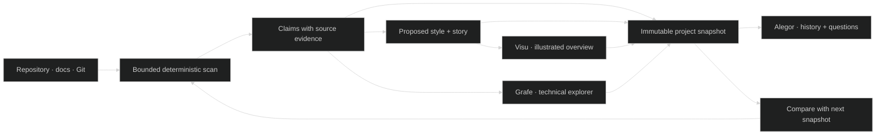
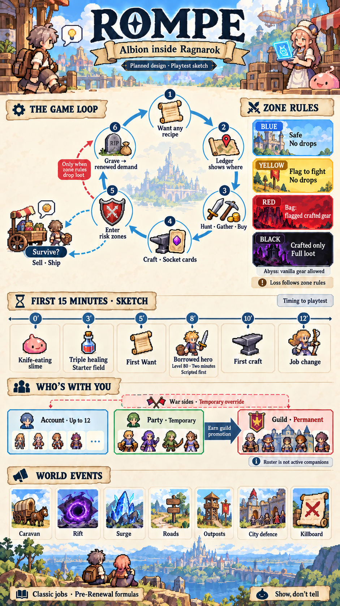

# Design Represent Around Living Project Portraits

Represent should become one coherent suite for understanding a project's identity, structure, and change, with three complementary experiences: a memorable illustrated portrait, a precise technical explorer, and a companion/history layer. The ROMPE test established a strong quality signal: **the “A memorable overview” image is the only tested output that feels like a natural Represent product**. Visu should lead the first product proof, because a good overview gives people an immediate mental model; Grafe should progress as a parallel design track for people who need source and code inside the visualization. Both should use the same evidence and snapshot history. The suite should stay clean at first glance and reveal concise, technical, and source-level detail on demand. Proposed names are recommendations, not locked decisions or verified domain availability; this is one suite, not a recommendation to launch separate apps or accounts.

## System Intent

Represent makes a changing software project understandable. It turns project evidence into a stable model, then presents that model in views suited to different questions. **Represent Visu** answers “what is this project, and what are its important parts?” through an illustrated overview that adopts the project's visual character. **Represent Grafe** answers “how is this code organized and connected?” through an explorable technical canvas with meaningful nodes, relationships, snippets, and source navigation. **Alegor** is the proposed companion that helps select a project and snapshot, follow its history, and ask evidence-grounded questions. It is a product role, not a mascot.

The shared model should distinguish observed source facts, declared project plans, generated interpretations, user corrections, and unknowns. Every important claim should have provenance and a freshness state. The image can stay concise because detail lives behind its regions and in Grafe. A static export should still make sense without interaction. “Progress” should describe dated, evidenced changes; a percentage is appropriate only when the project supplies a real denominator and status source.

The operator accepted the quality lesson from the ROMPE experiment: **an attractive, coherent overview is the product goal; box diagrams can be useful working instruments without becoming the product's main visual language**. This is direction from the operator on 2026-10-21. The full Visu ambition is to make the illustration itself animated and interactive. The technical track is intentionally a different design problem, inspired in part by the visible Codevis screenshot, which shows code snippets around nodes but also demonstrates how dense labels and edges can overwhelm a whole-project view ([historical screenshot and analysis](../research_notes/Represent%20living%20project%20views/original-vision.md)).

## Ingestion Vector

The first implementation should inspect only a reviewed, bounded source scope. Use deterministic tools to establish identity, files, symbols, explicit links, source ranges, Git revision, and declared status. Use a cached language model for compact explanations and story selection only where deterministic facts are insufficient. Record the origin of every claim so the views can explain what they show and where it came from.

```text
project-root/
├── README.md                 # @LLM-ENTRY: purpose, product vocabulary, intended users
├── src/                      # @LLM-TARGET: deterministic files, symbols, imports, calls
├── docs/                     # @LLM-TARGET: declared architecture, plans, status evidence
├── .github/                  # @LLM-TARGET: workflows and delivery signals
├── public/                   # @LLM-DECORATIVE: project-owned visual style samples
├── package.json              # @LLM-TARGET: language, scripts, package boundaries
├── .git/                     # @LLM-TARGET: revision identity and change comparison
├── node_modules/             # @LLM-IGNORE: third-party dependencies by default
└── dist/                     # @LLM-IGNORE: generated output by default
```

This tree is a proposal, not a tested scanner policy. On connection, preview included and excluded paths and let the operator correct them. Style detection should prefer project-owned assets and UI tokens, then present a proposed style profile with its evidence. If those signals are weak or conflicting, use a clear neutral fallback and say why. Do not treat a framework, language, folder name, or logo alone as the project's full style.



## Visualization Spec

Visu's default is **one memorable, project-specific infographic**, not a page of generic cards. Its composition should explain the main purpose and a small set of significant subsystems, flows, or milestones. The selected ROMPE image is the visual reference for coherence, atmosphere, and instant overview, while its companion evidence layer supplies clickable detail ([selected poster](../../../experiments/rompe/imagegen/rompe-poster-v2.png)). The test used an authored prompt and a manual correction pass. It did not prove automatic style detection, generated hotspot accuracy, incremental art updates, or source verification.



In the MVP, render an illustration or poster and bind a modest set of semantic regions to evidence IDs. Hover, keyboard focus, and tap reveal a short explanation; another action opens status, technical detail, and exact source links. A structured outline offers the same content where image navigation is difficult. The image and detail layer must always identify the snapshot they describe. When evidence changes, stale art cannot quietly present itself as current.

Grafe has its own visual language and acceptance criteria. It should improve on the idea visible in Codevis: the selected node can show code and source location, while focus, filtering, aggregation, and progressive detail keep the canvas legible. Directory, module, type, function, import, call, ownership, test, and optional runtime relationships should appear only when evidence supports them. A city view can be a theme in this technical tool, but code-city metrics do not automatically explain architecture. The 2019 GoCity paper describes a Go-specific code-city system; its reported evaluation is evidence about that prototype and its participants, not a universal comprehension result ([GoCity paper](https://homepages.dcc.ufmg.br/~mtov/pub/2019-saner-gocity.pdf)). The public `divan/codevis` URL returned 404 during research, so its current availability and history remain unknown ([repository URL](https://github.com/divan/codevis)).

Algorithm Visualizer contributes a useful interaction pattern: explicit tracer events can be replayed across synchronized views. Its inspected source uses authored instrumentation and serialized commands; it does not automatically infer an arbitrary repository's behavior. Its observed 48.9K GitHub stars show unusually strong public interest, but stars are not an active-user count or proof of current usage ([repository](https://github.com/algorithm-visualizer/algorithm-visualizer)). `awesome-creative-coding` is a discovery catalog for techniques and renderers, not an ingestion engine; choose a rendering library only after the real scene and interaction requirements are known ([catalog](https://github.com/terkelg/awesome-creative-coding)).

## Bootstrapping Steps

1. Turn this proposal into two design briefs with a shared source and snapshot contract: one for Visu, one for Grafe. Keep them parallel and equally serious; sequence implementation only after reviewing both.
2. Choose one representative code repository with a visible visual identity and manageable scope. Preview its read paths and exclusions. Record baseline revision and privacy mode.
3. Produce a deterministic inventory, a small evidence ledger, and a proposed style profile. Mark every field as observed, declared, inferred, corrected, or unknown.
4. Generate one Visu overview with a limited semantic region map. Review art direction, factual fidelity, readability, and accessibility separately. Attach concise summaries, technical details, and sources to those regions.
5. Design Grafe from the same evidence ledger. Start with bounded hierarchy and relationships, then test source snippets, focus, search, and aggregation. Compare against the Codevis screenshot's strengths and density failures.
6. Save two immutable snapshots around a controlled source change. Measure cached work, model/image calls, time, cost, stale-region handling, layout continuity, and human corrections. Build the simplest useful timeline and compare view.
7. Add an explicit UI/UX review round during design and again during implementation. Use provisional gates below; replace them with numeric targets after pilot observation.

## Ghost AI Plan

All language-model work must go through Ghost's AI pipeline, with stage-level cache keys that include source/evidence digest, prompt/model version, selected style, and composition recipe. Set per-run limits and report measured work; opening a detail popover reads saved data and does not call a model. The exact Ghost protocol for short synthesis is a later implementation decision. Whether image generation is available through a Ghost-managed surface is unresolved; verify that capability before integration, and document the boundary instead of quietly adding direct provider SDKs.

## Embeddability Plan

Keep scanning, evidence, snapshots, view definitions, and rendering inputs in a headless core. Web is the first thin surface for the Visu MVP; CLI and library interfaces should reuse the same core, while VS Code, JetBrains, desktop, and mobile can follow without changing the project model. Grafe and Visu should switch inside one Represent workspace while retaining selected project and snapshot. Exported snapshots remain usable without the shell or Alegor companion.

## A small MVP can produce a trustworthy living overview

The first Visu MVP should narrow the output and workflow, not force every project into ROMPE's pixel-art look. Support one dependable poster-style composition recipe with distinct project style profiles. Infer style from owned visual assets, style documentation, UI tokens/themes, and product context; offer project overrides and a neutral fallback when evidence is weak. Validate on ROMPE and a non-game project so the recipe proves it can adapt instead of merely copying the experiment. Within that constraint, cover one project, one overview, a handful of interactive regions, local snapshot history, and a clear update preview. It should read the source once, generate a compact evidence model, and cache each stage independently. On later runs, deterministic extraction can identify changed files and claims; Ghost can summarize only changed or newly ambiguous evidence; the renderer can reuse approved composition and unchanged image assets where safe. The MVP must report actual cache hits, calls, latency, and generation cost rather than promise “cheap” without measurement.

Raster art creates a real freshness constraint: text, symbols, and imagery may state a fact that changed. The safest initial behavior is to label the affected region as stale and offer a scoped refresh. Metadata-only details can update independently if the illustration does not claim them. When a central story changes, make a new complete image and preserve the prior snapshot. Do not claim arbitrary pixel-level edits until a pilot proves that they preserve quality and meaning. If the image service cannot be routed through the approved Ghost path, document that boundary before wiring a second provider stack.

Project style detection should combine several signals: owned visual assets, documented product language, UI themes or design tokens, and existing interface conventions. It should return a short proposed palette/type/texture/motif profile with source links and allow correction. It should not copy a logo blindly or infer a full brand from one asset. If confidence is low, show a restrained neutral style that can still produce a good overview. Keep style separate from meaning so a user can change the visual theme without changing project facts.

The UI should stay minimal at rest: project name, snapshot date/revision, one strong overview, a compact change indication, and clear paths into detail. Every region should support hover, focus, and tap. A first popover gives a plain-language summary; a second step gives technical detail, status provenance, and source. The timeline can show dated thumbnails and short change labels; compare two snapshots by highlighting additions, removals, changed claims, and changed relationships. Avoid making smooth morphs imply continuity when the underlying entities are not comparable.

## The full suite shares evidence and separates two views

**Visu** becomes a semantic animated scene: motion explains a flow, dependency, or change; it is not decoration alone. An economy flow or a request path can animate as an explanatory model, but must be labeled conceptual unless a runtime trace confirms the actual sequence. A viewer can focus a region, follow a relationship, open technical evidence, or move through historical snapshots. The scene has a still equivalent, keyboard navigation, reduced-motion support, readable text alternatives, contrast, and user-controlled playback. Major regions link to shared project identities, so opening Grafe lands on the corresponding technical area.

The full renderer should operate on **semantically layered art assets**, with labels, hit regions, and motion registered against stable evidence IDs. A flat raster can anchor the MVP, but it cannot by itself become a truthful animated scene. Hover/focus/tap interactions should read already prepared snapshot data; they must not trigger AI calls. Explicit user actions can request a refresh and show its cost/work preview.

**Grafe** becomes a source-linked technical workbench. It progressively expands from repository to subsystem to symbol and source lines. Code can appear inside selected nodes or an adjacent detail pane. Search, filters, evidence types, test coverage, and optional runtime traces help users ask precise questions. Large projects need aggregation and an explicit “why shown?” rationale rather than an unbounded graph. This is the track for the old technical ambitions: code shape, relationships, runtime paths, uncertainty, and code navigation.

**Alegor** is a proposed companion identity, not a role the user has fixed. A useful service direction is an optional contextual assistant available from either view, not a persistent chat that takes over the main canvas. A user might ask what changed since a date, why a region is marked planned, or whether a view is stale; the assistant answers with evidence and links into Visu or Grafe. Snapshot history belongs to the shared Represent workspace and remains useful without Alegor; the assistant reads that history rather than owning the source of truth. Keep one app/account with clear Visu/Grafe switching that retains the selected project and snapshot. Decide retention, encryption, sync, and team access before promising a hosted history service.

The recommended brand architecture is **Represent** as the single product suite and shared model, with **Visu** (illustrated overview), **Grafe** (technical explorer), and a candidate **Alegor** companion/history experience. These are three related experiences under one coherent identity, not separate apps or account silos. Use the short names in navigation and explain their jobs in onboarding. `alegor.ai` is a styling idea only; no domain or trademark availability check has been made. The user's only fixed constraint for Alegor is that it is not a mascot; the assistant/history role remains this report's proposal.

The service can start local-first: scan and store snapshots on the user's machine, with an explicit export. A later hosted workspace could add synced history, team access, embeds, and share links; a subscription could expose measured refresh budgets or usage tiers. Those are product proposals only—no hosting, payment, price, domain, or cost model has been validated. Keep an offline/export path so the overview does not depend on the companion service. The local [living-overview concept](../../../experiments/rompe/living-overview-concept/index.html) has 20 recorded passing interaction checks across desktop and mobile; its timeline selects two art revisions from one ROMPE source snapshot. It demonstrates interaction behavior, not ingestion, style detection, persistent project snapshots, generated updates, or project evolution. Mobile detail is readable on demand even though the raster overview text remains small at phone scale.

### Separate source history from rendered-view revisions

Each immutable `projectSnapshotId` should identify one source revision and its evidence ledger. A separate `viewRevisionId` identifies the style, story, layout, art, and interaction mapping rendered from that snapshot; a user can revise a view without pretending the source changed. Later snapshots link to their parent and carry explicit evidence diffs. Methrep's `represent.scene/v0` remains a scene compatibility envelope, and `events.jsonl` can record changes; the event log is not the snapshot store. This keeps history, view refreshes, and renderer playback from being conflated.

## Quality gates keep the picture clear and honest

The UI/UX improvement round belongs in both design and implementation. Evaluate the whole user journey, from source-scope review through first overview, detail reveal, update preview, and historical comparison. A reviewer should be able to explain the project purpose and main parts from the still image without coaching. Every visible region should have a meaningful detail path, and every detail claim should identify its evidence and age. No key fact should require hover alone. At keyboard and mobile sizes, users need an equivalent way to open details and read the text outline.

Measure style fit by recording which project signals informed the proposal and whether reviewers accept or correct them. Measure freshness by checking whether changed source claims mark the proper regions stale and whether prior snapshots stay reproducible. Measure update cost in deterministic work, model calls/tokens, image operations, cache hits, elapsed time, and accepted output. Measure Grafe separately for source-link correctness, task success, useful aggregation, and response time. ROMPE's mobile screenshot had no horizontal overflow but text was too small at fit scale; geometry alone is not a readability pass ([trial report](../rompe-tool-trials.md)). Numeric thresholds should come from the first representative pilot, not be invented from a single illustration.

## Research lessons now shape the product

The older Notion notes already paired an iconic whole-project image with runtime paths, relationships, technical depth, first-person navigation, and a possible local evolving model. They also sketched visual-scripting-like intermediate data, Unity/WebGPU, code profiling, and a minimap ([historical synthesis](../research_notes/Represent%20living%20project%20views/original-vision.md); [main Notion note](../../../notion/Pixel%20Clay%20-%20Represent%20Code%20Graphics%20Representatio%20d2122e06d68d451c9f980fa24256b9f4.md#L77)). The current direction sharpens that broad vision: the overview must be attractive enough to serve as the product, while the technical explorer remains a separate design track. Old creature/city metaphors remain optional visual forms; they are not the companion's identity.

The earlier ROMPE report recommended three complementary outputs. The operator has since judged only the illustrated “A memorable overview” suitable as a core Represent product direction. That verdict supersedes the recommendation, while the measurements remain useful: interactive-diagram was explorable but box-like; Eraser output was precise but flat; image generation produced the strongest overview. Preserve those tools as research instruments and keep their limits visible ([ROMPE trials and verdict](../rompe-tool-trials.md)).

The GoCity study supports deterministic, source-linked structural metrics and shows a possible spatial encoding; it does not establish inferred responsibilities or general adoption. The Algorithm Visualizer star count signals public interest, not active usage, and its authored tracers teach replay mechanics rather than repository analysis. The `awesome-creative-coding` list helps discover rendering approaches after the interaction needs are defined. The seven earlier cloned references still inform ingestion, layout, change history, and interaction, but none makes a generic graph the right first impression ([earlier study](Represent%20reference%20repository%20study.md)).

## Conclusion

Treat the product as one shared, evidence-backed history with two views that each earn their place: Visu explains the whole through art; Grafe explains code through exact structure. Keep Alegor's companion role as a recommendation until the product boundary is tested. Start with the updateable still overview, but design its semantic regions, identity, and snapshot lineage so animation can grow from the same content later.

Keep the next proof narrow and observable: one real repository, one proposed style, one memorable image, several source-backed regions, and two snapshots around a known change. The proof succeeds only if the image remains clear, the details are trustworthy, the update work is measurable, and users can trace what changed. That gives Represent a product foundation before committing to a rendering stack or a hosted companion.
