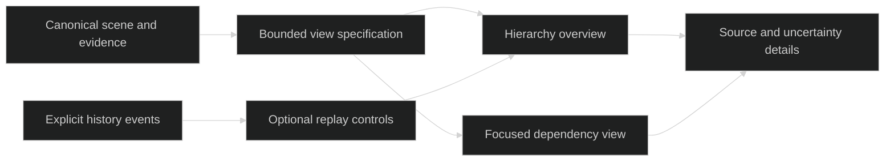

# Build Represent From Proven Independent Patterns

## System Intent

This records the initial six-repository study. The later [ROMPE trials](../rompe-tool-trials.md) add a seventh repository, actual browser validation, and the operator's immediate game-design test case before scanner implementation.

**Represent should combine staged extraction, traceable facts, bounded views and stable spatial identity.** No studied repository supplies the whole companion. GitNexus and CodeBoarding inform ingestion; interactive-diagram informs a small explanatory renderer; CodeCharta informs identity and analysis overlays; Git City informs stable hierarchy and history; Gource informs optional replay. Adopt their separations before their frameworks. The first implementation remains a deterministic, zero-LLM CLI producing a scene for `D:/ware/plane-sync`, followed by measured medium/Ghost validation. This study does not implement that scanner or establish that the six applications run successfully on this machine.

The target is a headless model that supports several useful views without generating a bespoke application for each repository. Observed containment and imports must remain distinguishable from inferred architectural roles. A scene should answer “what is here?”; a later view specification should answer “what should I look at for this question?”; an explanation should point back to evidence. Existing project constraints retain Ghost as the only AI route and keep sibling repositories read-only. TypeScript and a lightweight web surface remain reasonable candidates, but a parser feasibility spike and renderer acceptance tests should settle the specific packages.

## Ingestion Vector

The proposed pipeline separates cheap enumeration from content parsing and separates extracted facts from interpretation. GitNexus has distinct scan/parse outputs and ignore handling for nested rules and Windows paths; CodeBoarding adds definition resolution through LSP, demonstrating why syntax extraction alone must not be described as a complete call graph. ([Scan phase](https://github.com/abhigyanpatwari/GitNexus/blob/04427e03c8314be4c2a2ab74a99b53b7222c0514/gitnexus/src/core/ingestion/pipeline-phases/scan.ts), [ignore handling](https://github.com/abhigyanpatwari/GitNexus/blob/04427e03c8314be4c2a2ab74a99b53b7222c0514/gitnexus/src/config/ignore-service.ts#L327), [definition resolution](https://github.com/CodeBoarding/CodeBoarding/blob/3a5098c31c1649fc4a16257e46ce6830c2cfac8c/static_analyzer/engine/call_graph_builder.py#L24))

```text
Read-only repository path
|-- enumerate + ignore policy       # @LLM-ENTRY: record exclusions and unsupported inputs
|-- current source snapshot         # @LLM-TARGET: normalized paths, content hashes, sizes
|   `-- parse supported languages   # imports and declarations, with locations
|       `-- resolve bounded subset  # unresolved stays unresolved
`-- bounded Git history             # HEAD, policy, commit/path evidence
    |
    v
Canonical structural model          # stable IDs; facts distinct from hypotheses
|-- scene.yaml                      # represent.scene/v0, Module/File baseline
|-- events.jsonl                    # explicit event policy; no invented activity
`-- evidence/diagnostics manifest    # coverage, reasons, limits, source references
    |
    `-- later view specification    # selected nodes, grouping, emphasis
        `-- shared renderer         # no repository-specific UI generation
```

The evidence manifest is a proposed additive companion artifact, not a replacement for the existing two-file contract. Resolve its schema before implementation; use scene annotations to reference evidence without expanding every edge into a large record. Canonical paths support repeatable identity, but a rename changes path-derived identity unless a separate correspondence mechanism is introduced. CodeCharta's documented identity/lens split supports keeping that policy separate from metrics and semantic overlays. ([Wire schema](https://github.com/MaibornWolff/codecharta/blob/4e8dfb60d2aae6472a7c725bf9f044133f965d28/dev_docs/cc-json-2.0.schema.json#L1-L140))

## Visualization Spec

The first eventual view should show a small hierarchy overview with a focused dependency explanation and source details. Keep hierarchy visible when searching, expose omitted-node counts, and select edges by the question rather than drawing every relationship. interactive-diagram distinguishes chain highlighting from immediate-neighbor highlighting; CodeCharta retains ancestors of search matches. These are concrete patterns for preserving context, not proof that either provides Represent's desired semantic zoom. ([Selection semantics](https://github.com/LizardLiang/interactive-diagram/blob/1e252e62fd07631e71316179bc00861f52c6292b/assets/skeleton.html#L3823-L3860), [contextual search](https://github.com/MaibornWolff/codecharta/blob/4e8dfb60d2aae6472a7c725bf9f044133f965d28/visualization/app/codeCharta/renderer/renderModel/flatness/mapFlattenPredicate.selector.ts#L1-L31))



Stable IDs, placement and animation are different requirements. Git City keeps file plots stable across its captured timeline and interpolates changing building properties; CodeCharta exposes fixed folder rectangles. Adapt persistent cluster anchors and keyed selection, then test local edits independently from identical-input determinism. Equal-weight layout ties need an explicit path tie-break. ([Git City layout](https://github.com/maximalcode/git-city/blob/8eacc4b8b5d3abdb334882016a4673fca83d3663/src/renderer/src/layout/treemap.ts#L1-L145), [animation](https://github.com/maximalcode/git-city/blob/8eacc4b8b5d3abdb334882016a4673fca83d3663/src/renderer/src/city/Buildings.tsx#L36-L105), [fixed folders](https://github.com/MaibornWolff/codecharta/blob/4e8dfb60d2aae6472a7c725bf9f044133f965d28/visualization/app/codeCharta/renderer/threeViewer/algorithm/treeMapLayout/treeMapGenerator.ts#L1-L106))

The supplied [Interactive Atlas brief](../sources/ChatGPT_Prompt-Codex-Interactive-Atlas_20261020-1748.pdf) contributes design prompts: behavioral views, overview plus explanation, explicit assumptions and reusable model/view configuration. Its rankings and prices are unverified and unused. No visual screenshot from that PDF or an upstream browser session is claimed as validated evidence here. Literal cities and actor animation remain optional themes; they must encode useful information rather than decorate the baseline.

## Bootstrapping Steps

First record the contract choices, ignore policy, supported extensions, dependency claim kinds, history bounds and output location. Then create a small hand-labelled fixture with containment, static imports, unresolved dynamic expressions and parse errors. Validate the chosen parser distribution on Windows before committing the language/toolchain decision. Include JavaScript: the first target uses ESM and `.mjs` tests. A C#/TS/Python-only implementation misses the required target.

Next build only enough CLI/library functionality to emit the first `plane-sync` scene under Represent's output directory. Treat its measured 19 tracked files as the small corpus, record the post-filter count separately, and show the result before additional product work. The acceptance gate is valid YAML, unique IDs, valid endpoints, byte-identical repeat output, accurate source references and explicit incomplete coverage. A source edit should preserve unaffected IDs; ignored artifacts should not become architecture.

Then choose a medium repository from actual eligible-file counts and measure Ghost as the large corpus. Record elapsed time, peak memory, parsed/unsupported/error counts and history scope; do not convert upstream benchmarks into Represent promises. P2 enrichment, P3 rendering and P4 companion work remain subsequent phases. Capture a reusable skill only after a successful prototype establishes a repeatable procedure.

## Six repositories contribute different pieces

| Reference | Borrow or adapt | Avoid in v0 |
|---|---|---|
| GitNexus | Staged processing, reason-bearing edges, content-addressed parse-cache design | Copying noncommercial code; adopting its complete graph runtime |
| CodeBoarding | Call-site evidence, distinction between calls/references, file-first grouping | Provider integrations or mandatory LSP infrastructure before a small parser proves useful |
| interactive-diagram | Config-driven views, label fitting, geometry audits, details | Its monolithic HTML runtime as the core; executable config as the scene format |
| CodeCharta | Identity plus additive lenses, separate view state, ancestor-preserving search | Assuming new schema support throughout the older runtime; importing the whole desktop stack |
| Git City | Stable hierarchical placement, streamed history, bounded captures | Treating LOC/activity as architecture or assuming path identity survives renames |
| Gource | Actor/action replay and explicit time controls | Default moving physics layout; importing GPL implementation into the baseline |

**Provenance is the most valuable ingestion lesson.** GitNexus records reason/evidence alongside confidence and excludes global-name guesses from selected traversals. CodeBoarding keeps call sites and distinguishes calls from references. Represent should implement a smaller vocabulary of demonstrable relationships first, reporting unresolved cases rather than filling gaps with plausible edges. This gives later Ghost enrichment something reliable to explain. ([Relationship schema](https://github.com/abhigyanpatwari/GitNexus/blob/04427e03c8314be4c2a2ab74a99b53b7222c0514/gitnexus-shared/src/graph/types.ts#L283), [reason handling](https://github.com/abhigyanpatwari/GitNexus/blob/04427e03c8314be4c2a2ab74a99b53b7222c0514/gitnexus/src/core/graph/edge-reasons.ts), [call graph](https://github.com/CodeBoarding/CodeBoarding/blob/3a5098c31c1649fc4a16257e46ce6830c2cfac8c/static_analyzer/cfg/call_graph.py#L20))

Cache extraction separately from interpretation and rendering. GitNexus's cache keys incorporate parser identity; CodeBoarding distinguishes static-analysis cache from provider prompt caching. Represent needs content hash plus parser/config version, successful publication and explicit invalidation. A cache hit does not mean graph reconstruction disappears. Defer sophisticated community detection until directory/module groups demonstrably fail a useful view; CodeBoarding itself uses sorted file leaves for its naming partition. ([Parse cache](https://github.com/abhigyanpatwari/GitNexus/blob/04427e03c8314be4c2a2ab74a99b53b7222c0514/gitnexus/src/storage/parse-cache.ts), [analysis cache](https://github.com/CodeBoarding/CodeBoarding/blob/3a5098c31c1649fc4a16257e46ce6830c2cfac8c/static_analyzer/analysis_cache.py), [grouping](https://github.com/CodeBoarding/CodeBoarding/blob/3a5098c31c1649fc4a16257e46ce6830c2cfac8c/static_analyzer/clustering/service.py))

For history, adapt Git City's streaming approach only when bounded current-history signals warrant it. Its first-parent, no-renames policy and ancestry-checked incremental splice are explicit tradeoffs, not complete historical identity. Gource's per-file actions offer a useful replay vocabulary, but activity must not automatically become importance. Neither supplies semantic source relationships. ([History stream](https://github.com/maximalcode/git-city/blob/8eacc4b8b5d3abdb334882016a4673fca83d3663/src/main/git/analyze.ts#L120-L232), [splice safeguards](https://github.com/maximalcode/git-city/blob/8eacc4b8b5d3abdb334882016a4673fca83d3663/src/main/git/analyze.ts#L460-L565), [Gource actions](https://github.com/acaudwell/Gource/blob/70db547c6b8b40745fb41a8db7e8d28897be1a9e/src/gource.cpp#L1188-L1255))

## Trials establish narrow facts, not application readiness

All six repositories were shallow-cloned without submodules and inspected at the SHAs in [the inventory](../reference-repos.json). Two isolated executions succeeded: GitNexus's dependency-free edge-reason helper distinguished a heuristic from module membership, and interactive-diagram regenerated eight bundled examples with a clean resulting Git status. The first verifies one helper; the second verifies template/config regeneration. **Neither verifies repository parsing or browser layout.** ([Executed helper](https://github.com/abhigyanpatwari/GitNexus/blob/04427e03c8314be4c2a2ab74a99b53b7222c0514/gitnexus/src/core/graph/edge-reasons.ts#L25), [regeneration script](https://github.com/LizardLiang/interactive-diagram/blob/1e252e62fd07631e71316179bc00861f52c6292b/scripts/regen-examples.mjs#L11-L58))

CodeBoarding, CodeCharta, Gource and Git City received source inspection only. No complete dependency installation, parser benchmark, application test suite or interactive render was completed. Browser access was unavailable, so node clicks, exports, screenshots and geometry-audit results remain untested. CodeBoarding's required Python range differed from the default local interpreter; native parser and desktop dependencies also remain feasibility questions. ([CodeBoarding requirements](https://github.com/CodeBoarding/CodeBoarding/blob/3a5098c31c1649fc4a16257e46ce6830c2cfac8c/pyproject.toml#L11), [GitNexus package](https://github.com/abhigyanpatwari/GitNexus/blob/04427e03c8314be4c2a2ab74a99b53b7222c0514/gitnexus/package.json))

License boundaries affect reuse. GitNexus is PolyForm Noncommercial and remains source study only, with no copied code. CodeBoarding, interactive-diagram and Git City identify MIT; CodeCharta identifies BSD-3-Clause; Gource supplies GPLv3 text. Permissive candidates still require retained notices if code is later reused. This study authorizes no source transplant. ([GitNexus](https://github.com/abhigyanpatwari/GitNexus/blob/04427e03c8314be4c2a2ab74a99b53b7222c0514/LICENSE), [CodeBoarding](https://github.com/CodeBoarding/CodeBoarding/blob/3a5098c31c1649fc4a16257e46ce6830c2cfac8c/LICENSE), [interactive-diagram](https://github.com/LizardLiang/interactive-diagram/blob/1e252e62fd07631e71316179bc00861f52c6292b/LICENSE), [Git City](https://github.com/maximalcode/git-city/blob/8eacc4b8b5d3abdb334882016a4673fca83d3663/LICENSE), [CodeCharta](https://github.com/MaibornWolff/codecharta/blob/4e8dfb60d2aae6472a7c725bf9f044133f965d28/LICENSE.md), [Gource](https://github.com/acaudwell/Gource/blob/70db547c6b8b40745fb41a8db7e8d28897be1a9e/COPYING))

## A coherent v0 makes uncertainty inspectable

The synthesis is a persistent structural model with evidence, a bounded view selector and a replaceable renderer. This costs more contract discipline than a quick generated diagram, but prevents every repository from becoming a separate UI and lets unsupported analysis remain visible. TypeScript is attractive for sharing types with a later web view; native grammar packaging on Windows is its immediate validation gate. SVG is attractive for a small explanatory view; node count and interaction measurements should decide whether Canvas is needed later.

Renderer acceptance should include label fitting, residual overlap reporting and safe text insertion. interactive-diagram's bounded layout passes provide an audit pattern, while its use of `innerHTML` for some detail fields shows why scanner/LLM strings cannot be forwarded unchanged. ([Audit](https://github.com/LizardLiang/interactive-diagram/blob/1e252e62fd07631e71316179bc00861f52c6292b/assets/skeleton.html#L1468-L1560), [details insertion](https://github.com/LizardLiang/interactive-diagram/blob/1e252e62fd07631e71316179bc00861f52c6292b/assets/skeleton.html#L4130-L4146))

The next engineering decision should therefore be made against the hand-labelled JS fixture, not a favorite visual metaphor. A small, reproducible scene with declared omissions establishes whether the model deserves a renderer. Only then should semantic naming, layout polish and companion behavior consume implementation effort.
