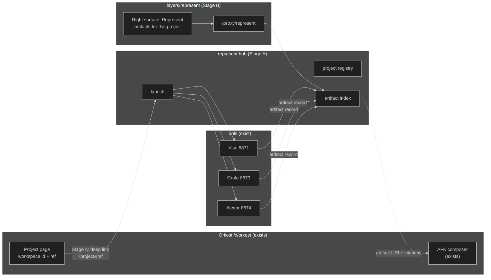
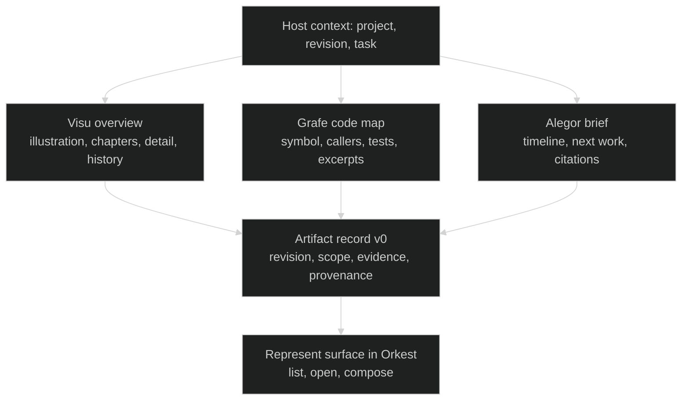

# Represent within Orkest: platform design

> Design, 2026-10-24. Drafted, then audited by an independent Fable 5.1 pass (fifteen findings, all folded in; the audit record is in LOGBOOK 2026-10-24), then bootstrapped. It continues [Represent within the Orkest platform](Represent%20within%20the%20Orkest%20platform.md) and honours the [exploration learning record](Represent%20exploration%20learning%20record.md) continuation contract and the [Visu preservation guide](../../guides/visu-experience.md). Heads revalidated: Represent `0e80bcc` (`codex/represent-v0`), Orkest `8f96ded`, Ghost `cc920933` (dirty working tree, not inspected). No service, runner, credential or provider was started or changed. Nothing here is implemented; the bounded plan is [REPRESENT-ORKEST-IMPL](../../REPRESENT-ORKEST-IMPL.md).

## What this design decides

Represent is Maremoto's AI developer-tooling product line. Orkest is the work platform it lives in. The integration seam is a **portable artifact record** plus a **small hub service**, not a shared database, a second board, or a new shell. Visu, Grafe and Alegor keep their own stores, UIs and CLIs and remain launchable without Orkest. Orkest gains one extension that opens a Represent tool for the project and revision it already knows, and later shows the artifacts that came back. Unattended agents, verifiers and runners stay in ORKEST-FORK and are not touched.

The design has three stages. Stage A needs no Ghost code. Stage B adds one GhostShell layer following the RIMA precedent. Stage C is the Alegor companion over Orkest context and is design-only here.

## 1. Readiness revalidation (2026-10-24)

The 2026-10-21 research notes carried a caveat that the Orkest snapshot might lag the active session. Rechecking the Ghost tracker, the Orkest repo and the cockpit layer gives this picture.

| Area | State on 2026-10-24 | Evidence | Consequence for Represent |
|---|---|---|---|
| Orkest cockpit fork `/x/orkest` | **Done** (Phase 2, operator approved 2026-10-21) and deployed on the lab1 dashboard (`:3002`) with Orkest on. Phase 6 production hosting and acceptance (6.1 to 6.3) are open. | [ORKEST-FORK](../../../../Ghost/docs/ORKEST-FORK-IMPL.md) header and Phase 2 boxes; `layers/orkest` has 219 files, pages `index`, `[workspace]`, `sessions`, `settings`. | A real host exists. Its project page is keyed by the methrep workspace id, which is the `ware.json` project name (`Represent`, `plane-sync`, ...). |
| Multica adapter `Ghost.Multica` | **Phase 3 done.** Identity, board read, board write, extras (status catalog, metadata, timeline, wake stream) with fixture/live/ratchet contract tests. Father connection sealed (3.2); workspace scripted (3.3); embedded board as project kanban (3.4). | `src/Ghost.Multica/WorkBoard/*`, `Extras/*`; tracker 3.1 to 3.4 ticked. The `IMulticaWorkBoard` stub in `Interfaces.cs` is stale; the operations live in `IMulticaBoardRead` and `IMulticaBoardWrite`. | The adapter implements board reads and writes; the writes sit behind Father's `/internal/multica/*`, which the dashboard proxy cannot reach, and no Orkest UI write path is live (box-to-issue linking is gated 4.8). Represent does **not** write to Multica in this design. |
| Provider session readers | **Phase 5 done** (2026-10-22). methrep reads Claude Code, Codex, Cursor, OpenCode and Gemini CLI sessions; Orkest shows them. | Tracker 5.1 and 5.2; `pages/x/orkest/sessions.vue`. | Alegor can later cite session evidence through methrep's readers instead of reading transcript files itself. |
| Unattended path (runner VM, verify sandbox, candidates remote, Foreman, verifier, reconciler, decision queue) | **Not live.** OQ-8 approved 2026-10-23; the 4.2 kit is written and tested offline and waits on the operator's elevated build and AC-10a. No Multica daemon or agent has run. | Tracker header "agent-blocked (2026-10-22)"; Ghost `ffa3a007`. | Nothing in this design depends on it. Represent never dispatches work; it hands off to Orkest's existing composer. |
| Operator-owned boxes | 1.2, 1.4, 1.7, 4.1, 6.1, 6.3, 6.4 are the operator's. | Tracker. | Out of scope; not referenced as dependencies. |
| Orkest summary docs | `orkest/docs/CONTEXT.md` ("Cockpit fork: Ready to start") and `ROADMAP.md` lag the tracker. | Compared this session. | Treat the Ghost tracker as current status; this design does not edit Orkest docs. |
| GhostShell extension points | `defineExtension` (nav; its `backends` field is declarative only, not auto-wired), `defineRightSurface` (dock surfaces scoped to a route namespace), layers auto-registered under `layers/`. RIMA owns `layers/rima` from its own repo; its proxy is **shell-core** code: `server/routes/proxy/rima/[...path].ts` plus `rimaApiBase` and `rimaServiceToken` in `nuxt.config.ts` runtimeConfig, with a method allowlist. | `layers/orkest/app/plugins/00.extension.ts`, `10.orkest-right-surfaces.ts`, `layers/rima/app/plugins/00.extension.ts`, `nuxt.config.ts`. | Stage B follows the RIMA precedent exactly: one layer plus the same three shell-core wiring points (proxy route, runtimeConfig base and token). It imports nothing from `layers/orkest`, so it survives Orkest's extraction. |
| Represent tools | Visu (8871, paused, Ghost gateway for paid stages), Grafe (8873), Alegor (8874). Each: loopback bind, per-process bearer token injected into its own HTML, exact-Origin check, project allowlist from server config, immutable content-addressed snapshots. Stores differ: Visu defaults to `<repo>/.represent/visu`; Grafe and Alegor default to `%LOCALAPPDATA%/Represent/<tool>`, and Alegor refuses a store inside any configured project root. Grafe runs Git for scope discovery but does not record HEAD; its UI has no URL routing to a symbol. | [visu-discovery](../../reference/visu-discovery.md), [grafe-mvp](../../reference/grafe-mvp.md), [alegor-mvp](../../reference/alegor-mvp.md). | A browser page served by GhostShell cannot call these APIs directly (origin and token). A hub page cannot call a tool page's API either, and a tool page cannot call the hub. So the hub must spawn the tools with a token it knows, and every attach goes through the hub, never through a tool page (section 4.2, OQ-1). |
| Name collision | Ghost already uses "Represent" for methrep: `Ghost.Represent.Host`, tool `ghost-harness-represent`, scene format `represent.scene/v0`. | [methodology-represent](../../../../Ghost/docs/reference/methodology-represent.md), [ghost-represent-conversion](../../../../Ghost/docs/reference/ghost-represent-conversion.md). | The product keeps the name; code and routes for the product use `represent-*` ids distinct from methrep. Section 3 records the rule; renaming methrep is not proposed. |

Open-ended company facts stay as recorded: no trademark check, no market validation, Orkest's brand gates still open.

## 2. Target user and concrete jobs

The first user is the operator: one person maintaining many repositories, moving between them daily, with agents doing part of the work. The second user is an external developer who installs the tools locally and never sees GhostShell. Both are experts; neither wants a dashboard.

| Job | Today | With this design |
|---|---|---|
| J1. Come back to a repo after days away and know where it stands | Open Alegor on 8874, pick the project, read the brief. | From the Orkest project page, open the Alegor brief for that project; later the brief also cites the task and recent agent sessions Orkest knows. |
| J2. Before touching a function, see who calls it and what tests cover it | Open Grafe on 8873, index, search. | From an Orkest task or IMPL box, open Grafe on the exact revision; attach the focused neighborhood as an artifact to the task. |
| J3. Explain a project to yourself or someone else in one picture | Open Visu on 8871, capture, explain, illustrate, pay deliberately. | Same tool, same manual stages and costs, opened for the project Orkest has selected; the overview becomes an artifact pinned to that revision. |
| J4. Hand a question to an agent with the right context | Type it into the AFK composer. | Open the composer from a Represent artifact; the artifact URI and its evidence citations travel with the request. Orkest and Ghost own everything after that. |
| J5. Read what an agent did and whether the picture is still true | Read the run and the diff. | The artifact shows its revision against the branch head and says "captured at `abc123`, head is `def456`", with manual refresh. |

J1 to J3 are read-only and need no new infrastructure. J4 uses Orkest's existing composer. J5 is a freshness comparison, not analysis.

## 3. Boundaries

### Product, brand, repository

- **Represent** is the product line and the repository `D:/ware/represent`. **Visu**, **Grafe** and **Alegor** are its tools. These names remain provisional until the naming canon records them; no new domain or trademark work is implied.
- **methrep** keeps its name and code. In prose, "Represent" means the product line; "methrep" means the methodology daemon. New code ids are `represent-hub`, `/x/represent`, `/proxy/represent`; nothing new is named `Ghost.Represent`.
- The Represent repo stays a `d:/ware` sibling (WARE-ROOTS). The Ghost code this design proposes is what RIMA already needed: a GhostShell layer `layers/represent`, edited by absolute path from a Represent session as `layers/rima` is from `d:/ware/rima`, plus the shell-core wiring a proxy requires (`server/routes/proxy/represent/[...path].ts` with a method allowlist, and `representApiBase` and `representServiceToken` in `nuxt.config.ts` runtimeConfig). Those shell-core edits are small and named in the plan; they are the only Ghost files outside the layer this design touches.

### Responsibilities

| Concern | Owner | Represent's relationship |
|---|---|---|
| Projects, tasks, issues, agent runs, approvals, receipts | Orkest, through Ghost and the Multica adapter | Reads project id and revision from the host; never writes board state. |
| Eligibility, verification, acceptance | Ghost / GhostDev | Not involved. An artifact is never evidence of accepted work. GhostDev verification stays optional for Represent in both directions: a Represent record may cite a receipt SHA when the host passes one, and a GhostDev workflow may attach a Represent artifact to a box as context, but neither makes the other true. |
| Methodology data (IMPL, LOGBOOK, sessions) | methrep | Alegor may cite it as a selected source in Stage C; it does not re-parse trackers. |
| Project understanding: overview, code map, re-entry brief | Represent tools | Owns captures, explanations, illustrations, citations and their history. |
| Artifact identity and portability | Represent hub | Owns the artifact record and its index; stores nothing Orkest owns. |
| Paid model calls for Represent | Ghost AI Gateway (internal); replaceable endpoint (standalone, design only) | Visu's explain and illustrate stages stay explicit and manual. |
| Agent CLIs and their logins | The user's machine or Orkest's runner, per ORKEST-FORK | Represent never holds or forwards CLI credentials. |

## 4. Architecture

### 4.1 The artifact record (the seam)

Every Represent output that is worth returning to a task is described by one JSON record. It is the only thing Orkest needs to understand.

```json
{
  "schema": "represent.artifact/v0",
  "id": "sha256:...",
  "tool": { "name": "grafe", "version": "0.1.0" },
  "project": { "hostId": "plane-sync", "repoRoot": "D:/ware/plane-sync", "remote": "https://github.com/..." },
  "revision": { "ref": "main", "sha": "7f3a...", "dirty": false, "capturedAt": "2026-10-24T15:02:11Z" },
  "scope": { "kind": "focused-symbol", "summary": "syncIssues: 4 callers, 2 tests" },
  "evidence": [ { "path": "src/sync.ts", "lines": [120, 164], "hash": "..." } ],
  "view": { "url": "http://127.0.0.1:8873/#/projects/plane-sync/snapshots/...", "static": "artifact.html" },
  "task": { "hostId": "orkest", "issue": "WARE-123", "box": "SYNC.2.3" },
  "provenance": { "inference": "none", "model": null, "cost": null }
}
```

Rules: `id` is content-addressed over everything except `task` and `view.url`; `task` is optional and attached by the host; `evidence` lines carry the captured hash so a later reader can tell the citation still matches; `provenance.inference` is `none` for Grafe and Alegor and names the model, prompt version and measured cost for Visu. Visu's existing capture, explanation and art identities map onto `revision`, `scope` and a `visu` extension block; nothing in Visu's store is reshaped.

### 4.2 The hub

`represent hub` is a new small Node service in `src/hub/`. It is the only process GhostShell talks to.

- **Project registry.** Maps a host project id (methrep workspace id, equal to the `ware.json` name) to the tool configurations that already exist (the `examples/*/*.json` allowlists). It refuses roots outside the allowlist, as the tools do.
- **Project registry rule.** Host ids are matched case-insensitively (`Represent` in `ware.json`, `represent` in the tool configs).
- **Artifact index.** Reads the configured tool stores read-only (each tool's actual store path from its config or environment, not an assumed location) and lists artifact records per project. Records it is asked to attach go into its own store at `%LOCALAPPDATA%/Represent/hub/artifacts/` by default, outside every project root, like Grafe's and Alegor's stores. It never modifies a tool's store.
- **Launch.** Spawns each tool's server with a bearer token the hub generates and passes on the command line (a new `--token` flag in each tool; today the token is per-process and unknowable from outside). Because the hub knows the token, it can call the tool's API server-side. It returns a URL carrying project, revision and task for the tool page to display. Reusing an already-running tool server the hub did not spawn is not supported.
- **Attach.** Every attach is a hub action: a CLI command (`represent attach <tool> <snapshot> --task ...`) and a hub API the Stage B surface calls. The tool pages never call the hub; they only display what their URL says. Freshness is reported by each tool (Alegor already compares a snapshot with HEAD; Visu already marks stale covers) and relayed by the hub, not recomputed.
- **Bind.** Loopback only. A LAN bind is not part of this design; the Stage B surface is used from a browser on lab1 until views are routed through the shell proxy with their own authentication story.
- **No inference.** The hub makes no model calls and holds no gateway key.

The alternative, adding an allowed-origin setting to each tool, is cheaper to code but spreads tokens and CORS rules over three servers, leaves no place for the registry, and still cannot make a tool page call another origin. OQ-1 records the choice. The order matters too: the record and a CLI attach are proven first (Stage A.1); registry and launch come after (Stage A.2).

### 4.3 Stages



**Stage A, no Ghost code.** A.1: the tools can emit artifact records, Grafe records the captured HEAD and gains URL routing to a symbol (both new work), and a CLI attaches a record to a task id. A.2: the hub's registry and launch open a tool from a URL that names project, revision and task. Proof: from a Plane Sync task, open Grafe at the task's commit, attach the focused neighborhood, reopen the record a day later and identify repo, revision, tool, sources and task from the record alone.

**Stage B, one GhostShell layer.** `layers/represent` declares an extension with nav entry `/x/represent` (the hub's project list) and a right surface scoped to `/x/orkest` and `/x/represent` listing artifacts for the current project with "Open", "Attach" and "Compose from this". It imports nothing from `layers/orkest`; it reads the workspace id from the route the same way Orkest's own pages do and reaches the hub through the shell-core proxy route named in section 3. "Compose from this" is bounded by what Orkest exposes today: `openComposer(stepId)` prefills only a box id, so the surface opens the composer for the box the artifact names and copies the artifact URI and citations to the clipboard for the operator to paste. A text-prefill parameter would be a requested Orkest change, recorded as a dependency and not made by Represent. Proof: the same Plane Sync journey from the Orkest project page, plus an e2e spec.

**Stage C, Alegor as companion (design only).** Alegor's brief gains two selected sources it can cite: the current Orkest task (issue title, box, status, from the hub's view of what the host passed) and recent sessions for the project through methrep's readers. It proposes a next step with citations and offers "Compose from this". It never dispatches, never holds a run, and never claims a result is accepted. Whether a companion panel above all three tools is wanted is decided after Stage B's live UX round, not before.

### 4.4 How Visu participates

Visu is the overview tool. It is hosted, not rebuilt.

- The same `web/visu` page is what opens from Orkest, served by Visu's own server through the hub's launch. The illustration, pins, outline, disclosures, history and three themes are unchanged.
- Orkest supplies project and revision; Visu shows them in the slot its topbar already has for "Local workspace", as `project @ revision`, with no new row. Task actions are not added to Visu's page at all; attach happens in the hub or the surface. Capture is free; explain and illustrate remain explicit buttons with the measured cost shown before and after. Nothing in the host triggers a paid stage.
- A new explanation revision reuses art, as today. The artifact record points at the view revision, and the art identity rides in the `visu` block, so an old illustration stays attributable.
- Theme: Visu persists its own choice in localStorage. The shell preference applies only when Visu has no stored theme; a stored theme always wins. Appearance never calls a model.
- The quality bar for any hosting change is the ImageLab dark, light and mono and the Luz mobile screenshots in the preservation guide, reviewed in the design UX round before code and in the live UX round after.

Visu implementation remains paused. The only Visu code in the bounded plan is the artifact export and the host-supplied project and revision header, both inside existing seams in `core.mjs` and `server.mjs`.

### 4.5 Grafe and Alegor

Grafe's artifact is a focused neighborhood: the selected symbol, its typed edges, candidates and captured excerpts at one snapshot. The deep link opens that neighborhood directly. Grafe stays bounded JS/TS; the design does not promise more languages.

Alegor's artifact is a re-entry brief between two snapshots with its citations and unknowns. Stage C adds host sources; Stage A and B use Alegor exactly as it is.

### 4.6 The Dot-like experience, in Orkest terms

The screenshot's lesson was conversation beside a visible work surface, a recognizable companion, app entry points and an explicit "take over". Orkest already has the work surface (project page, spine, sessions), the entry points (dock surfaces) and a take-over affordance (open the session in its app; Claude deep links). Represent adds the tools and, in Stage C, the companion voice. No desktop stream, VM or OS metaphor is needed for this.

In Stage C the conversation lives in the Alegor surface in Orkest's right dock, beside the project page, so the work surface stays visible while the companion speaks. The companion answers from citations (snapshots, the current task, methrep session readers) and ends every proposal with the same two affordances Orkest already has: open the composer for the box it names, or open the session it cites in its app. "Take over" therefore means opening that session, not seizing a remote machine. The companion never runs anything.

## 5. One end-to-end task

**Task:** fix a Plane Sync bug where a renamed GhostDev box leaves a stale Plane issue. Marks: **[E]** exists, **[A]**, **[B]**, **[C]** this design's stages, **[G]** gated in ORKEST-FORK.

1. **[E]** The operator opens `/x/orkest`, picks `plane-sync`, reads the IMPL card and the open box.
2. **[A]** Clicks "Code map" (Stage A: a link on the hub's project page; Stage B: the Represent surface). Grafe opens on `plane-sync` at the branch head with the sync module selected.
3. **[E]** In Grafe, selects `syncIssues`, sees four callers, two tests and the rename branch excerpt. Zero model calls.
4. **[A]** Attaches from the hub page (Stage A.2) or the CLI (A.1). The hub writes an artifact record with revision, scope, evidence hashes and the task id the host passed. Grafe's own store is unchanged.
5. **[A]** Opens Alegor for `plane-sync`; the brief shows the last two snapshots and the declared next work, with citations. Captures a new snapshot (free).
6. **[B]** Back in Orkest, the Represent surface lists both artifacts for this project. "Compose from this" opens the existing AFK composer for the box the artifact names and copies the artifact URI and cited excerpts to the clipboard; the operator pastes them into the request.
7. **[E]** Dispatch goes through Orkest's current path (AfkRunner on lab1 today). **[G]** The Multica runner path replaces it when ORKEST-FORK Phase 4 lands; nothing in Represent changes.
8. **[E]** The operator reviews the run and the diff in Orkest.
9. **[A]** Reopens the Grafe artifact. Its header says "captured at `7f3a...`, branch head is now `9c01...`"; a manual re-index produces a new snapshot and a new record. The old record remains valid for what it cited.
10. **[C]** Later, Alegor's brief cites the merged commit and the session that produced it, through methrep's readers, and proposes the next box.

Steps 1, 3, 7 and 8 need no Represent work. Steps 2, 4, 5 and 9 are Stage A. Step 6 is Stage B. Step 10 is Stage C.

## 6. UI/UX design round

Changes that hosting requires, kept small and judged against the preserved screenshots:

| Change | Where | Why |
|---|---|---|
| Project and revision chip in the header | all three tools | The host passes them in the URL; the user must see which revision a view describes. Visu reuses its "Local workspace" slot; Grafe and Alegor gain one line. |
| "Attach" and "Copy artifact link" | hub page and Represent surface, never the tool pages | Tool pages cannot call the hub (origin and token); the hub is the one place that writes records. Hidden in standalone use without a task. |
| Freshness line | all three tools report; the hub and the surface relay | "captured at X, head is Y" with a manual refresh; never automatic, never paid. Alegor and Visu already compute theirs; Grafe gains HEAD capture. |
| Theme handoff on open | all three tools | Shell preference only when no stored theme; keep the in-tool switch; monochrome stays available. |
| Represent surface | `layers/represent` | A list, not a dashboard: tool, scope summary, revision, age, open, attach, compose. |

Explicit non-changes: no new overview renderer, no graph-of-everything, no automatic refresh, no raster lettering, no replacing Visu's illustration with cards. The design UX round compares mockups of the five changes against the ImageLab, Luz and ROMPE references and the Grafe and Alegor browser-check captures before any code. The live UX round repeats the Plane Sync journey in the browser after Stage B.

## 7. AI, authentication and accounting

- Visu keeps the Ghost gateway route it measured (LiteLLM to OpenRouter to Google models). Keys stay in Visu's environment, never in the hub or the layer.
- The hub and the layer make no model calls.
- For standalone distribution, Visu needs a replaceable backend boundary: one configuration that points at either the Ghost gateway or an OpenAI-compatible endpoint with the same explicit cost display. This design names the boundary; implementing it is not in the bounded plan.
- Agent CLIs keep their own logins. A Represent artifact URI in a composer request is text; it carries no credential. Orkest decides where the run executes.

## 8. Standalone path

Everything in Stage A runs on a developer's machine with Node 22 and Git: the three tools, the record and CLI attach, the hub, portable artifact JSON and static views. Orkest is optional and arrives as Stage B. Nothing requires GhostShell, Multica, a runner or a private gateway except Visu's paid stages, which already fail closed without a key. Exports contain captured project text and image data and stay private by default.

## 9. Costs

Grafe, Alegor, hub and layer: zero model cost. Visu: unchanged, per explicit action; historical measurements are $0.3682722 for the first trial and $0.28688598 for the discovery run, including a $0.0144183 text-only status update. No new paid run is part of this design or its plan. Effort is expressed in the plan as phases with acceptance evidence, not hours.

## 10. Risks and open questions

Three questions, resolved with reasoned defaults the operator may override in Phase 0 (the clarify-impl convention; this repo's DOCS-PROTOCOL has no rule on open questions). The plan carries them.

- **OQ-1 Hub versus per-tool origin allowlist.** Default: hub, after the record and CLI attach are proven. Reason: one registry, one token the hub knows because it spawned the tool, tool pages untouched, and the RIMA proxy precedent. A per-tool allowlist still could not let a tool page call the hub.
- **OQ-2 Where attached artifact records live.** Default: `%LOCALAPPDATA%/Represent/hub/artifacts/`, outside every project root, overridable by `REPRESENT_HUB_STORE`, exported deliberately. Alternative: inside each tool's store. The default matches Grafe's and Alegor's store rule (Alegor refuses a store inside a configured root, so a `.represent/hub` under the repo would be refused for the Represent project itself) and lets a record cite several tools later.
- **OQ-3 Project identity.** Default: the methrep workspace id, equal to the `ware.json` name (confirmed in the represent-adapter's `WareJsonReader`), is the host id; the registry matches it case-insensitively against tool configs and maps it to repo roots. Alternative: repo root path as id. The default matches Orkest's route and survives moving a checkout.

Risks: Orkest's extraction later moves `layers/orkest` out of Ghost; the Represent layer must keep importing only shell APIs. The Ghost working tree was dirty during revalidation; status was read from the tracker and committed files only. The hub is a fourth local server; keep it tiny and optional. Loopback view URLs only work from a browser on lab1; a remote operator sees the artifact list but cannot open views until a proxied, authenticated view path exists. The composer handoff depends on clipboard paste until Orkest offers a text prefill.

## System Intent

Make a developer's project legible inside the work platform they already use, by hosting Represent's three tools for the project and revision Orkest has selected and returning portable, source-linked artifacts to the task. Scale: one operator and tens of repositories first; one external developer and one repository second. Domain: software projects in Git, bounded JS/TS for Grafe, Git and Markdown for Alegor, any text for Visu.

## Ingestion Vector

The hub reads only what the tools already read, plus its own registry. Trees are per Rule 8.

```text
D:/ware/<project>/                    # a registered repository
|-- .git/                             # @LLM-TARGET: revision, ref, dirty flag (Alegor, hub freshness)
|-- README.md, docs/**/*.md            # @LLM-TARGET: Alegor facts; Visu bounded sample
|-- src/**/*.{ts,js,mjs}              # @LLM-TARGET: Grafe bounded scope
|-- package.json                      # @LLM-TARGET: languages and scripts (Visu style hints)
|-- node_modules/, dist/, .env        # @LLM-IGNORE: never captured
D:/ware/represent/
|-- examples/{visu,grafe,alegor}/     # @LLM-ENTRY: per-tool project allowlists the hub registry reuses
`-- .represent/visu/                  # @LLM-TARGET: Visu's store (repo-local, ignored); read-only to the hub
%LOCALAPPDATA%/Represent/
|-- grafe/, alegor/                   # @LLM-TARGET: default tool stores outside project roots; read-only to the hub
`-- hub/                              # @LLM-TARGET: registry.json and attached artifact records
```

## Visualization Spec

Three views, each already real, framed by the host: Visu's illustrated overview with chapters and detail on demand; Grafe's focused graph with evidence; Alegor's timeline and brief with citations. The host adds a header chip and a freshness line in each tool, and an attach action and a flat artifact list in the hub page and the Orkest surface. No new renderer.



## Bootstrapping Steps

1. Operator reviews this design and the five UX changes against the preserved screenshots; decisions land in `CONTEXT.md`.
2. Artifact record v0 and export in Visu, Grafe and Alegor; Grafe HEAD capture and symbol URL routing; CLI attach; tests and a Plane Sync trial.
3. Hub: registry (case-folded ids, real store paths), index, spawn-with-token launch, attach API, tests, Plane Sync trial from a URL.
4. GhostShell layer `layers/represent` by the RIMA precedent plus its shell-core proxy wiring: extension, right surface, e2e; Plane Sync journey from `/x/orkest` on lab1.
5. Live UX round; Visu round-trip with a free capture and reused art; Alegor host-source design note for Stage C.
6. Promotion to `reference/` with the artifact schema as a reference doc.

These steps are the phases of [REPRESENT-ORKEST-IMPL](../../REPRESENT-ORKEST-IMPL.md). None of them provisions infrastructure, runs an agent, writes to Multica, or edits an ORKEST-FORK box.

## Ghost AI Plan

Unchanged from the locked decision: Represent-owned model calls go through the Ghost gateway, cached by evidence, recipe and model version, explicit and manual. The hub and layer are inference-free. The standalone endpoint boundary is named in section 7 and deferred.

## Embeddability Plan

The tools stay headless cores with CLIs and local web shells. The hub is a thin HTTP surface over them. The GhostShell layer is the first host shell; IDE and desktop shells would consume the same hub and artifact record. Artifacts are portable JSON plus a static view.
