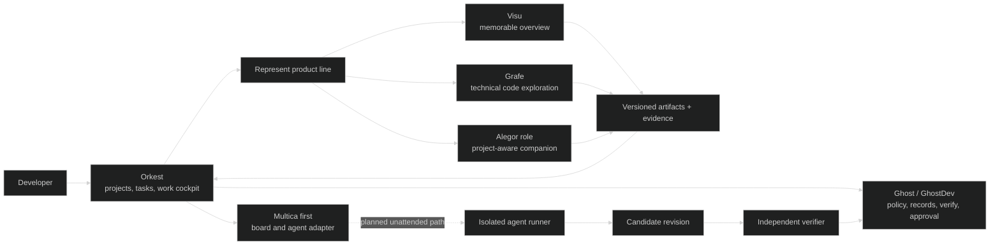

# Represent within the Orkest platform

The better fit is **Orkest as the agent/work platform, with Represent as Maremoto’s specialist AI developer-tooling product line**. My earlier “Represent Workspace / Represent OS” proposal centered a new shell and companion; that risked duplicating Orkest’s project, task, identity, and execution responsibilities. Keep its useful ideas—project-aware context, persistent artifacts, readable evidence, clear handoff, and a computer-like surface—but place them within Orkest. Represent can contain **Visu** for memorable overviews, **Grafe** for technical code relationships, and an evolving **Alegor** companion role. Multica-first is a sensible way to learn before standalone Orkest; it does not prove every planned board, runtime, verification, or provider path is ready. Prove a real project/task opening a Represent view and returning a versioned artifact, while keeping unattended-runner gates in their owning plan. ([earlier proposal](Represent%20OS%20design%20and%20runtime.md); [Orkest platform notes](../research_notes/Represent%20within%20the%20Orkest%20platform/orkest-platform.md); [vision and runner notes](../research_notes/Represent%20within%20the%20Orkest%20platform/vision-and-runners.md))

## The earlier plan starts from a new workspace; yours starts from a work platform

The prior report answered the Dot screenshot as a Represent product-design problem: a web workspace, companion, tool launcher, project snapshots, and optional execution. That is useful interface research, but it assigned Represent orchestration, navigation, durable work history, and visualization together. Your newer framing starts from Orkest: couple to Multica first, then pursue standalone capability. Represent should make this work platform expert for developers rather than build a competing control plane. Keep “OS” as a possible interface metaphor, not a separate kernel, scheduler, project database, or approval ledger. ([earlier report](Represent%20OS%20design%20and%20runtime.md); [Orkest CONTEXT](../../../../orkest/docs/CONTEXT.md); [Multica and CloudCLI guide](../../../../orkest/docs/guides/multica-cloudcli-knowledge-and-setup.md))

| Question | Earlier proposal | Your clarified direction | Recommended synthesis |
|---|---|---|---|
| Product center | A Represent-owned workspace inspired by Dot | Orkest platform, initially coupled to Multica, with a specialized Represent developer-tools branch | Orkest owns project work and agent orchestration; Represent supplies expert developer capabilities and their outputs. |
| Visu | Deferred in the proposed shell | A tool you like that belongs inside Represent | Keep Visu as a first-class Represent tool; its implementation can stay paused while its product role remains in the suite. |
| Grafe | A code map plus optional history playback | A dev-focused tool within the broader platform | Make it the technical exploration surface, linking each relationship to code evidence; let Orkest open it for a project/task. |
| Alegor | A proposed companion/workspace shell | A leaner Dot-like companion, potentially attached to Orkest and local CLI workflows | Keep the companion ambition, but design its interaction over Orkest’s project/work context. Do not make Alegor a second executor or source of truth. |
| Agent connection | Optional future execution adapter | Learn from Multica and CloudCLI, connect to existing agent CLIs, then consider standalone | Preserve local interactive and unattended remote execution as distinct modes with explicit credentials, host, and safety boundary. |

Company docs describe **Maremoto** as the company, **Waremoto** as its software department, and **GhostWare** as shared runtime infrastructure. Use “Maremoto/Waremoto AI developer-tools product line” for Represent’s branch role without implying a new corporate division. Keep its scope broad for focused expert products, not just visualization or project re-entry. Whether Represent is one product, an umbrella, or both remains open. ([company stack notes](../research_notes/Represent%20within%20the%20Orkest%20platform/company-stack.md); [Naming and Branding](../../../../docs/reference/naming-and-branding.md))

## Orkest can host the expert workflow, but its platform is still emerging

Orkest’s stated sequence fits “start coupled, learn, then standalone”: layer over Multica, build a native board from its useful ideas, then support both. The guide assigns Multica board/task routing and Ghost eligibility, candidate identity, verification, and acceptance. Board status is routing information, not proof of correct work. CloudCLI has its own login and is studied for session-reading ideas; its earlier embedding plan was reversed. Learn from both tools without making CloudCLI a required runtime or copying interfaces/assets. ([Orkest CONTEXT](../../../../orkest/docs/CONTEXT.md); [Multica and CloudCLI guide](../../../../orkest/docs/guides/multica-cloudcli-knowledge-and-setup.md))

The important qualification is a **source-snapshot discrepancy**, not a rejection of your stated direction. You describe Orkest as having unmanaged agents and intend it to reach Multica feature parity. At inspected heads, the detailed tracker and source still show the unattended runner/verify path gated, `IMulticaWorkBoard` empty, and `IMulticaAgentRun` limited to agent listing. This could reflect newer work in your active Claude Code session. I therefore treat unmanaged agents and parity as **your product intent**, while implementation readiness is **unverified by this snapshot**; reconcile with that active work before planning implementation. ([unattended-work status](../../../../orkest/docs/reference/unattended-work.md); [Ghost Orkest tracker](../../../../Ghost/docs/ORKEST-FORK-IMPL.md); [Multica adapter interfaces](../../../../Ghost/src/Ghost.Multica/Interfaces.cs); [Orkest platform notes](../research_notes/Represent%20within%20the%20Orkest%20platform/orkest-platform.md))

Keep two work paths visible. **Unmanaged/exploratory Orkest tasks** can support general assistance, research, visualization, and other work without forcing every task through GhostDev’s IMPL doctrine. **GhostDev-managed coding tasks** add eligibility, recorded boxes, exact candidate verification, receipts, and human approval. They can share Orkest projects and agent surfaces while retaining different evidence and acceptance rules. The source snapshot does not verify the unmanaged path’s readiness, so this is a product distinction to carry into the active Orkest design, not a claim that it is available today. ([unattended-work](../../../../orkest/docs/reference/unattended-work.md); [Orkest platform notes](../research_notes/Represent%20within%20the%20Orkest%20platform/orkest-platform.md))

Represent need not wait for Orkest’s standalone board. Its local tools already provide bounded outputs: Visu’s illustrated overview, Grafe’s JS/TS relationships, and Alegor’s Git/docs snapshots and citations. They do not dispatch agents. Keep Visu paused but in the suite, and preserve each tool’s evidence until a shared artifact contract is designed. ([Visu reference](../../reference/visu-mvp.md); [Grafe reference](../../reference/grafe-mvp.md); [Alegor reference](../../reference/alegor-mvp.md))

## Dot is an experience target, not a blueprint for its private runtime

The screenshot’s useful pattern is conversation beside a visible work surface, recognizable companion, app entry points, and explicit “Take over.” For developers, show project/revision, active task, tools/artifacts, run status, evidence, and a clear handoff. A leaner Dot can connect existing developer tools and make their work legible; it need not stream a full desktop continuously. The screenshot and public help do not reveal Dot’s VM, container, credentials, or orchestration design. ([user-provided Dot screenshot, 2026-10-21]; [prior Dot research](Represent%20OS%20design%20and%20runtime.md); [companion research](../companions.md))

Separate **local interactive CLI work**, using a user-selected supported login on their machine, from **unattended work**, which needs service credentials, spend controls, isolation, cancellation, and audit. Orkest’s checked-in plan chooses capped provider keys for its isolated runner and excludes subscription logins there; this does not establish universal provider support. A Ghost AI Gateway key also does not automatically authenticate an external CLI. Show the active auth/accounting path clearly. I did not inspect the active Claude Code session you mentioned. ([Ghost AI system](../../../../Ghost/docs/reference/ai-system.md); [Ghost AI Gateway](../../../../Ghost/docs/reference/ai-gateway.md); [Orkest unattended-work](../../../../orkest/docs/reference/unattended-work.md); [Multica setup guide](../../../../orkest/docs/guides/multica-cloudcli-knowledge-and-setup.md))

## Keep the runner, verifier, and work surface as separate decisions

The attached comparison is context, not approval to provision. It separates a **long-lived agent runner VM** from a **disposable verifier** that checks a candidate commit. The agent must not control the trusted checks. Independent verification improves trust, but does not guarantee identical verdicts: toolchain/dependency changes and flaky tests still matter, so record the environment and actual checks. The proposed VM/verifier also cost maintenance, resources, latency, caches, compatibility, and access to local services. None was provisioned or measured here. ([user-supplied runner/verify comparison](C:/Users/Administrator/.codex/attachments/bfc55e0d-41d3-4844-91a7-61093664edf9/Pasted%20text.txt); [unattended-work](../../../../orkest/docs/reference/unattended-work.md); [vision and runners](../research_notes/Represent%20within%20the%20Orkest%20platform/vision-and-runners.md))

Current Visu/Grafe/Alegor analysis is bounded and read-only, so it needs no execution sandbox. A minimal Linux container can package a reproducible build/test job; it is not automatically a safe long-lived agent boundary if it shares Docker, host files, or credentials. Given Multica’s bypass-permission agent model, the planned isolated VM is clearer for unattended runs, subject to its gates. A disposable verifier container is an option only with separate identity, read-only candidate access, network/resource limits, trusted checks, bounded output, and proven isolation. Choose from measured Orkest workloads, not because the Represent UI resembles an OS. ([Grafe core](../../../src/grafe/core.mjs); [Alegor core](../../../src/alegor/core.mjs); [Orkest runner notes](../research_notes/Represent%20within%20the%20Orkest%20platform/vision-and-runners.md); [Docker security references in earlier report](Represent%20OS%20design%20and%20runtime.md))

The product can look like a tailored computer using ordinary web panels. Show a terminal or remote desktop only when an execution adapter owns its session and permissions. Keep the work surface, control plane, agent runner, and verifier as distinct responsibilities. ([runtime analysis](Represent%20OS%20design%20and%20runtime.md); [unattended-work](../../../../orkest/docs/reference/unattended-work.md))

## Build the platform proof around one real task and one artifact

Prove one Orkest project/task can open a Represent capability with the correct project and revision, then return a durable, source-linked artifact. Plane Sync is a useful case: launch Grafe on a selected commit, inspect a function and callers, and attach the result to the task. When Visu resumes, test the same flow with a manual overview snapshot. Include Alegor only if it answers a specific re-entry need. Confirm a later reader can identify repo, revision, tool, sources, and task. This tests Represent’s value without waiting for unattended infrastructure. ([Grafe real-project trial](../../../experiments/grafe-mvp/README.md); [Alegor real-project trial](../../../experiments/alegor-mvp/README.md); [Visu MVP reference](../../reference/visu-mvp.md))

Use artifacts as the first seam, not a universal snapshot database: record project/revision, tool version, capture time, source scope, evidence links, and artifact URI. Orkest owns work and agent state; Represent owns its explanations and citations. Add run/session identifiers as corresponding contracts become real. Portable artifacts also preserve a standalone path without making Multica permanent. ([Orkest architecture and adapters](../../../../orkest/docs/CONTEXT.md); [Represent implementation references](../../reference/))

Open tooling and portable artifacts may create useful contribution points, but this is not market validation. Internal dogfooding can use GhostWare/GhostDev; external use should not require a private Ghost service or silently route CLI sessions through its AI gateway. Recheck the pinned Multica/CloudCLI versions and distribution terms before packaging. The guide distinguishes connecting to a user’s Multica from copying its source/UI/assets or hosting it for third parties. ([Orkest setup guide](../../../../orkest/docs/guides/multica-cloudcli-knowledge-and-setup.md); [company stack notes](../research_notes/Represent%20within%20the%20Orkest%20platform/company-stack.md))

## System Intent

Research the product boundary between Orkest, Ghost/GhostDev, and Represent, then recommend a low-duplication way for a developer to understand a project, connect existing agent tools, and return to evidence-backed work. Target the operator’s expert developer workflow first while keeping the product structure adaptable to other Maremoto specializations. This is a recommendation grounded in current local project records, not an accepted product or infrastructure decision.

## Ingestion Vector

This report used the Represent context and MVP references, earlier OS report, Orkest research notes and guides, Ghost tracker/interface source, and the supplied runner comparison. It did not inspect the active Claude Code session or start services. The proposed input tree is not a scanner contract; scope should be reviewed before agent or model ingestion.

```text
project-root/
├── README.md                         # @LLM-ENTRY: project purpose and vocabulary
├── docs/                             # @LLM-TARGET: design, tasks, status, user-owned context
├── src/                              # @LLM-TARGET: code symbols, modules, and relations
├── .git/                             # @LLM-TARGET: commit/ref and evolution evidence
├── package.json                      # @LLM-TARGET: languages, dependencies, scripts
├── .env                              # @LLM-IGNORE: secrets; never ingest or expose
├── node_modules/                     # @LLM-IGNORE: installed third-party code by default
└── dist/                             # @LLM-IGNORE: generated output by default
```

## Visualization Spec

Make Orkest’s cockpit host focused Represent views: **Overview (Visu)**, **Code map (Grafe)**, and **Alegor as a companion for goal/task context, agent interaction, results, and continuity**. Orkest owns task/run state; Alegor’s current Git/docs history and evidence MVP is a foundation for that broader companion role. Gource-like playback can show evidence-linked evolution. The interface may resemble a tailored desktop, but controls must map to real capabilities. No shared artifact contract exists today.



The dashed path marks the runner and verifier as gated in checked-in evidence; reconcile with active Orkest work before treating that as current. Artifacts should separate captured facts, declarations, and inference, link to their revision, and reveal citations. Gource’s tested lesson is optional history playback; file activity alone does not prove architecture or importance. ([Gource research](Represent%20OS%20design%20and%20runtime.md); [Grafe reference](../../reference/grafe-mvp.md))

## Bootstrapping Steps

Treat the boundary as a recommendation pending review. Define only the artifact identity needed to link one Represent result to one Orkest task; prove a read-only handoff; then ask a developer to reopen it and confirm its project, revision, evidence, and task. Add session readers, write actions, and unattended runs only when that flow warrants them. Keep advancing the existing runner gates separately; this report does not approve OQ-8, provision a VM, or change credentials. Test local, Multica-backed, and eventual standalone use without promising provider parity.

## Ghost AI Plan

Represent’s internal rule remains that its model requests go through Ghost. Current Grafe/Alegor workflows make no calls; Visu refresh can remain explicit. If a companion later summarizes or chooses views, retain evidence, prompt/model version, cost, and uncertainty. Claude/Codex/Grok CLI sessions have separate authentication and billing unless an attributed gateway route proves otherwise. Keep GhostDev as an optional integration for tracker-backed workflows; do not require its methodology for general Orkest work or for external standalone Represent use. Define a replaceable AI boundary before promising a Ghost-free deployment.

## Embeddability Plan

Keep the tools local, headless, and portable. Start Orkest integration as a deep link or code-level module; no public plugin API or extracted package is established. Share only needed project/task/artifact IDs. Orkest owns board and agent work; Ghost/GhostDev owns its current verification authority; Represent owns specialized outputs and source evidence. Future standalone integrations should use adapters. IDE, desktop, CLI, and library surfaces should preserve the same scope and provenance.

## Conclusion

Your platform-first idea is the stronger thesis: Orkest connects to agent work, and Represent adds specialist developer capabilities. Prove a small handoff that preserves source and task identity.

The open choice is whether Represent becomes an Orkest-native developer edition, a separate product, or both. Prove integration with portable artifacts first; the Dot-like companion can follow without requiring another platform now.

## Source and evidence basis

Research snapshot: 2026-10-21. Notes record inspected heads: D:/ware `132edce`, Ghost `e3e0202`, GhostDev `6027378`, Orkest `f0bcd86`, Represent `2381ac2`. They do not prove every checkout was clean or services live. At those heads, old GhostDev AFK was live and Orkest unattended work remained design. No services, credentials, provider calls, or infrastructure were used; the attachment is context only.

Detailed claims and source anchors are preserved in the three [Orkest platform research notes](../research_notes/Represent%20within%20the%20Orkest%20platform/): [company stack](../research_notes/Represent%20within%20the%20Orkest%20platform/company-stack.md), [Orkest platform](../research_notes/Represent%20within%20the%20Orkest%20platform/orkest-platform.md), and [vision and runners](../research_notes/Represent%20within%20the%20Orkest%20platform/vision-and-runners.md). Their summaries may lag active work; verify code and tracker evidence before claiming readiness.
