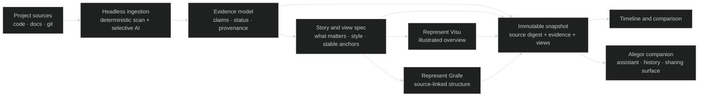

# Represent — living project views and product architecture

> Research design note, grounded in the ROMPE tool trial and the current Represent/Ghost documents. This is a proposal, not an implementation decision. Names in the product remain provisional.

## System Intent

Represent turns a project's structure and evolution into a memorable overview with optional deeper explanations and source evidence. The first product proof is Represent Visu: a style-aware illustrated portrait that can be refreshed as the project changes. Represent Grafe is the parallel technical exploration view; Alegor is the proposed project assistant and snapshot-history companion.

## Ingestion Vector

```text
project-root/
├── README.md                 # @LLM-ENTRY: project purpose and user-facing language
├── src/                      # @LLM-TARGET: deterministic modules, symbols, relationships
├── docs/                     # @LLM-TARGET: declared design, plans, and status evidence
├── .github/                  # @LLM-TARGET: workflows and implementation signals
├── public/                   # @LLM-DECORATIVE: style samples, logos, and visual assets
├── .git/                     # @LLM-TARGET: revision identity and change comparison
├── node_modules/             # @LLM-IGNORE: dependencies, not project-owned architecture
└── dist/                     # @LLM-IGNORE: generated output unless explicitly requested
```

This is a proposed generic scope, not a tested scanner policy. Onboarding must preview the actual paths included and excluded. Status sources need provenance and conflict handling; visual assets need attribution/provenance metadata.

## Visualization Spec

The MVP is one cohesive, memorable illustrated overview using the project's own visual cues, with a small number of semantic regions. Hover, keyboard focus, or tap reveals concise status and then source-backed technical details. The static image remains understandable on its own, and a text outline supports assistive technology and narrow screens. The full Visu direction makes the illustration itself animated and interactive; Grafe uses a separate code-bearing technical design.

Visual baseline from the ROMPE trial: [selected illustrated poster](../../../../experiments/rompe/imagegen/rompe-poster-v2.png). The trial showed overview appeal, while its interactive-diagram and Eraser outputs showed that useful detail alone does not meet the product's visual bar.

## Bootstrapping Steps

1. Select a representative repository and confirm source scope/privacy.
2. Produce a deterministic inventory and evidence ledger with stable identities, source links, explicit status, and unresolved conflicts.
3. Infer a proposed style profile from project-owned visual cues and let the user correct it.
4. Author one bounded overview/story and render the image plus semantic region map; validate factual freshness, text alternatives, keyboard/touch behavior, and visual readability.
5. Save a content-addressed immutable snapshot and a thumbnail; make a controlled source change and measure cache hits, regeneration operations, time, cost, and human corrections.
6. Design Grafe and Alegor flows against the same project identity and snapshot lineage, without requiring simultaneous implementation.

The experiment is not evidence that automated ingestion, style inference, image hotspots, or cheap incremental editing already work. All AI calls must follow Represent's Ghost-only decision; specify protocol, cache keys, and budgets in the implementation POC.

## Product intent

Represent should make a project understandable at a glance, then let a curious viewer ask for more detail without turning the first view into a dense dashboard. The user's accepted reference is the ROMPE **“A memorable overview”** illustrated poster: an authored visual identity, a coherent whole-project picture, and small labels that make major relationships memorable. The tested interactive-diagram and Eraser outputs were useful for auditing and precise detail, but their box diagrams did not meet this product bar. Do not infer that technically correct nodes and edges automatically make a compelling overview.

The product thesis is a **living project portrait**: a project gets a recognizable visual world, and its important systems, status, and changes are represented within that world. A clean first impression can open into concise explanations, then technical evidence and source references on demand. The core UX principle is the user's own: modern, fast, minimal controls; detail in hover, focus, and popups; clear short explanations with deeper technical information available.

Proposed suite hierarchy and names (recommendation only; not locked):

- **Represent** is the umbrella product and shared project model.
- **Represent Visu** is the illustrated, memorable overview experience.
- **Represent Grafe** is the technical explorer for code and architecture, aiming beyond the historical Codevis screenshot toward source-linked, explorable code structure. The screenshot does not establish the identity/status of the original repository. “Grafe” is a proposed name for this mode, not a user decision.
- **Alegor** (styled `alegor.ai` if the name and domain are available) is the project assistant and history companion. It is a functional product role, not a mascot: it helps people understand a selected snapshot, summarizes verified changes, points into Visu and Grafe, and keeps project history accessible. It should be calm, optional, and grounded in the selected project/snapshot. Whether it runs as a separate service or an integrated surface is open. The `.ai` domain availability has not been checked.

The proposed brand system is intentionally simple: **Represent** names the suite; **Visu** and **Grafe** name two distinct ways to see a project; **Alegor** names the assistant that remembers and explains its evolution. Use a shared identity, typography, and navigation, while giving Visu its own art direction and Grafe a more exact technical visual language. These are recommendations for review, not locked names or evidence that domains/trademarks are available.

Treat Visu and Grafe as parallel product-design tracks using one project identity, evidence model, and snapshot lineage. They need not be implemented in parallel. A Visu MVP is the recommended first customer-facing proof because the trial established its visual value and clarified a feasible update workflow. Grafe remains an independent full-product track; it should not be reduced to a hidden layer of the poster.

## What the ROMPE trial teaches

The strongest result was the built-in image-generation poster, especially after a factual refinement pass. It connected the loop, risk zones, early progression, affiliations, and events in one illustrated scene. Source corrections materially changed what the image had to say: death loss is conditional on zone rules; red equipment loss has a flagged-crafted condition; black has a named abyss exception; twelve is roster capacity rather than active companions; party, guild, and war sides have different relationships. The image is persuasive and legible as an overview, but cannot prove all details or retain clickable source links by itself.

That experiment was **audited source material → human/model-authored prompt and refinement → image output**. It did not test automated repository discovery, automatic project-style detection, automatic hotspot registration, incremental regeneration cost, Ghost integration, or image truth verification. The design below treats those as proposed capabilities to validate. The trial's poster prompts and image are preserved at [`experiments/rompe/imagegen/`](../../../../experiments/rompe/imagegen/); detailed tool results and limitations are in [`rompe-tool-trials.md`](../../rompe-tool-trials.md).

Two lessons follow. First, produce one memorable composition rather than choosing a generic graph as the default. Second, preserve a parallel evidence representation so the art can remain concise without becoming the source of truth. The poster is a view over facts and evidence, not the canonical project database.

## Shared model and lifecycle

Represent needs to distinguish four things that a first prototype could easily blur:

1. **Project identity** — a stable project ID and its source roots, languages, branch/revision, visual preferences, and privacy policy.
2. **Evidence and claims** — source-grounded facts, relationships, confidence, status, source locations, and unresolved conflicts. “Implemented,” “planned,” “inferred,” “unknown,” and “stale” must be distinguishable. Percent complete is shown only when an explicit measurable denominator exists; otherwise show verified states or dated change indicators.
3. **View definition** — the chosen story, composition, style tokens, illustration assets, semantic regions, optional interactions, and their references to evidence IDs. Layout stability matters across snapshots so progress can be compared.
4. **Immutable snapshots** — each captured source revision receives a snapshot ID and digest. A snapshot keeps its evidence, view definition, rendered artifacts, generation metadata, and parent snapshot. Later scans create new snapshots; they never mutate the old one. Timeline thumbnails are derived from these saved versions.

Reuse methrep's `represent.scene/v0` envelope and `events.jsonl` as a compatibility boundary where appropriate, as recorded in CONTEXT, but do not treat its append-only event stream as snapshot storage. Events describe changes or activity; immutable snapshots are independently addressable records. A manifest/index may point to both. This leaves a clean path for local-only history, sync, and future publishing without baking those concerns into a renderer.



The model and ingestion core remain headless to preserve Represent's embeddability commitment. Web, IDE, desktop, CLI, and library surfaces can call the same scan, evidence, snapshot, and view APIs. The companion may provide history and navigation, but the view artifacts should remain portable and usable without it.

## MVP: Represent Visu, an updateable overview

### User workflow

1. **Connect a project.** Choose a local folder or repository, confirm included/excluded areas, and select local-only or an explicitly configured hosted AI path. The first run previews the source scope and explains what will be read.
2. **Build a first portrait.** Deterministic extraction collects project identity, directory/module boundaries, language, key entry points, declared milestones, and available Git changes. A small, bounded AI synthesis selects a few important stories and writes short explanations tied to source evidence.
3. **Detect and propose a style.** Inspect project-owned visual signals—README/product assets, themes, UI tokens, logos, fonts, and prominent colors—and propose a restrained art direction. Present the style with the first composition and allow correction. Do not blindly reuse a logo or claim the detected style is definitive. When evidence is weak, offer a legible neutral style as a labeled fallback.
4. **Generate a memorable overview.** Create one coherent illustrated composition that shows the project's main purpose and a small set of important systems/flows. Use labels, callouts, colors, and illustration to explain the whole; do not populate a generic node grid. Keep every statement backed by evidence or visibly qualified. In the MVP, visible labels and symbols are baked into the raster, so changing a fact they depict makes that region/art stale and requires an art revision. A fresh overlay must never silently contradict old art.
5. **Add optional detail.** Register a small set of semantic regions to evidence IDs. Hover, keyboard focus, or tap opens a short explanation; a second action exposes source links and technical detail. The image remains useful when all overlays are off. Provide a matching structured text outline for screen readers, narrow screens, and non-pointer input. Mark any overlay that refers to a newer snapshot than the image, or keep the previous complete snapshot as the selected view until the refreshed image is ready.
6. **Save a snapshot.** Store the source digest, evidence, style, composition, region map, generated assets, model/prompt versions, and parent snapshot. Show the timestamp and source revision. Alegor can present this history and explain it, while keeping the snapshot export usable without the companion.
7. **Update on change.** On the next scan, compare stable evidence IDs and source digests. Show a compact update preview: changed areas, claims that became stale, and the suggested regeneration scope. Regenerate the whole portrait only when the story/composition changed materially; otherwise preserve the scene and update data overlays or replace one bounded illustration region if that can be done without breaking continuity.

### MVP visual and interaction scope

- One illustrated overview per project; one chosen story and an intentionally small number of anchors.
- A single supported visual direction with style tokens inferred from project assets; allow a few user overrides (palette, density, light/dark or pixel/editorial feel) rather than building a full art-direction editor.
- Semantic, focusable regions aligned to visible landmarks. The initial region map can be emitted with the view spec and reviewed against the rendered asset; image-only unverified coordinates are not trusted as clickable truth.
- Detail popovers with summary, evidence/status, and source links. Keep the popover optional and the static poster self-explanatory.
- A local timeline of dated snapshots with small thumbnails, source revision, and a change note. Compare two snapshots through a highlighted change digest or a simple side-by-side; no animated history scrubber in the MVP.
- Export the image plus its structured data and accessible text. “Share” remains an explicit user action with a visibility preview; local-only is the default.

The hard part is truthful incremental editing of a raster composition. For MVP, a safe strategy is to generate the illustration and layout from a constrained, reusable composition recipe, then keep a stable semantic region map and evidence layer alongside it. Metadata-only updates—such as a linked explanation or a status detail not asserted by the art—can update the overlay safely. If a fact rendered in the art changes, mark that region/art stale and revise or regenerate the art before presenting the new claim as current. If the image tool cannot revise a local region while preserving the rest, regenerate the whole overview only for meaningful story changes and retain prior snapshots. Do not promise pixel-stable partial edits until tested. Cache outputs by normalized input hashes and generation settings; do not pay to regenerate unchanged art. Offer a no-AI fallback with a simpler project-styled vector illustration and text when generation is unavailable. No current cost estimate is asserted; establish it through an instrumented pilot measuring calls, tokens, image operations, cache hits, latency, and accepted regeneration rate.

### MVP exclusions

- No broad autonomous claim that an entire repository is understood; show scan scope, source revision, and unresolved evidence.
- No fabricated completion percentages. Show explicit tracker states, verified implementation markers, and dated changes; derived percentages require a named denominator and source.
- No live runtime telemetry, team collaboration, public gallery, organization-wide dashboard, or automatic hosted publication.
- No broad visual editor, freeform scene authoring, or guaranteed arbitrary image region edits.
- No full technical code graph in the first Visu implementation. Keep Grafe as its own design and POC track.
- No need to implement a cloud Alegor service to validate local snapshots and timeline UX.

### MVP cost and freshness policy

Cost should be designed into the work plan rather than guessed. Use deterministic extraction for unchanged source facts; send compact, changed evidence to Ghost for synthesis; cache each independent stage by source/config/model/prompt version; reuse prior approved story and art where valid; set per-run step, token, and cost ceilings; and report actual usage. Group changes by their impact on the story: text/status-only changes can update evidence overlays; one subsystem change can request a scoped story refresh; a project-wide architecture shift can request a full composition. If cache invalidation or image editing makes scope uncertain, ask for confirmation before an expensive full regeneration and show the estimated operation count if the provider can report it.

Ghost already provides typed structured-output calls, task-intent routing, prompt/response caching, rate limits, resilience, and cost budgets in its AI system/protocol references ([AI system](../../../../../Ghost/docs/reference/ai-system.md), [protocols](../../../../../Ghost/docs/reference/protocols.md)). Represent should define the exact protocol and cache-key granularity in a later POC brief, not wire directly to image or text vendor SDKs. Image generation is a separate capability decision: route it through an approved Ghost-managed surface if one exists; otherwise document the boundary rather than silently creating a second provider stack. Local inference is a candidate for compact text synthesis, but art generation capability and quality must be measured separately.

## Full product: two coordinated views

### Represent Visu — an animated, interactive project portrait

The full Visu experience retains the “memorable overview” as its visual foundation, then turns the illustration itself into a responsive, explorable world. Major parts of the project become recognizable places, characters, artifacts, paths, or mechanisms selected to fit project style and story. Motion communicates meaningful state or flow: it should answer “what changed?”, “what depends on this?”, or “where does this process go?” rather than decorate the screen. Viewers can focus a region, reveal concise text, open deeper technical evidence, follow a relationship, and step through dated snapshots. Filtering, reduce-motion, static-image export, text outline, keyboard focus, contrast, and screen-reader descriptions are integral. Every important animation has a still equivalent and user-controlled playback.

This is not a poster surrounded by unrelated controls. The full renderer needs a semantic scene graph in which visual entities are bound to stable project/evidence IDs, with layered art and registered interactions authored as part of one scene. Detailed facts may appear in small panels, but the main scene remains art-directed and coherent. View modes may zoom from a whole-project composition into one subsystem scene while retaining position and relationship cues.

### Represent Grafe — a code-structure and behavior workbench

Grafe is a separate, intentionally precise experience: better Codevis in the sense that code can be explored inside meaningful nodes and relationships, with evidence and status. It should support progressive scales—repository, module, symbol, source lines—and structural/behavioral links such as imports, calls, ownership, data flow, and runtime traces when present. A selected node should reveal source excerpts/locations, responsibilities, callers/callees, tests, and implementation state without turning every file into an always-visible node. Use deterministic language tooling (AST/indexers) for identities and relationships, LLM synthesis for grouping, naming, and explanations with evidence, and selection/ranking to decide what is shown. Keep generated artifacts, vendored dependencies, and build outputs out of the architecture view unless explicitly requested.

Grafe may use maps, nested spaces, code-bearing nodes, and timelines. It has different acceptance criteria from Visu: query usefulness, source navigation, graph comprehension at large scale, responsiveness, and fidelity. A beautiful code city alone is insufficient. Conversely, Visu should not inherit a code-city layout merely because a graph library can draw it.

### The full service workflow

Onboarding starts by connecting a repository and reviewing scope/privacy. The first indexing pass establishes the stable project ID, source revision, deterministic technical index, style profile, and evidence quality. Represent proposes a Visu story and a Grafe overview; the user can approve/adjust focus. The user explores either mode and can jump between them through shared identities (a Visu region points to the corresponding Grafe subsystem; a Grafe node can reveal its place in the overview). A change watcher creates a new candidate snapshot when a commit, branch, tracker, or requested refresh changes the evidence. A digest explains what changed, which views are stale, what can be reused, and which rebuilds are proposed. The user can accept the whole update, refresh one mode, or keep a historical view.

The timeline presents snapshots as a visual sequence: thumbnail, date, revision, and short change label. Comparing snapshots can highlight additions, removed areas, status transitions, altered relationships, and changed art direction. Avoid morphing unrelated scenes as if identity were continuous. Stable IDs and explicit “not comparable” states govern transitions. “Progress” can mean observable changes over time; it should not imply a single completion score unless the project supplies a real measurable plan. Alegor can answer “what changed since last week?” or “why is this region marked planned?” using the saved evidence and snapshot pair, with links to the underlying claims. It should not invent status or autonomously rewrite project views.

**Alegor's proposed suite role:** a non-mascot assistant/history surface around Represent projects. It can own project selection, snapshot timeline, change digests, saved user preferences, and conversational explanations grounded in a chosen snapshot; deep links open the relevant Visu or Grafe region. It can help decide whether an update should be refreshed, but the user remains in control of publication and costly regeneration. It should never be required to view an exported snapshot. Define account, synchronization, retention, encryption, and team-sharing behavior before making it a hosted service. “Alegor” and `alegor.ai` remain candidate branding, and domain/mark availability is unverified.

## Cross-cutting UX and quality gates

Apply the user's UI/UX improvement round during both design and implementation. The review must assess the complete flow, not just visual polish:

- **Understandability:** in a short first-look task, a new viewer can state the project's purpose and identify its main systems/flow; every visible label has a clear referent.
- **Progressive disclosure:** overview remains visually calm; a user can reach summary, technical detail, and source evidence with predictable hover/focus/tap actions. No essential information depends on hover alone.
- **Freshness and trust:** snapshot revision and age are visible; stale claims are marked; planned/inferred/verified states have distinct treatments; no unsupported percentage appears.
- **Style fit:** a reviewer can explain which project signals informed the style, and can override an incorrect inference before publishing.
- **Change continuity:** unchanged regions retain identity and layout when possible; the update digest explains any reflow or full regeneration. Old snapshots remain reproducible.
- **Performance:** first meaningful view arrives within an agreed pilot target on representative local hardware; opening popovers and switching view modes does not require a new AI call. Large technical projects progressively load detail.
- **Accessibility:** keyboard-only use, focus visibility, readable contrast/type, accessible descriptions, text alternative, reduced motion, and touch targets are reviewed at desktop and mobile sizes.
- **Privacy and sharing:** local/private is explicit; scan exclusions are visible; publishing reveals exactly which source references and metadata are included.
- **Cost:** each AI/art operation has cache status and measured cost/latency; unchanged scans do not regenerate; configured limits stop work cleanly.

Set numeric performance/readability thresholds from a representative pilot instead of inventing targets from this single ROMPE rendering. In the ROMPE experiment the 390px layout had no horizontal overflow, but fit-view labels were too small; geometry passing alone is not a usability pass.

## Parallel design tracks and next evidence

| Track | Design question | Next prototype evidence |
|---|---|---|
| **Visu MVP** | Can project style plus a compact evidence-backed story yield a memorable composition that updates cheaply? | Choose one real code project and one non-code/design-heavy project; produce style profile, evidence ledger, first composition, hotspot/focus map, static export, and a second snapshot after a controlled change. Record edit scope, cache hits, operation count, time, and human corrections. |
| **Visu full** | Can the illustrated scene itself carry semantically meaningful, accessible interaction and motion? | Design one small subsystem scene with 5–10 entities, stable identities, 2–3 meaningful state transitions, text alternative, keyboard/touch behavior, reduced-motion mode, and snapshot comparison. |
| **Grafe full** | Can a source-linked code view reveal useful architecture without graph overload? | Select a real repository slice, establish deterministic file/symbol IDs and edges, compare hierarchy/map/code-bearing node layouts, and test question-to-source navigation at multiple scales. |
| **Alegor companion** | Which history actions benefit from a separate companion surface? | Sketch local-only timeline, change digest, snapshot-grounded Q&A, and cross-mode links first; test whether a companion adds value beyond embedded project history before committing to service/account architecture. |

For the Visu prototype, retain the existing headless, Ghost-only product commitments. The project's scanner, evidence model, stable snapshot IDs, and view scene should be designed together, but the first renderer POC should demonstrate only the chosen flow. Keep the current research-first sequence; this note does not promote scanner or renderer work to implementation.

## Open decisions

- Is the initial overview a generated raster with registered regions, a constrained SVG/canvas scene, or a hybrid? The ROMPE test proves raster art appeal, not reliable update mechanics.
- Which project signals are allowed to influence style, and how is licensing/provenance captured for generated or repo-owned assets?
- Is project history local by default, synced through Ghost infrastructure, or provided later by Alegor? What sync/privacy responsibilities belong to the companion?
- Which status sources count as authoritative (trackers, CI, Git, code analysis, user assertions), and how are conflicts displayed?
- How are stable visual anchors reconciled when the story changes enough to move or remove a region?
- Which Ghost-managed image-generation route is supported, and what are its actual per-operation budgets, latency, caching, and privacy constraints?
- What source languages and scale define the first Represent Grafe slice?

## References consulted

- [`docs/CONTEXT.md`](../../../CONTEXT.md) — headless core, Ghost AI, scene/events envelope, research-first and embedding commitments.
- [`docs/DOCS-PROTOCOL.md`](../../../DOCS-PROTOCOL.md) — Mermaid style, research and evidence conventions.
- [`docs/research/rompe-tool-trials.md`](../../rompe-tool-trials.md) — observed renderer results and limitations.
- [`experiments/rompe/imagegen/README.md`](../../../../experiments/rompe/imagegen/README.md), [`prompt.txt`](../../../../experiments/rompe/imagegen/prompt.txt), [`refinement.txt`](../../../../experiments/rompe/imagegen/refinement.txt), and [`rompe-poster-v2.png`](../../../../experiments/rompe/imagegen/rompe-poster-v2.png) — actual selected overview and authoring prompts.
- [`experiments/rompe/interactive-diagram/README.md`](../../../../experiments/rompe/interactive-diagram/README.md) — what the tested inspector can provide and why it is not the main visual direction.
- [Ghost AI system](../../../../../Ghost/docs/reference/ai-system.md), [Ghost protocols](../../../../../Ghost/docs/reference/protocols.md), and [Ghost AI gateway](../../../../../Ghost/docs/reference/ai-gateway.md) — typed calls, routing, cache, tracing, cost controls, and the distinction between inference and session planes.
