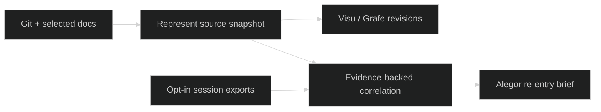

# Alegor research trials

Local read-only study records for the optional Represent companion/history track. Upstream clones live under ignored `D:/ware/represent/references/alegor-*`; no upstream source changes are kept here.

## `sessions` portability smoke trial (2026-10-21)

- Upstream: [`nicknisi/sessions`](https://github.com/nicknisi/sessions), MIT, local revision `9293eb6a8ed7a92c27c9c531061bd20e5b8bd1cb`.
- Environment: Windows 11, Bun 1.1.12.
- Setup: `bun install --frozen-lockfile` — completed, 104 packages installed.
- Command: `bun test src/context.test.ts` from the clone root.
- Result: 8 pass, 14 fail. Errors originate in `src/context.test.ts` fixture helper: `opts.cwd.replaceAll('/', '-')` does not normalize Windows backslashes. The generated child path contains `C:\Users\...` as a segment and `mkdirSync` throws `ENOENT`.
- Interpretation: portability smoke exposed a Windows test-fixture bug; it does not establish that product indexing is broken on Windows. This fixture-driven behavior check was inconclusive. No user transcripts or paid services were involved.
- Reproduce: clone the pinned revision, install with frozen lockfile, run the command above on Windows. The intended corrected experiment would normalize separators in a disposable clone or run in Linux; do not patch the canonical reference checkout for this research record.

### Candidate record relationship

