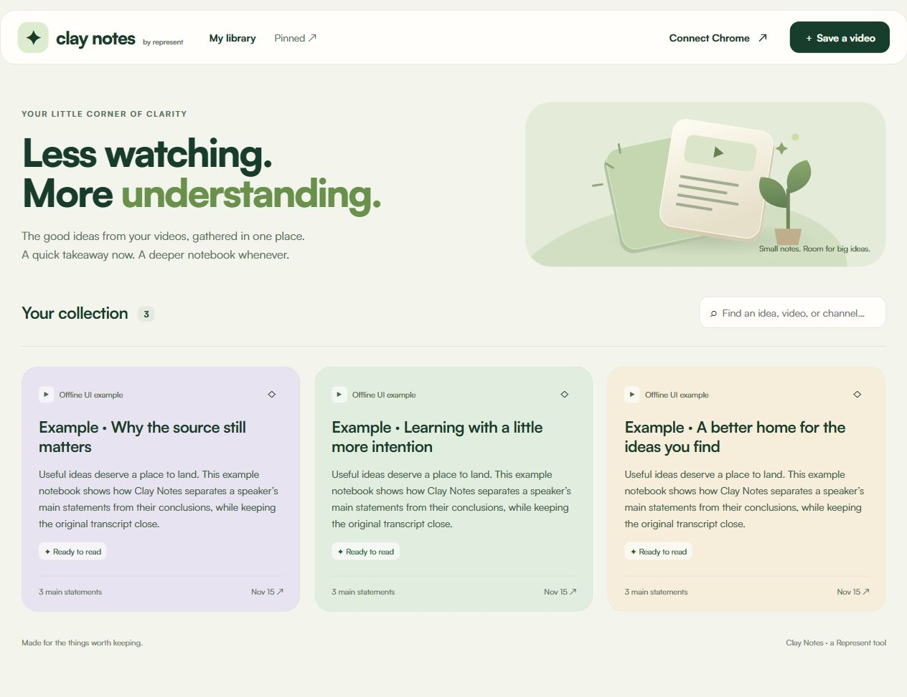
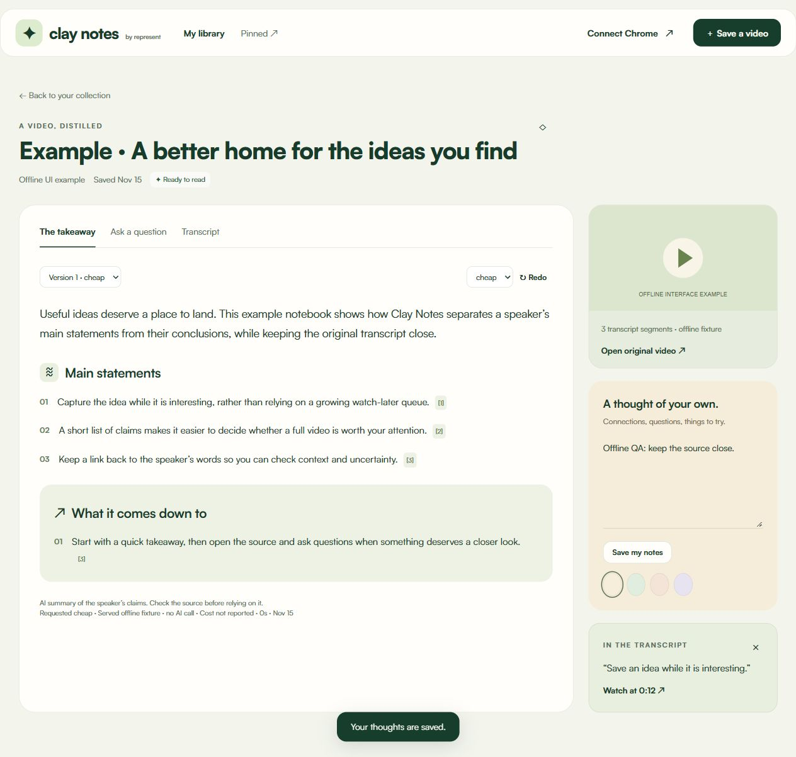

# Clay Notes — local implementation evidence

2026-11-15. Source lives in `src/clay-notes/` and `extensions/clay-notes/`; [operating reference](../../docs/reference/clay-notes.md).

The browser checked the actual empty local library at port 8876, then an isolated populated fixture library at 8877. Fixture notes, transcript, gateway responses and thumbnail illustration were authored for UI verification; they are not evidence that a real video or model was processed. Default user storage stayed empty. [Browser observations](browser-check.json) record twelve checks, including citation lookup, saved personal notes, fixture Q&A, model-selected revision history, keyboard tabs, Satoshi and mobile overflow. Mobile viewport override was reset; the browser tab was closed after QA.

[Mobile notebook screenshot](mobile.jpg). All three screenshots show offline examples. The declared model names in revision controls are selected request aliases; the served-model metadata explicitly says “offline fixture · no AI call”.

Domain, HTTP and extension-worker VM tests run using [the test launcher](../../scripts/clay-notes-test.mjs). The launcher derives totals from the real Node TAP summary and adds a per-test timeout for the installed Orkest verifier. One phase-2 repeat hung and was manually stopped after 154 seconds; a focused diagnostic and bounded repeat passed. Phase-3 acceptance includes fresh targeted and full-suite verification, recorded in Orkest's receipts and gate verdict rather than inferred from this text.

Review found and repaired transcript-submission races, an orphan queued state after model rejection, missing saved-but-needs-transcript feedback, stale player metadata, unnecessary library DOM replacement during polling and missing arrow-key tab behavior. New behavioral tests cover queue/model/capture cases. Review's other two suggestions did not reproduce as defects: the content button sends no closed-over video identity, and an awaiting-transcript notebook has no revisions, so it already retries extraction.

[Doctor summary](doctor-summary.json) records repository health separately from product tests. Legacy evidence annotations remain unresolved; the feature startup completed the layout migration. No legacy work was adopted or falsely marked tested. Installed-Chrome capture and a real Ghost response remain external trial limits.
