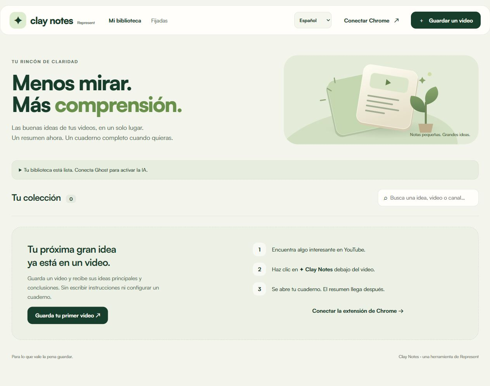
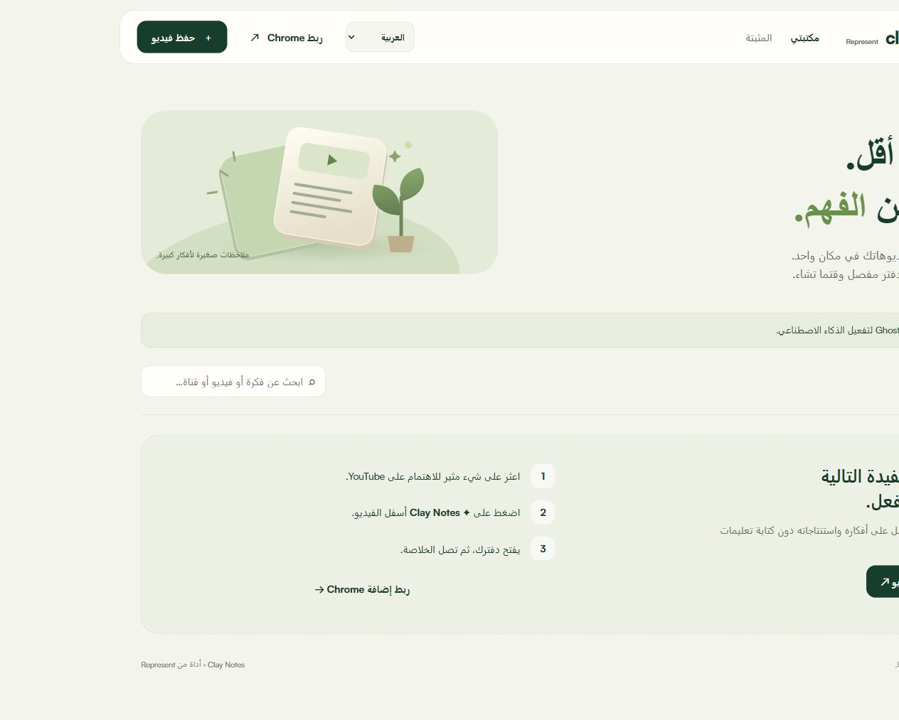

# Clay Notes 0.2.0 — release preparation and source trials

2026-11-15. [Release plan](../../../docs/guides/clay-notes-release.md), [gateway request](../../../docs/design/clay-notes-gateway-request.md), [as-built reference](../../../docs/reference/clay-notes-release-prep.md).

The ten-language web UI and Chrome catalogs are implemented. [Browser observations](browser-check.json) cover Spanish controls, Arabic RTL/reload/mobile and actual captured-source display. Translations were authored for this slice and have not had independent native-speaker review. Language changes preserve video titles, transcripts, personal notes and model responses. Source content in these screenshots is from the actual user-provided videos, not a fabricated AI result. No summaries were generated.

[Mobile Arabic](arabic-mobile.jpg) · [Actual source notebook](source-notebook.jpg). The empty-library locale screenshots were captured before importing the three source-only notebooks. The real notebook screenshot shows the imported transcript, not a model answer.

## Real video source results

| Video | Language / captions | Segments | Caption characters | Last captured timestamp |
|---|---|---:|---:|---:|
| X6J3ByTqhLY · ¿Seguirá cayendo Bitcoin? | es / automatic |582|20,745|21:13|
| t2_F7Fn8vYA · Bitcoin acaba de perder su último soporte | es / automatic |724|26,282|24:57|
| Ecuit73WzV0 · The NEAR Protocol Pivot Nobody Saw | en-US / manual |175|11,360|12:09|

These are caption-derived measurements, not asserted full video durations. [Exact hashes and metadata](video-trials.json) record every exported/normalized source. All1,481 caption segments are within the current160,000-character per-video bound. Raw exports remain in the browser export directory; the isolated local source notebooks are ignored runtime data, not Git artifacts. The adapter validates export video IDs and strips metadata headers before using the existing caption parser. An injected gateway that throws on invocation proves the import path does not request inference.

The native browser exporter established transcript availability in its current session. It did **not** establish that the unpacked extension can capture every transcript with its player/timedtext strategy. Ads were skipped only through YouTube's visible Skip control; no login, policy warning or access restriction was bypassed. Chrome installation, actual capture and live summary quality still need operator-gated trials.

## Package and validation

[Package report](package.json) identifies `clay-notes-0.2.0.zip`, its member allow-list and SHA256. The archive includes ten locales and original SVG-derived/code-native PNG icons in16/32/48/128 sizes, using a deterministic stored-ZIP writer with fixed timestamps and CRCs. Runtime stores, `.env`, captured transcripts, tests and tooling are excluded. The ZIP is local under `dist/clay-notes/`; it has not been uploaded or published.

Tests cover regional language negotiation, complete authored catalogs, translated Chrome metadata, source preservation, native-export parsing, no-inference imports, matching video IDs, deterministic ZIP contents/CRCs, secret/runtime exclusion and invalid/missing resources. A read-only review found no release-blocking issue in the package/parser/localization integration. Existing Windows service tests received bounded fixture cleanup and a realistic5-second completion deadline; test files have a60-second timeout and remain fail-closed on timeout/error. Earlier failed/timed-out runs are retained in the Orkest receipts and are not counted as passes.

Gateway status remains **request prepared; operator Apply pending**. No gateway secrets were read, copied or printed. No route-runner, queue, registry, consumers or key/model API mutation was performed. No live inference or paid call occurred. The operator's default-lane choice is recorded; it does not supply Apply evidence or a paid-call allowance.
