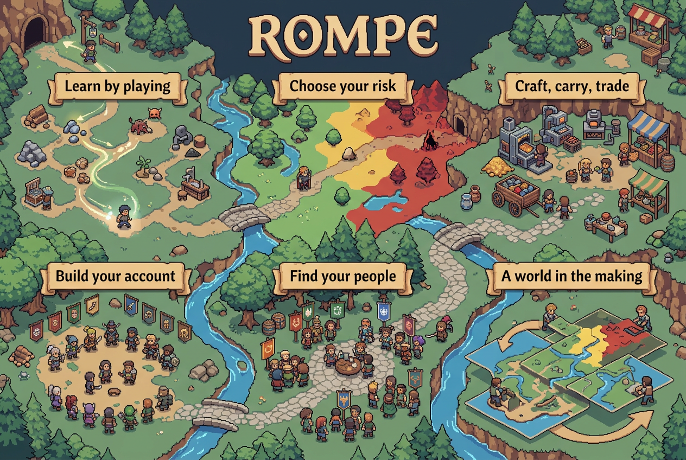
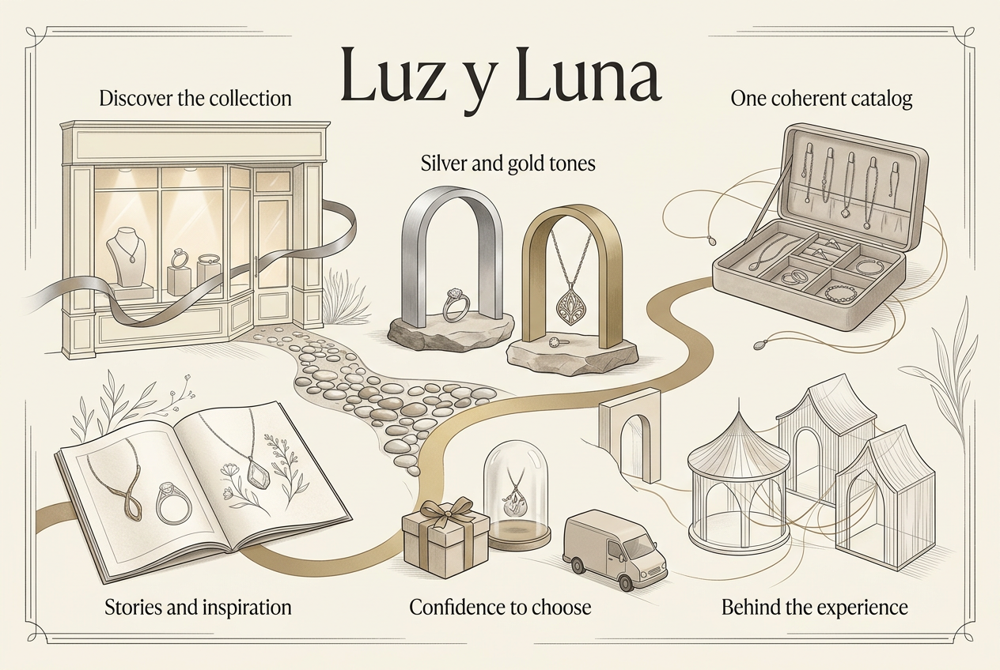

# Visu: ROMPE and Luz pilot

Actual local run, 2026-10-21. This directory retains generated images, browser captures and measured results. Runtime snapshots and full source excerpts stay in ignored `.represent/visu/`.

## What worked

ROMPE detected `retro` with medium confidence from documented retro/classic-RPG language. Luz detected `editorial` with high confidence from Cormorant/Garamond and cream `247 244 239` tokens. The detector is a small transparent heuristic, not a general visual model. Chapter mapping is curated; styles are not selected by project ID.

The final [ROMPE overview](rompe-overview-v2.png) and [Luz overview](luz-overview-v3.png) are different in palette, typography and visual metaphor. Both were generated through Ghost's actual `image-gen` alias. They are conceptual illustrations; runtime/implementation status is not established by their imagery.

## Lessons from rejected attempts

The first images (`rompe-overview.png`, `luz-overview.png`) received too much raw documentation and printed unreliable small text. The second ROMPE image kept only title/chapter headings and became a more coherent world. Luz's second image (`luz-overview-v2.png`) still printed duplicate/technical captions despite prompt constraints. The third Luz image used explicit illustrative motifs and seven allowed text elements; its final text and composition were visually inspected. This demonstrates the usefulness of an editorial art brief, not reliable automatic art quality control.

The first story API attempt produced malformed JSON for ROMPE and an inexact quotation for Luz. A second ROMPE attempt selected an invalid evidence ID. All three failed closed and remain in the paid ledger. Structured output with numbered excerpts local to each chapter succeeded. Validation checks that evidence exists and belongs to the allowed chapter source; semantic accuracy still needs review. We did not quietly accept malformed output or hide failed-call cost.

## Cheap-update proof

[measurements.json](measurements.json) is the runner output, not an estimated benchmark. The script copies only selected original files to a new ignored input directory, reuses existing captured state, then mutates those copies. It checks original full-file hashes before/after.

| Case | Expected and observed behavior |
|---|---|
| Unchanged / restarted | Same content identity, no added event, no model request |
| Out of scope | No view change and no model request |
| Detail/checklist change | New source/view revision, same image hash, zero model/image calls |
| Depicted source change | Old art remains visible and becomes stale; no implicit generation |
| Style override | Source identity unchanged, view changes, art stale |
| Source removal | Missing evidence visible, art stale; generation refuses required missing evidence |

Measured unchanged scans took about 69–82 ms and detail-only updates about 82–173 ms in the recorded run. These are single observations on this host, not percentile or cross-machine claims. Every controlled update test used zero AI calls. Initial and refined generations across both projects cost **$0.3682722**, including failures, as reported by Ghost headers. Latest successful story+image pairs were approximately seven cents per project; exact individual records are retained. Historical live trial methods differ slightly as recorded above; do not treat refinement cost as a fresh-install benchmark.

## UI and QA

[browser-check.json](browser-check.json) records the actual automated checks and zero POST requests while browsing. Screenshots include [desktop ROMPE](rompe-desktop.png), [evidence](rompe-evidence.png), [history](history-desktop.png), [desktop Luz](luz-desktop.png), and [390px mobile Luz](luz-mobile.png).

Design review simplified the surface to an illustrated overview with history and progressive evidence. Implementation review fixed cropped images, normalized marker coordinates, keyboard focus loss, Escape reopening the inspector, wrong historical-art selection, misleading comparisons and unauthorized thumbnail requests. The default view keeps the full illustration; details open on demand. The optional checklist layer explicitly reports captured checklist counts, not overall progress.

Fourteen core regression cases cover scope boundaries, cache/history, failed billing, duplicate calls, style conflicts, source removal, schema citations, PNG corruption, checklist semantics, shared scene envelope and authenticated API access. Browser tests cover desktop/mobile navigation, focus/tap/Escape, separate art revisions and a readable outline.

Reproduce with `npm run pilot` from this repository (the script resolves its own repository path). Browser checks additionally need a running Visu server and Playwright. See [usage](../../docs/reference/visu-mvp.md).
